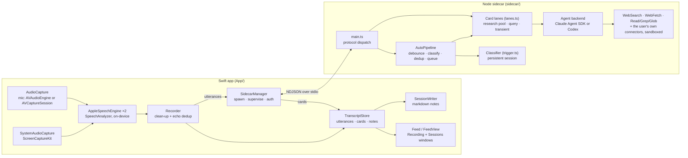

# Advisor — Design

**Status:** Living document. The sections down to *Trade-offs made* describe the
system as it is (checked against the code 2026-10-18, v0.4.7). *Milestones* and
the dated sections after it are the decision history. Each entry gives the
decision, the reason, the rejected alternatives and the residual risks. The
issue or commit that an entry names holds the detail (entries compressed
2026-11-01). Where a later change overturned an entry, the entry carries a
forward pointer.

**Input:** [REQUIREMENTS.md](REQUIREMENTS.md)

## Overview

Two processes on one machine:



The Swift app owns everything realtime and visual; the sidecar owns everything that thinks. Only text crosses the boundary.

## Components

Detail and rationale live in the dated sections below; this is the map.

### Swift app

**Capture.** Mic via an `AVAudioEngine` tap on the default input, or an `AVCaptureSession` for a chosen non-default mic (`AudioCapture`; see *Non-default mic selection*). System audio via a `ScreenCaptureKit` audio-only stream (`SystemAudioCapture`, with a permission preflight). Both delivered as 16 kHz mono Float32, tagged `me` (mic) / `them` (system). Apple's echo cancellation is off (see M2).

**Transcription.** Apple SpeechAnalyzer/SpeechTranscriber (macOS 26), on-device, one engine per source (`AppleSpeechEngine`), locale from the `sttLocale` preference. Streaming with built-in endpointing; volatile (in-progress) text shows at the feed tail. `Recorder` takes each final result, drops `um`/`uh`/`er`/`erm` and immediately repeated words (`cleanedTranscript`) and non-speech junk, then dedupes echo: while system audio is captured a mic final is held 1.5 s, and dropped if its distinctive words (>3 chars) overlap ≥0.7 (on the smaller set) with a `them` line from the last 15 s — or, for a short reply with no distinctive word, exactly matches one. A `them` line arriving later also removes a matching mic line from the previous 12 s. Emits `Utterance{id, time, source, text, latencyMs}` (`text` is mutable for corrections). Start, recovery and teardown run on one serial lifecycle queue. (Originally whisper.cpp; see *STT engine switch* and *Whisper removed*.)

**AppServices.** Launch-lifetime owner of the shared `TranscriptStore` (utterances, cards, editorial notes, volatile text, status), `SidecarManager` and `SessionWriter`, started from the Sessions scene so saved sessions can be queried with no recording open. The `Recorder` belongs to the recording window and is held weakly. Scenes (`AdvisorApp.swift`): **Sessions** (the main window, opens at launch), **Recording** (a single-instance SwiftUI `Window`, ⌘N; never auto-opens) and **Settings**. There is no menu-bar item and no `NSPanel`: the recording window's **Float** toggle raises it to `.floating` level on all Spaces.

**Recording window** (`TranscriptView`, `ListeningToolbar`, `ComposerForm`, `RecordControl`). Toolbar: Listen / Stop / Resume with the timer (Stop is resumable), mic mute, audio source, then Ask and Note, the folder indicator, Name, Context and Tags chips, Auto cards, Hide Transcript, Summarise, Float and Export. Ask (⌘K) sends a free-text query and Note (⇧⌘N) an editorial note, each from a popover. Closing the window ends the session; if cards are still researching, `WindowCloseGuard` (`SessionClose.swift`) asks whether to wait for them or stop them. ⌘Q runs the same close through `QuitSequence` (`AppServices.shutdown`, 5 s deadline, then a synchronous save, sidecar stop and `_exit`).

**Feed** (`Feed`, `FeedView`). One model and view for both windows: transcript runs (paragraphs with their time in the margin), cards anchored under the line that triggered them, editorial NOTE cards (`FeedNoteView`) and headings, in chronological order. The live feed follows the tail unless the user scrolls up. Right-click a line for AI actions (Answer / Context / Fact check), a correction, or Add note. Cards collapse, copy, skip or delete, and take follow-ups. Each window supplies its behaviour through `FeedActions`.

**Sessions browser** (`SessionsView`, `SessionArchive`, `SessionDetail`, `TranscriptDoc`, `NoteEdit`, `AnswerPanel`). Master/detail: search (a `#tag` term filters by tag) and a date-grouped list with folders (each folder can hold a default context and tags, and has its own record button); the detail renders the saved note through the shared feed. Ask and Summarise stream into the Answer panel and can be stopped; research actions, follow-ups, corrections and notes work on saved notes too. Edits splice the note's lines (`NoteEdit`) and decline if the note changed underneath; the note still being recorded is read-only there.

**SessionWriter** (with `SessionMarkdown`). One markdown note per session, `yyyy-MM-dd-HHmmss.md`, in the session folder (the `sessionDir` preference, default `~/Library/Application Support/Advisor/sessions/`) or a folder sub-directory of it. Frontmatter: `name`, `started`, `ended`, `context`, `tags`. Body: an optional `# Summary`, then `# Transcript` with cards and NOTE blocks inline as blockquotes at their place in the conversation; the Sessions browser appends Ask answers under `# Follow-ups`. Each card is written as `Card.persisted`: a finished card as it stands, one mid-follow-up or mid-re-summarise as its last completed answer, one still on its first run not at all. Rewritten on a 2 s debounce; transcripts only, no audio; the vault is never written. **Export** copies the note byte-identical (`SessionWriter.export`).

**SidecarManager.** Spawns the Node sidecar and supervises it: on a crash it fails every still-researching card and pending document request, restarts with exponential backoff (1/2/4/8 s, capped 8 s, ≤5 attempts; a crash after a >60 s healthy run resets the budget), then replays `session_start` plus the lane/auto config (not the utterance history — the classifier session is gone). A deliberate `stop()` cancels any pending restart. Authentication: subscription by default; in API-key mode the Keychain key is injected as `ANTHROPIC_API_KEY` / `OPENAI_API_KEY` at spawn (`apiKeyEnv`), and each session start re-reads it, replacing the process if it changed. Saved-session requests route back by request id (`discardDocumentRequest` drops one and cancels it). Sends to a dead sidecar surface on the status line. Transport: newline-delimited JSON over stdin/stdout — no port management, lifecycle tied to the parent, trivially debuggable. The sidecar's stderr goes into the app's log file.

**Logging.** All app and sidecar diagnostics go through `FileLog` (`Log.swift`) to `~/Library/Logs/Advisor/advisor.log` — the standard macOS user logs folder, so the file shows up under Console.app → Log Reports and survives a packaged run (where stderr goes nowhere). The app is the *sole* writer: its own lines arrive via `appLog.write`, the sidecar's stderr is captured by `SidecarManager` and funnelled in via `appLog.appendSidecar` (lines reassembled across chunk boundaries, each wall-clock-timestamped). One serial queue → no write contention and a single chronological timeline that interleaves app and `[sidecar +Xs]` lines. Mirrored to stderr too for dev runs. Rotates by size (5 MB), keeping one previous file (`advisor.log.1`). A watchdog (`MainThreadWatchdog.swift`), started in `applicationDidFinishLaunching`, pings the main queue each second from its own queue; when a ping goes unanswered for 5 s it logs the stall and runs `/usr/bin/sample` on the app into `hang-<n>-<UTC time>.txt` beside the log. It measures from the unanswered ping, not from the last answer, so a late tick under App Nap is not a stall, and the logged length counts from the ping, not from the start of the stall. A stall of about 7 s or more is caught: its first ping goes out up to 1 s after it starts, and a ping tick that fires late moves the report one tick later. App Nap can delay ticks more. If `sample` fails, the log gives its exit status or the launch error, and the file can be missing or incomplete. After a sample is saved, it keeps the newest five by `n`, because the clock can go back. The recording window's close guard logs each window's first responder. Both came from a hang on close (2026-10-31) that left no trace in the log and that could not be reproduced.

**Preferences.** `~/Library/Application Support/Advisor/config.json`, mirrored by `Preferences.swift` and `sidecar/src/config.ts` (App-only fields such as `sttLocale`, `authMode`, `sessionDir`, saved contexts and tags never reach the sidecar; `logTranscriptText` does, for the sidecar's utterance line). Tabs: Agent (provider, model, effort, authentication, connector actions), Triggers, Transcription, Contexts, Tags, General (appearance, session folder, transcript text in the log).

### TS sidecar

**main.ts.** Reads NDJSON from stdin and dispatches it; holds the live session prompt (seeded by `session_start`, replaced by `session_context`, prefixed to each task), the lane pools and the transient-lane runners. Sends `hello` on startup. Stray rejections and exceptions are logged, not fatal (issue #45).

**AutoPipeline** (`autoPipeline.ts`). Each utterance or note restarts a 1.5 s quiet debounce; then the classifier gets only the lines past its cursor, consecutive same-source lines merged. The cursor commits only on a successful classify (a failed window is re-fed, up to 3 times). New subjects are deduped for 10 minutes (normalised in any script), queued (≤20) and dispatched to free research lanes, anchored to the last line of the window. Turning Auto cards off drops the pending classify, queued research and any in-flight classify result.

**Classifier** (`trigger.ts`). A persistent session on the shared provider and model, offered no tools (`noTools`; on Codex, no web search or network) and none of the user's settings; returns triggers of kind `question | context | factcheck` (only the kinds enabled in Preferences, at most 2 per pass) with a subject and query, steered by the sensitivity preference (conservative / balanced / eager). Warmed at session start; 30 s timeout. A `question` becomes an `answer` card.

**Card lanes** (`lanes.ts`). Every card-answering session takes `cardLaneOptions`: one system prompt (`buildResearchSystem()`: persona plus fixed operating rules — lead with the answer, notes first then web, no narration, cite, say "couldn't verify", never ask), the tools `WebSearch`, `WebFetch`, `Read`, `Grep`, `Glob` plus the user's own connectors, and the effort preference. The per-task instruction comes from `researchTask` (answer / context / fact-check), `replyTask`, `summaryTask`, `documentQuestionTask` or `documentResearchTask`. Two kinds of lane:

- *Pooled, persistent* — research lanes (3 by default, 1–8 from the app) and one query lane (`QueryLanes`; a session start retires one still answering rather than aborting it — see *Ask and Note from the toolbar*). `Transcript` keeps a cursor per lane, so each task carries only the conversation that lane hasn't seen. `runCard` opens a `pending` card, then streams into it. A failed turn resets the lane and forgets its cursor, so its next card replays the conversation. A turn that loses the conversation with no error (`TaskResult.contextLost`, a cancelled Codex turn) forgets the cursor with no reset (#112).
- *Transient, one-shot* — card follow-ups (≤3 at once), the live summary, and saved-session tasks (ask, research, follow-up, summarise; ≤2 at once). Created per request, disposed after, never holding a pool slot.

**Query lane.** The Ask box (a `query` card with no anchor, so it sorts in at the time of asking) and right-click actions (the action's kind, anchored under the clicked line). One at a time — a second gets an `error` frame. Gets its conversation through its own cursor, like a research lane.

**guardedRun / cancel** (`guardedRun.ts`, `cancel.ts`). One run skeleton for every card, reply, summary and document task: stream, then a terminal frame, all suppressed once the id is cancelled. Streaming frames go out at most every 150 ms (`throttle.ts`); before any text a card stays `pending` and carries the agent's current `activity` (see *Card text streams as it is written*). `cancel` interrupts whichever lane holds the id and answers on the right channel (`card_update` or `document_answer`).

**Agent backends** (`agent.ts`, `codex.ts`, `providers.ts`). One `Agent` interface (`run` / `reset` / `interrupt`) behind a provider registry; one provider and model serve every lane. `AgentSession` is a long-lived Claude Agent SDK session fed by streaming input, with `includePartialMessages` so text reaches a card delta by delta, loading the user's own Claude configuration (`settingSources: ["user"]` — where personal context such as notes locations belongs), `maxTurns` 40, 180 s per task. `CodexAgentSession` wraps `@openai/codex-sdk` (measured far slower for cards — see the 2026-06-13 sections).

**Sandbox.** Claude: one policy, `toolDecision` — web, `ToolSearch`, connector reads/searches, and non-sensitive `$HOME` reads by absolute or `~` path; connector actions only with the preference on, unknown connector tools denied. Enforced by the `sandboxGate` PreToolUse hook and repeated in `canUseTool`. Codex: the same denylist as a Seatbelt profile, the CLI running under `sandbox-exec` (`codexSandbox.ts`); connectors all or none, by the same preference (`codexClientOptions`). See *Agent sandboxing*, *Codex runs under a Seatbelt profile* and *Codex connectors follow the actions toggle*.

## IPC contract (NDJSON, one object per line)

Types live in `sidecar/src/protocol.ts`; `protocol/examples.json` holds one
example frame per type in each direction, and both test suites hold their
side to it (see *Protocol contract test*). Swift → sidecar:

```json
{"type":"session_start","sessionId":"...","ts":...,"context":"..."}
{"type":"session_context","text":"<live edit of the session prompt>"}
{"type":"utterance","id":"<utterance uuid>","source":"me|them","text":"...","ts":...}
{"type":"note","id":"...","text":"<editorial note>","ts":...}
{"type":"query","id":"q7","text":"...","action":"answer|context|factcheck","triggerId":"<utterance uuid>"}
{"type":"config","auto":true,"lanes":3,"logTranscriptText":true}
{"type":"cancel","cardId":"<card or request id>"}
{"type":"card_reply","cardId":"...","kind":"answer","title":"...","base":"<card's current body>","replyText":"...","transcript":"them: ...\nme: ..."}
{"type":"summarise_live","cardId":"<existing summary card, on re-summarise>","transcript":"..."}
{"type":"ask_document","id":"d3","question":"...","document":"<the whole saved note>"}
{"type":"research_document","id":"d4","action":"answer|context|factcheck","text":"<selected passage>","document":"<the whole saved note>"}
{"type":"reply_document","id":"d5","kind":"answer","title":"...","base":"<card's current body>","replyText":"...","document":"<the whole saved note>"}
{"type":"summarise_document","id":"d6","transcript":"<the whole saved note>"}
{"type":"session_end"}
```

`action`/`triggerId` on `query` are set by right-click actions and absent for the Ask box; `config` may carry either field alone.

Sidecar → Swift:

```json
{"type":"hello","version":1}
{"type":"card","id":"...","trigger":"<utterance uuid>","kind":"answer|context|factcheck|query|summary","title":"...","body":"...","state":"pending|streaming|done|failed|cancelled"}
{"type":"card_update","id":"...","body":"...","state":"pending|streaming|done|failed|cancelled","activity":"Searching the web for “…”"}
{"type":"document_answer","id":"d3","body":"...","state":"pending|streaming|done|failed|cancelled"}
{"type":"error","fatal":false,"message":"..."}
```

The sidecar sends `hello` once at startup; the app ignores it — there is no version handshake. Card frames carry no separate `sources` or `verdict`: a fact-check's verdict and every card's citations are in the body markdown (removed 2026-10-18, see *Card sources and verdict removed*). Card ids are opaque: they carry a random per-process prefix, so a restarted sidecar cannot collide with cards the app still holds.

## Latency

The aspiration is ≤5 s from utterance to a useful card. As measured, it is not met (figures from the M4 note, the 2026-06-13 latency investigation and the 2026-10-07 *Effort preference* log):

| Stage | Now |
|---|---|
| Final transcript | SpeechAnalyzer endpointing; mic finals held 1.5 s more while system audio is captured (echo dedup) |
| Quiet before classify | 1.5 s debounce |
| Classify (warm persistent session) | ~1–1.5 s; the 5–10 s cold spawn is paid by a warm-up at session start |
| Speech → trigger | ~2 s |
| Placeholder card | at dispatch, as soon as a research lane is free |
| Trigger → first card text | median 30.5 s (p90 52.7 s) |
| Trigger → finished card | 33.4 s |

The placeholder-then-stream pattern keeps the card visible early. Until 2026-10-09 text streamed per assistant block, and the model mostly writes its answer as one block at the end, so cards filled in one go. Text now streams as it is written, and a card shows what the agent is doing until then — see *Card text streams as it is written*.

## Error handling

- **Sidecar crash** → in-flight cards fail and pending document requests fail; supervised restart with backoff and session replay (above); the status line shows the crash and each attempt; once the budget is spent it asks the user to stop and start listening again. Inside the sidecar, a stray rejection or exception is logged rather than killing the process.
- **Apple STT result-stream failure** (for example a Speech helper disconnect, `NSCocoaErrorDomain` 4099) → the status line shows recovery, audio sources drain before both speech engines restart, then sources resume; simultaneous mic/system failures coalesce, and a failure during that restart stops listening with the error.
- **Agent failure or timeout** → the card flips to `failed` with the reason, never silently; a failed pooled lane is reset and replays the conversation on its next card; a failed classify is re-fed (bounded).
- **Authentication** → no blocking banner. An API key is checked when entered in Preferences (`AuthValidator`), and re-read at each session start; a key that later fails surfaces as a failed card.

## Trade-offs made

| Decision | Alternative | Why |
|---|---|---|
| Standalone app; MCP only as the client protocol for sources | An Advisor MCP server | MCP is request/response from a host: it cannot capture audio continuously or push cards. The agent SDKs reach Jira, Confluence and Slack as MCP clients, so the sources come with the user's connectors |
| stdio NDJSON | WebSocket/gRPC | Simplest; lifecycle coupling is a feature here |
| Apple SpeechAnalyzer, on-device | whisper.cpp (removed 2026-06-14) | Streaming endpointing, no hallucination from noise, far less echo, no native build or model to ship |
| Classifier on the shared model, persistent session fed only new lines | A dedicated Haiku call; local heuristics | One provider/model knob; ~1–1.5 s warm; quality over cost (cost tracking was removed 2026-06-14) |
| Persistent pooled lanes with per-lane cursors | A fresh agent per card | Skips the 5–10 s cold spawn; follow-ups resolve referents from session memory |
| Placeholder + stream cards | Wait for complete answer | The card is visible at dispatch, even though the answer isn't |
| Float toggle on an ordinary window | Non-activating `NSPanel` overlay | Simpler and behaves like any window; revisit if focus-stealing annoys |
| The user's own Claude config and connectors | Built-in vault/Jira/Slack integrations | Keeps the app generic: personal context lives in `~/.claude`, not in Advisor |
| Markdown session files | SQLite | Human-readable, greppable, matches "local markdown" decision; revisit if search over history gets slow |

## Milestones

- **M0 — Spike (benchmark): ✅ 2026-06-11.** whisper.cpp with Metal on the M4
  Max transcribed an 11 s sample in 130 ms (`small`) and 395 ms
  (`large-v3-turbo`). (Superseded 2026-06-14: see *Whisper removed*.)
- **M1: ✅ 2026-06-12.** Mic capture to a live transcript. The system default
  input was BlackHole, a silent virtual device, so the app chooses a real mic.
  See *Non-default mic selection*.
- **M2: ✅ 2026-06-12.** System audio (ScreenCaptureKit), `me`/`them` tags and
  echo dedup by text overlap. Apple's echo cancellation was rejected: it fails
  (-10875) on the multichannel Studio Display output, and it mutes the mic when
  it does start. The dedup is imperfect, but attribution is cosmetic here, and
  trigger-level dedup catches the duplicates.
- **M3: ✅ 2026-06-12.** Sidecar, NDJSON over stdio and on-demand query (F14).
  A global npm `omit=dev` setting makes `npm install --include=dev` necessary.
- **M4: ✅ 2026-06-12.** Trigger detection and automatic cards (F8–F10). A
  persistent streaming-input session classifies in about 1 s after the first
  call. A cold spawn for each call took about 10 s, so the original 0.5 s
  budget was not possible through the SDK. Subjects dedup for 10 minutes.
- **M5: ✅ 2026-06-13.** Persistent research and query sessions with a
  transcript cursor for each lane, so follow-ups resolve referents from session
  memory. Session notes as markdown on a debounced rewrite. A Float toggle on
  an ordinary window, not an `NSPanel` overlay. Revisit that if focus stealing
  annoys. The cost ticker went on 2026-06-14 (commit `f663cf3`). (Superseded
  2026-06-18: the Sessions button that opened the folder; see *Sessions browser
  (master/detail) + ask-and-append*.)

Commit: `b208cfb`.

## Post-M5 tuning (2026-06-13, after first real-meeting test)

- The classifier prompt says that it reads messy live STT. It reassembles
  fragments and ignores echo near-duplicates. Consecutive lines from one source
  merge before classification.
- The brief is explicitly proactive: "trigger every minute or two in
  substantive conversation".
- Research runs in 3 persistent lanes, plus one query lane.
- `sidecar/test/replay.sh` and `fragments.txt` replay real transcripts for
  tuning.

Commit: `b208cfb`.

## STT tuning findings (2026-06-12/13)

The whisper settings (model, beam size, temperature fallback, vocabulary bias)
went with whisper. (Superseded 2026-06-14: see *Whisper removed*.) Two findings
still hold:

- **Echo dedup** compares distinctive words (more than 3 characters) pair by
  pair, with an overlap of at least 0.7 of the smaller set. A pooled match on
  common words suppressed genuine speech, so it was rejected.
- **Known limit:** no single-stream STT can recover overlapping speakers on a
  mixed mono feed. Do not engineer against it.

User-specific vocabulary from the vault was kept out of the app on purpose.

Commit: `b4cb67f`.

## STT engine switch (2026-06-12)

Apple SpeechAnalyzer/SpeechTranscriber (macOS 26) became the default engine. It
streams with built-in endpointing (complete, punctuated sentences), does not
hallucinate from noise, and removes most of the echo problem. Whisper kept two
advantages: vocabulary bias and a choice of offline model. Apple's first Listen
can download model assets. Volatile results show in grey at the feed tail. The
mic echo delay is 1.5 s (4 s for whisper), because both Apple streams finalise
at nearly the same time. (Superseded 2026-06-14: see *Whisper removed*.)

Commit: `3a637f0`.

## Agent sandboxing (2026-06-13)

Claude agents run under a tool policy, not `bypassPermissions`. Web tools are
allowed. Read, Grep and Glob reach only non-sensitive paths under `$HOME`; the
denylist holds `.ssh`, `.aws`, `.claude`, `.codex`, keychains and more. All
other tools are refused.

- **Grep and Glob are stricter than Read**, because they recurse. A search root
  may not be at or above a denied path, so a search over all of `$HOME` is
  refused.
- **Comparisons fold case**, because the default macOS volume is
  case-insensitive: `~/.SSH` is the same folder as `~/.ssh`. The separator
  guard keeps siblings such as `.ssh-notes` allowed.

Deferred: a hard OS boundary, such as a container that the app starts with
`docker run -i`. The OAuth credentials would be inside any such boundary. The
first check (`/etc/passwd` refused) used a path outside the working directory,
which is the only case that reached `canUseTool`. See *Enforced by a PreToolUse
gate*.

Commit: `658694f`.

### Symlinked credential roots (2026-09-21, issue #77)

A symlinked credential root was open: when `~/.ssh` points to
`~/dotfiles/.ssh`, neither path matched the lexical denylist. The Claude read
and search policies now compare against each denied root and its resolved
target, so a search rooted at `~/dotfiles` is refused too. `deniedPaths()`
stays lexical. Codex resolves its own policy paths.

### Enforced by a PreToolUse gate (2026-10-06, code review)

`canUseTool` was not the whole boundary. The SDK resolves a tool call in this
order: hooks, deny rules, ask rules, permission mode, allow rules, then
`canUseTool`. The allow-rules step approves two things on its own:

- reads inside the working directory, which was `$HOME`;
- allow rules from the user's settings, which `settingSources: ["user"]`
  imports. A real `~/.claude/settings.json` allowed `Read(~/.claude/**)`.

Also, the CLI's Glob searches the base directory of an absolute pattern, not
`path`. All three holes were reproduced against the bundled CLI.

One policy, `toolDecision`, now applies in two places:

- **`sandboxGate`, a PreToolUse hook.** A hook runs before every other step, and
  a hook deny holds in every permission mode. The gate only denies, and it
  fails closed. `canUseTool` repeats the same check.
- **An allowlist.** Web tools, ToolSearch (the CLI loads deferred connector
  tools through it), the MCP resource tools, `mcp__*` through `mcpPermission`,
  and Read/Grep/Glob. Skill, Task, Team, Workflow, Cron, ScheduleWakeup,
  AskUserQuestion, worktrees and all other tools are refused.
- **Paths are absolute or `~`-based.** The CLI expands `~` in a Read path before
  the gate, but passes a Glob or Grep `path` unexpanded. A relative path
  resolves against the CLI's working directory, so the policy could judge a
  different file. A search must name its `path`. Glob patterns and Grep `glob`
  filters must be relative: no leading `/`, `~`, `..` or absolute brace
  alternative.
- **The agents' working directory is an empty folder**,
  `~/Library/Application Support/Advisor/agent-cwd` (`agentCwd()`), so the
  implicit approval inside it reaches nothing. Codex keeps `$HOME`; its
  boundary is the Seatbelt profile.

Reads that the user's allow rules permitted (`~/.claude/**`, `~/dotfiles/**`)
are now refused. `sandbox.sdk.test.ts` proves the boundary against the real CLI
with a local fake model endpoint. Rejected: a move of the working directory
alone (the settings allow rules still bypass), and a check of the effective
root of a Glob pattern (it copies the CLI's internal pattern split, which can
change between versions).

Commit: `a21dd2e`.

## Connector tools (2026-06-13)

The user's MCP connectors, loaded through their Claude settings, pass the
sandbox. Read and search tools are allowed. Action tools are refused unless the
`allowMcpActions` preference is on, which is off by default: a prompt-injected
agent must not post to Slack during a meeting. The research prompt names the
connectors as valid sources. (The name rule changed 2026-10-17: see *Code
review batch*.)

Commit: `82ec06a`.

## Preferences & de-vaulting (2026-06-13)

Advisor knows nothing about the vault. The agents load the user's own Claude
configuration (`settingSources: ["user"]`, so `~/.claude/CLAUDE.md`), which
holds personal context such as note locations. A vault query worked with no
vault path in Advisor. The sidecar reads `config.json` again at each
`session_start` and rebuilds its sessions, so prompt and model changes apply.

The research system prompt is fixed in code (`sidecar/src/prompts.ts`): a
persona and a protected core of two-pass answers, no narration and citation
rules. A prompt edit therefore cannot break the latency or the format of a
card. Rejected:

- an editable persona preference: the session prompt covers the need, and a
  persona edit put the card contract at risk;
- a max-triggers-per-pass preference: a pass is an internal cadence that a user
  cannot see, and the knob duplicated sensitivity. It is now
  `MAX_TRIGGERS_PER_PASS = 2` in `trigger.ts`.

The session prompt goes into each task (`sessionContextPrefix`), not into the
system prompt. The persistent lanes fix their system prompt at session start,
so this way a live edit reaches the next card with no lane rebuild. The app
keeps the latest text, so a sidecar restart replays it.

Commit: `5d17ad3`.

## Right-click transcript actions (2026-06-12)

Answer, Context and Fact check on selected text are the auto-classifier's own
kinds, behind the same `config.triggers` toggles, so the manual and automatic
paths cannot diverge. The prompt templates live once in `trigger.ts`
(`researchTask`, `cardKind`). An action uses the `query` lane with optional
`action` and `triggerId`; `triggerId` anchors the card under the line.

SwiftUI `Text` with `.textSelection` hides the selected span from
`.contextMenu`, so each line is an `NSTextView` (`SelectableTranscriptText`)
whose `menu(for:)` reads `selectedRange`. Build it with `NSTextView(frame:)`. A
hand-built TextKit stack does not retain its storage and layout manager, so they
deallocate and the line goes blank.

Rejected: a dedup of a manual action against the equivalent in-flight auto
card. Auto cards anchor to the last line of the classifier window, and subjects
are fuzzy, so the match missed most real duplicates and added protocol and
state. A dedup that fires only sometimes gives false confidence. The occasional
duplicate is accepted; a reliable dedup needs semantic matching, which is out
of scope.

Commit: `6f1fb70`.

## In-card follow-up replies (2026-06-13)

A finished card takes a follow-up, and the answer is appended in place after
`---` and `**You:**`. The sidecar keeps no card state: `card_reply` carries the
card's current body, the `replyText` and the last ~15 transcript lines (for
referents such as "she" or "that"). `replyTask` in `trigger.ts` builds the
prompt.

A transient one-shot session answers each follow-up, not a research lane. The
pool is shared, so replies would drain it, and a reused lane's context drifts
off topic. The cost is one cold spawn for each reply, which is acceptable for
an action that the user starts. The reply takes no pool slot and no `busy`
gate. The sidecar repeats the exact `base + **You:**` prefix that the app shows
before the answer arrives.

The app-only `replying` flag hides the reply box and the cancel button while a
follow-up runs. The app changes the card only when the `card_reply` send
succeeds. Otherwise a dead sidecar leaves a card that spins with no answer and
no cancel.

Commit: `3b11429`.

### A completed card keeps its answer (2026-10-06, code review)

Only finished cards reach the note. A quit, a close or Stop and Close during a
follow-up or a re-summarise therefore dropped the previous answer, and a failed
re-summarise replaced the summary with its error. `Card.settledBody` now holds
the last completed answer:

- The note writes a running or cancelled card from `settledBody`
  (`Card.persisted`). The `# Summary` section does the same.
- A cancel, from the sidecar or from Stop and Close (`Card.apply`, `cancel`),
  restores it and sets the card back to `done`.
- A failed re-summarise keeps the old summary with a "Couldn't update the
  summary" line, state `failed`. The note keeps the summary without the line.
  A failed reply stays as it is, because its body holds the thread.
- A sidecar crash (issue #49) fails in-flight cards with no body. A re-summarise
  keeps its summary with the line. A follow-up goes back to its last answer,
  `done`.

Commit: `88722c4`.

## Packaging as a distributable .app (2026-06-13)

`App/package.sh` assembles a self-contained `Advisor.app`. `AppResources`
resolves resources from `Bundle.main` in the bundle, and from `repoRoot` (from
`#filePath`) in a dev checkout. The bundle carries the arm64 Node runtime
(about 127 MB) in `Contents/Resources`, so the target Mac needs no Node; the
SDK's child processes reuse it through `process.execPath`. `package.sh` signs
with a Developer ID, else a self-signed `Advisor Dev` identity, else ad hoc.
The target is a few machines for one user, not the App Store. The bundle has no
model files or native libraries. The sidecar needs the user's CLI login, or an
API key (see *Optional API-key auth*).

Commit: `e9d1195`.

## DMG distribution (2026-06-24)

The shared artefact is `App/dist/Advisor-<version>.dmg`, not a raw `.app`.
Recipients of the old local-only DMG got this Gatekeeper error: "Apple could
not verify "Advisor" is free of malware that may harm your Mac or compromise
your privacy." `dmg.sh` runs `sign.sh` (Developer ID, hardened runtime). Then it
builds the DMG, signs it, notarises it, staples and validates the ticket, and
runs `spctl -t open --context context:primary-signature`. All of this happens
under `Advisor-<version>.partial.dmg`, which gets the release name only after
the last check. A signed but unnotarised image therefore never carries the
release name. The exit trap deletes the partial file; only SIGKILL or a power
loss can leave one. The app has no notary round of its own: see *Notarisation:
nested entitlements + one notary round*.

Commit: `e02e23f`.

## Codex as an alternative provider (2026-06-13)

Every lane runs on Claude (Agent SDK) or Codex (`@openai/codex-sdk`), from one
provider and model in Preferences. Both sit behind the `Agent` interface (`run`,
`reset`, `interrupt`): `AgentSession` for Claude, `CodexAgentSession`
(`codex.ts`) for Codex. Both are long-lived, FIFO sessions that keep context.
Codex is unfit for the research and query lanes: see *Latency investigation —
progressive answers, warming, Codex unfit for research*.

- **Provider registry.** `providers.ts` holds `PROVIDERS`, and `createAgent`
  resolves through it (an unknown id gives Claude). A new provider needs one
  registry entry, one `Agent` class and one `AgentProvider.all` entry in
  `Preferences.swift`. The two lists are mirrored by hand, because Swift cannot
  import the TypeScript registry.
- **Authentication.** Codex uses the user's CLI login (`~/.codex/auth.json`).
  Its binary ships through `@openai/codex-sdk`, `@openai/codex` and
  `@openai/codex-darwin-arm64`. Codex has no system-prompt parameter, so
  Advisor puts its system prompt in the first turn of each thread.
- **Sandbox.** At first `sandboxMode: "read-only"` and `approvalPolicy:
  "never"`, which is coarser than Claude's policy. (Superseded 2026-08-10: see
  *Codex runs under a Seatbelt profile*; and 2026-10-09: see *Codex connectors
  follow the actions toggle*.)
- **One shared backend.** Three choices for each lane became one `{provider,
  model}`. Nobody used the split, and a separate classifier knob gave no
  benefit. `model` `""` is the provider default, and a provider change resets
  the model. Accepted: the classifier follows the shared model (default
  Sonnet), not Haiku. There is no config migration: unknown keys are ignored
  and missing keys take defaults (`mergeConfig()`, Swift `init(from:)`).

Commit: `353d590`.

### Codex session ordering (2026-09-21, issue #81)

Each Codex session queues warm-ups and requests first in, first out (FIFO). A
request selects its SDK thread and first-turn instructions only when it reaches
the head of the queue. The next turn waits for completion, not for
`thread.started`, and a timeout starts when its turn begins. Reset and cancel
settle active and queued work, and dispatch nothing from the queue. An internal
timeout advances the queue. Cancel and timeout retire the active thread, so the
next request gets fresh instructions. Late events from abandoned streams cannot
change the context or a card. Separate sessions still run concurrently.

## Latency investigation — progressive answers, warming, Codex unfit for research (2026-06-13)

The first complaint was 60 s or more from a question to a useful card. The
latency log of each stage stays on, on one `[sidecar +Xs]` timeline. Findings:

- **Codex is unfit for research and query.** The same question took about 170
  s on Codex and 25–34 s on Claude. Codex sends nothing until the turn ends.
  It is still selectable, and it is acceptable for the classifier, whose output
  is one JSON object.
- **Claude must be told to answer progressively.** With no instruction, it ran
  every tool and wrote one block about 24 s into the run. The system prompt
  requires two passes in one turn: a short `From your notes:` answer from the
  local search first, then a revision from the web and connectors. Useful text
  arrives about 9 s into the run, 15 s earlier, for about 5 s more in total.
  The prompt forbids narration, so the first block is content.
- **Rejected: a separate local-only card.** It started sooner (first text at
  about 5 s) but finished later (about 38 s). One instructed agent gives the
  same progressive effect with one card and one model.
- **Warm-ups.** The SDK starts a CLI subprocess on the first `run()` of each
  session (5–10 s; a cold Haiku classifier took 5.7–9.4 s). `session_start`
  warms the classifier (`warmClassifier()`) and the lead research lane, so the
  first question does not wait for either.

The remaining floor is STT finalisation (about 8–12 s, in the app) and the time
to gather local data. The ≤5 s aspiration is not met for agentic answers.

Commit: `1773607`.

## Whisper removed (2026-06-14)

Apple SpeechAnalyzer is the only STT engine. It won on each point that
mattered: streaming endpointing, no hallucination from noise and almost no
echo. Whisper cost a vendored CMake/Metal build, a C shim, about 6 native
libraries in the bundle, a 1.5 GB model and a VAD segmenter with a decode
queue. The vocabulary dictionary went too: its only purpose was to bias
whisper's `initial_prompt`, and the Apple engine has no equivalent hook.

Commit: `f4ee9d9`.

## Optional API-key auth (2026-06-14)

The CLI subscription login stays the default. A machine with no CLI login can
use a provider API key, as an opt-in fallback; a key is never required. The key
is kept in the macOS Keychain (`Keychain.swift`), never in `config.json`. At
spawn the app injects it as `ANTHROPIC_API_KEY` or `OPENAI_API_KEY`
(`SidecarManager.apiKeyEnv`), so the sidecar never reads a secret from config.

- **Claude** needs no sidecar change. The CLI inherits `process.env`, and an
  environment key takes precedence over a stored OAuth login.
- **Codex** needs an explicit key. `codexConstructorOptions(process.env)` gives
  `{ apiKey }` only when `OPENAI_API_KEY` is set, because a leftover ChatGPT
  login otherwise wins. `env` stays unset, so the CLI inherits the rest of the
  environment.
- `authMode` is app-side only.

An invalid key at first surfaced only as a research error during a session.
`AuthValidator` now checks a key against the provider's models endpoint when
the user enters it.

Commit: `44036d3`.

### Authentication refresh at session start (2026-09-21, issue #82)

The sidecar outlives each recording, so a read of the authentication at launch
alone left changes unapplied. `sendSessionStart` reads the current Keychain key
and compares the effective overrides with those of the spawn. When they match,
the process stays. When they differ, the app replaces the process before it
sends the new session, and cancels any in-flight saved-document request.

Both key variables are removed from the inherited environment before the
selected key is applied, so subscription mode leaves neither. The dev launch
finds Node through a login shell, which can export keys, so the app applies the
selection again after the shell profile. Keys never go into arguments, config
or NDJSON. Each spawn has a generation, and callbacks from a retired generation
cannot affect its replacement.

## Listening view redesign (2026-06-14)

The Listening view got the app's first design-token layer, `Theme.swift`:
semantic light and dark colours as dynamic `NSColor`s, plus spacing, radius and
type metrics. Card-model fields from this change remain: `isExpanded`
(fact-checks start collapsed) and `triggerQuote`. A dismissed in-flight card
cancels its research. The note is written again only when a card change alters
its output. The rest is superseded:

- `ListeningCardView`: replaced 2026-10-06, see *One feed for both windows*.
- `AskBar`: replaced 2026-10-20, see *Ask and Note from the toolbar*.
- Pause: removed 2026-06-19, see *Resume after stopping; Pause removed*.
- Summarise: removed here, back 2026-06-22, see *Summarise a conversation*.
- Card `sources` and `verdict`: removed 2026-10-18, see *Card sources and
  verdict removed*.

Commit: `63fc787`.

## Markdown export + one session format (2026-06-18)

A session note has one format, the inline layout (`SessionMarkdown.inline`).
Utterances and finished cards merge in time order, a card after an utterance at
an equal time, as in the live feed. Each card is a `>`-quoted block, so the
note reads like the window. Export flushes the note and copies the file
(`SessionWriter.export`). Rejected: the footnote format, with `[^card-N]`
backlinks for Obsidian and GitHub and an "Other cards" section. One format is
much less code than backlink navigation. Old notes keep their old format, with
no migration.

Commit: `b20ac12`.

## Sessions browser (master/detail) + ask-and-append (2026-06-18)

A master/detail browser shows the saved notes (`SessionsView`; `SessionArchive`
lists notes by their `yyyy-MM-dd-HHmmss.md` name). (Changed 2026-06-19: see
*Sessions as the main window*.)

- **Scope.** Layout and real data only. The design handoff's AI-derived fields
  (category, topic chips, summary, people, action items) and star were not
  built: they need new generation, protocol changes and storage for each
  session.
- **Titles.** `SessionDetail` uses the `name:` frontmatter, else `context:`,
  else the date. A note that the live writer still owns is renamed through the
  writer (`renameOwnedNote`): the next debounced rewrite overwrites a direct
  frontmatter edit. Other notes use `SessionArchive.setName`.
- **Rendered like the live window.** `TranscriptDoc` is the inverse of
  `SessionMarkdown.inline`: lines join into paragraphs (a gap of more than 2 s
  starts a new one), and blockquotes become cards. `SessionDetail.parse` splits
  surfaced cards from questions (`Q ·`).
- **Ask on its own path.** The query lane holds live-session state (cursor,
  session prompt, `busy` gate). A question about a saved note through it would
  pollute the live context and wait behind live queries. `ask_document` carries
  the whole note to a transient one-shot session, and `document_answer` returns
  by request id. A crash, a spawn failure or a stop fails every outstanding
  request. Two document questions can run at once. A finished answer is
  appended under `# Follow-ups` (`SessionMarkdown.followUpBlock`).
- **Two writers.** `SessionWriter` rewrites its whole note every 2 s and keeps
  its file after the session ends. The detail pane therefore edits no file that
  the live writer owns (`writer.currentFileURL`). `TranscriptWindowContext`
  carries the sidecar and the owned file across scenes.

Residual: the list refreshes when it opens and on `.advisorSessionsChanged`.

Commit: `d235d06`.

## Appearance preference (2026-06-18)

A light, dark or system preference (issue #3). `config.appearance` is app-side
only. `AppDelegate` sets `NSApp.appearance` at launch and on each
`.advisorConfigChanged`, so a change needs no relaunch. The theme colours are
dynamic `NSColor`s, so the app appearance drives the whole UI with no
`.preferredColorScheme` on each view.

Commit: `c82f50e`.

## Sessions as the main window (2026-06-19, issue #4)

The app opens on the **Sessions** browser. The recording window
(`TranscriptView`) is a separate `Window(id: "recording")`, opened with ⌘N. A
`Window`, not a `WindowGroup`, gives one recording window at a time: ⌘N brings
the existing one forward.

`AppServices` owns the app-lifetime store, sidecar and writer, and the Sessions
scene starts them. Reason: the Sessions browser must answer questions about
saved notes before a recording window opens. The `Recorder` belongs to the
recording window, and `AppServices` holds it weakly.

**Close = clean stop.** A close of the recording window ends that session and
clears the store. It never stops the shared sidecar, so the Sessions browser
continues to work.

**Close guard for in-flight agents (2026-06-19, issue #7).** Agents that a
session dispatched continue after its window closes. `WindowCloseGuard`
(`SessionClose.swift`) proxies the window's `NSWindowDelegate`. If a card is
still researching, it asks the user to **Wait**, **Stop and Close** or
**Cancel**. The single-instance `Window` has two traps:

- It keeps the view's `@State` across a close and a reopen. Reset the
  `finishing` flag in `onDisappear`, or a stale overlay covers the next session.
- `NSWindow.close()` does not fire SwiftUI's `onDisappear`. The wait closes
  through `dismissWindow(id:)`, or the clean stop does not run.

**⌘Q saves the recording's tail (2026-10-06, code review).** Quit runs the same
close path as the window, through `QuitSequence`.
`applicationShouldTerminate` answers `.terminateLater`. `shutdown` runs
`releaseRecording` and stops after **5 s**, so a wedged SpeechAnalyzer cannot
block quit. `finishQuit` always follows: a synchronous save, `sidecar.stop()`,
then `_exit(0)`. Reason: before this change, quit lost the microphone text in
the 1.5 s echo delay and the finals that the engines emit as they stop.
In-flight agents are not waited for. This replaced the `onTerminate` cleanup.

**Trailing-STT bleed across sessions (2026-06-19).** `AppleSpeechEngine.stop()`
flushes buffered audio as trailing finals, and the echo delay holds `me` finals
for up to 1.5 s. These finals reached the shared store after the window closed.
The fix is a session token, `TranscriptStore.sessionGeneration`. Each result
carries the token from capture, and the store write on the main actor drops a
result with an old token. The generation increases at each store reset that
starts a blank view (start, and the window's `onDisappear`), but not at a plain
Stop. Rejected: a "stopped" flag. A reused recorder re-armed it before a
delayed final fired, and a queued callback had no late check.

**Auto-classifier outliving the session (2026-06-19).** A `sessionActive` flag
in the sidecar stops new automatic work after `session_end`, and
`session_end` drops queued research. The check repeats after the classify
await. Research lanes already running continue. User queries (Ask,
right-click) are not gated, so they work after Stop.

**Cancel now reaches reply agents (2026-06-19).** The `cancel` search includes
the transient reply lanes (`replyLanes`), so Stop and Close interrupts a
follow-up agent too.

**The store-clear hazard, guarded.** `SessionWriter` rewrites its note from the
store, so a clear of the shared store could overwrite the saved note.
`SessionWriter.releaseNote()` runs on window close, after the last flush, and
makes every later rewrite a no-op. After that, `SessionArchive` manages the note
on disk.

### Recording ownership and finalisation (2026-09-21, issues #78/#79)

The writer owns its note until the Recording window closes, also while stopped
or while agent cards finish. Folder rename and delete reject a folder that
holds that note, and the command checks again when the user confirms.

A window close starts a close task that the app owns. The task stops capture
and awaits both speech-result consumers. Then it drains pending transcript
lines through the mic echo delay and the main-actor store writes. Only then
does it save, release the note and advance the session generation. A reopened
window awaits this task, and late callbacks from the old generation are
ignored. The Wait path drains speech first, keeps the writer while cards
finish, and starts no new agent work.

## Delete sessions (2026-06-19, issue #8)

**Delete** is in the detail pane's `…` menu, behind a confirmation. A trash icon
on each row was tried first and rejected: it crowded the row. The live session
cannot be deleted, because its `SessionWriter` would write the note again.

## Resume after stopping; Pause removed (2026-06-19, issue #6)

Pause and Stop overlapped, so Pause was removed. Stop releases the audio
engines (the mic and the ScreenCaptureKit stream) but keeps the session live:
no `session_end`, no `writer.end()`, no new note. **Resume** restarts audio into
the same session with no generation change, so the classifier keeps its
context. A session ends only when the recording window closes or the app quits.
A new session therefore needs a new recording window. The toolbar states and
the timer arithmetic are in the pure `RecordControl` helper.

### Short replies and recording retries (2026-09-21, issues #80/#83)

A line with no distinctive word is not evidence of echo. The app suppresses a
short mic reply only when its token sequence exactly matches recent system
speech. Longer lines keep the overlap rule.

`RecordingControl` holds the start, stop and resume state and the timer for the
toolbar and the Space shortcut. A failed start or a failed automatic recovery
leaves a stopped session with Resume, and keeps the note, the context and the
generation. A start in progress blocks duplicate retries. A close cancels the
bookkeeping of that start.

## Pre-canned contexts (2026-06-19, issue #10)

Saved contexts (`SavedContext {id, name, text}`) are in `config.json` as
`contexts`. They are App-side only: the sidecar receives only the resolved
context text. `ContextLibrary` holds the pure list operations. Preferences and
the recording window both edit the list. `AdvisorConfig.persistContexts` writes
only the `contexts` key, so it cannot overwrite preferences that it does not
hold. Each window reloads on `advisorConfigChanged` only when the list differs,
so no save loop occurs. Accepted limit: Preferences adds by id, so a duplicate
name there gives two entries that the by-name **Save…** cannot tell apart.

## Cmd-N, no Sessions title panel (2026-06-19, issue #11)

The Sessions window's custom title panel and its **New** button were removed.
⌘N starts a recording through `RecordingCommands`, which replaces `.newItem`,
because the shortcut belongs in the menu bar. It is a `Commands` type because it
reads `openWindow` from the environment, and the `App` struct cannot. (The
sidebar padding for the window controls was superseded 2026-06-21: see
*Floating sidebar*.)

## Session tags (2026-06-20, issue #15)

The tag library (`tags: [SavedTag]`, name and colour) is in `config.json`,
App-side only, with pure operations in `TagLibrary`. Tags are created and
coloured only in Preferences. The Tags chip on the recording toolbar and on the
session detail only picks from the library. Reason: creation and colour belong
in one place.

A note stores its tags by name in frontmatter (`tags: a, b, c`, formatted by
`SessionArchive.tagsLine`), and the colour comes from the library at render
time. Consequences:

- A delete in Preferences rewrites no note: rows show only tags that the
  library knows.
- A rename rewrites every saved note (`SessionArchive.renameTag`), and the live
  note through its writer (`advisorTagRenamed`). The rewrite is synchronous;
  revisit if the archive becomes large. A rename to an existing name is
  blocked.
- `TagPill` draws colour text on a low-opacity capsule, so one stored hex value
  reads in light and dark.

The live note is tagged through `SessionWriter.setOwnedNoteTags`, so a late card
rewrite cannot overwrite the tags. `endSession` clears `sessionStart` before it
clears the staged tags, or empty tags overwrite the saved note. In search, a
`#tag` term filters by tag (`SessionSearch`).

## Choosable transcript folder (2026-06-20, issue #16)

The `sessionDir` preference (App-side only; `""` is the default folder) sets
where notes are saved. `SessionArchive.directory` reads it at each access, and
`SessionWriter` resolves it at each `start()`, so a change applies with no
relaunch. Reason: the config file is small, and a fresh read is simpler than a
cache with invalidation.

A change offers **Move / Leave Them / Cancel**. `SessionArchive.move` never
overwrites a name, ignores files that are not sessions, and returns
`(moved, skipped)`. If nothing moves, the old folder stays; a partial move
reports what stayed behind. The live note does not move. Accepted limit: a
recording that continues across the change writes to the old folder, and the
browser does not show it. Rejected: a block on the change during a recording,
as more scope than the problem needs.

## Session list right-click menu (2026-06-21, issue #20)

Each list row has a context menu with the detail pane's actions, applied to the
right-clicked row, not to the selection. Both surfaces call the same functions
(`renameSession`, `deleteSession`, `exportSession` in `SessionsView.swift`), so
the live-note rules cannot diverge. An export failure shows an `NSAlert` on both
surfaces.

## Share a session (2026-06-21, issue #23)

**Share…** is a `ShareLink` over the note's file URL, with
`SharePreview(detail.title)` so the sheet shows the title, not the file name.
Export copies the markdown to a chosen path; Share gives the same file to a
share service.

## Session folders (2026-06-21, issue #25)

A folder is a real sub-directory of the storage folder, and a session is in one
folder or in none. Rejected: a `folder:` frontmatter key. Real directories show
in Finder and need no registry in `config.json`. Empty folders stay.

- `SessionArchive` owns the layout. `list` descends one level and ignores
  deeper and dot-prefixed directories.
- Each change is a `moveItem` behind a check for an existing file, so nothing
  is overwritten.
- `deleteFolder` never deletes sessions. It moves them back to the root and
  removes the directory only when it is empty.
- `sanitiseFolderName` is the one name check. It rejects empty and dot-prefixed
  names, `/` and `:`.
- The live note cannot be filed, because its writer owns the path.
- The storage move (issue #16) keeps the folder structure.

A folder header is a plain row, not a `Section` header: a sidebar `Section`
header flattens nested controls and hides the folder's record button
(issue #35). A drop ignores URLs that are not current sessions, such as a file
from Finder. Folders are managed in the sidebar, not in Preferences.

## Card text via AppKit, link cursor (2026-06-21, issue #26)

Card text renders through **`MarkdownText`** (`MarkdownText.swift`), a
read-only, selectable `NSTextView`. Reason: SwiftUI `Text` shows no
pointing-hand cursor over a link on macOS, because a link has no view of its
own; `NSTextView` gives the cursor and the click. The renderer is inline-first:
it splits blocks on blank lines and parses each with
`AttributedString(markdown:.inlineOnly)`, with fonts and colours from `Theme`.
The `MarkdownUI` dependency was removed. (Superseded in part: nested lists
2026-10-04, see *Sessions window restyle*; tables 2026-10-15, see *Card
tables*; the source links 2026-10-18, see *Card sources and verdict removed*.)

## Floating sidebar (2026-06-21)

`SessionsView` uses `NavigationSplitView`. On macOS 26 its sidebar renders as a
floating Liquid Glass panel over the detail. Rejected: the hand-made
`HStack` of two opaque columns, which cannot float. The float needs a real
`.sidebar` `List`, so the sidebar became a `List`, and `plainSidebarRow()` keeps
the row style. **Record** moved into the sidebar toolbar, on the row of the
window controls. Accepted: the sidebar is resizable (320–420 pt), and section
headers no longer stay at the top. A screenshot verified the layout. Row click,
drag and collapse need a manual check, because synthetic clicks need an
Accessibility grant. Commit: `8d7f472`.

## Mic capture wedge + stable signing (2026-06-21)

Two faults that are easy to mistake for each other:

- **The silent mic was an AVAudioEngine bug, not permissions.** On macOS 26, if
  `kAudioOutputUnitProperty_CurrentDevice` on the input node is set to the
  device that is already the system default input, the input wedges. The
  engine runs, and the format is valid, but the tap never fires, and no error
  occurs. Tap-callback logging found it. `AudioCapture` sets the device only
  when it differs from the default (`defaultInputDeviceID()`). The symptom is
  "system audio transcribes but the mic is silent", because system audio uses
  ScreenCaptureKit. The cause is not the Studio Display, echo cancellation or
  STT. See *Non-default mic selection* for the follow-up.
- **TCC grants resetting was the ad-hoc signature.** An ad-hoc signature
  changes the code hash at each build. macOS then treats each build as a new
  app and drops the Microphone and Screen Recording grants, but System Settings
  still shows them as on. `package.sh` and `install.sh` sign with a stable
  identity (a Developer ID or the self-signed `Advisor Dev` certificate), so the
  Designated Requirement stays the same. See docs/development.md.

Commit: `7588806`.

## System-audio permission preflight (2026-06-23)

`SystemAudioCapture` checks and requests Screen & System Audio Recording
through CoreGraphics before it calls ScreenCaptureKit. Reason: a direct call to
`SCShareableContent.excludingDesktopWindows` made a missing permission look like
a capture failure ("The user declined TCCs for application, window, display
capture"). Without the permission, recording continues with the mic only, and
the status line tells the user to grant it and relaunch. A ScreenCaptureKit TCC
error gives the same instruction, in case the check and `SCStream` disagree.
Commit: `c4e7a46`.

## Non-default mic selection (2026-06-24)

`AudioCapture` uses `AVAudioEngine` only for the default input. A selected
non-default mic goes through `AVCaptureSession`, matched by CoreAudio device
UID, then by name. Reason: the built-in MacBook Pro Microphone, selected as a
non-default device while the Studio Display mic is the default, also wedges:
STT starts, but no mic samples arrive. This keeps the app's mic picker and does
not change the macOS default input. Commit: `26fa3f7`.

## Correct a transcription word/phrase (2026-06-22, issue #32)

Right-click a selection for **Correct "…"** (this occurrence) or **Replace all
"…"** (every occurrence in the session). The user chooses the scope for each
correction, as asked. `TranscriptCorrection` holds the pure logic for both
surfaces.

- Live: the correction changes the utterance `text` in `TranscriptStore`. It is
  text-only: nothing goes to the sidecar, and no card is generated again.
- Saved: `SessionArchive.correctOccurrence` and `correctAll` change only the
  transcript lines. Frontmatter, cards and follow-ups stay byte-identical. The
  browser cannot correct the live note, because two writers would overwrite
  each other.

(Superseded: a saved correction now edits the block that the pane showed, see
the issue #91 entry. The menu refuses a selection across two transcript lines
for both scopes, see the issue #92 entry.)

## Summarise a conversation (2026-06-22, issue #30)

Issue #30 added an on-demand **Summarise** to the recording toolbar and to the
saved-session detail. It replaced the summarise control removed 2026-06-14. A
session has one summary: a `# Summary` section before `# Transcript`, written as
one `> **SUMMARY**` card. Summarise again updates it in place.

The summary covers the whole transcript, not the classifier's delta, so it runs
on a transient one-shot session (`prompts.summaryTask`).

- Live (`summarise_live`): the app sends the transcript and, on a repeat, the
  card id; the sidecar answers with a `card_update` on that id.
  `SessionMarkdown.inline` writes the section from the done card.
- Saved (`summarise_document`): the answer comes on the `document_answer`
  channel, and `SessionArchive.upsertSummary` replaces the section. It is
  disabled while the writer owns the note.

Both paths write a byte-identical section, so a summary made live and repeated
from the browser replaces the section and does not duplicate it. Summary cards
take no follow-ups.

## Transcript runs in their own card (2026-06-22)

Each run of transcript paragraphs between two cards showed in one recessed card
(`surfaceCardInset`), so that answer cards stood out by fill. (Superseded
2026-10-04 and 2026-10-06: plain text with times in the margin, see *Sessions
window restyle* and *One feed for both windows*.) Commit: `19382f0`.

## Editorial notes injected into the transcript (2026-06-24, issue #34)

The user can add a note at a transcript line, for context that the audio
missed. It shows as a green **NOTE** card. Notes can be added and deleted, not
edited. A delete does not take back what the agents already read.

The note goes to the agents in the transcript stream, not on a separate
channel. The app sends a `note` frame (`SidecarManager.sendNote`), and the
sidecar adds it to the same `transcript[]` that the classifier and the lanes
read. `prompts.transcriptLine` labels it `[note from the user] …`, and the
classifier prompt treats that line as authoritative. A note schedules a
classify and can trigger research, as the user chose.

The note takes the time of the line under the right-click (`NoteAnchor.time`).
At one time, the sort order is utterance, note, card, so the note sits under its
line and above a card that it triggers. The sidecar adds the note in arrival
order. The note is saved as a `> **NOTE**` block (`SessionMarkdown.noteBlock`),
and `TranscriptDoc` reads it back as a `.note` block. Notes do not count as
cards or questions. Known gap: browser search does not include notes. (Since
2026-10-20 the toolbar's Note popover takes the text, see *Ask and Note from
the toolbar*. Rendering superseded 2026-10-06: see *One feed for both
windows*.)

## Start a recording in a folder (2026-06-25, issue #35)

The red record button on a folder header starts a recording whose note is
written straight into `<root>/<folder>/`. The target goes through `pendingFolder`
on `TranscriptWindowContext`, because `openWindow(id:)` cannot pass a value to a
single-instance `Window`. Session start and the window's `onDisappear` clear it,
so ⌘N starts a recording outside any folder. `SessionWriter.start(…, folder:)`
applies `sanitiseFolderName`; an unusable name falls back to the root.

The folder is fixed at session start and shows read-only in the toolbar.
Rejected: a folder picker during the recording. It would move the note that the
writer owns, which the issue #25 rule forbids. **Move to Folder** after the
session does the job.

## Folder-level context (2026-06-25, issue #36)

A folder can hold a default context that seeds the session prompt of each
recording started in it. It is a hidden `.context.md` in the folder
(`SessionArchive.folderContext`, `setFolderContext`), not a config entry.
Reason: folders stay pure file system, and the context moves with a folder
rename. `list` and `folders` ignore the dot-prefixed file.

- `deleteFolder` removes it only when nothing else remains, so an incomplete
  delete keeps the folder and its context.
- The storage move (issue #16) carries it.
- A blank save removes the file.

**Load** copies a saved context's text into it; it is not a link.
`seedDefaultsFromPendingFolder` seeds the recording draft through
`pendingFolder` (`RecordingDraft.seedFromFolder`, `FolderRecordingDefaults`;
since issue #76 it seeds the folder's tags too). It is a seed, not a lock: the
user can edit it, and it does not apply once `sessionStart` is set.

## Failed classify no longer drops its window (2026-07-03, issue #43)

Decision: the classifier cursor moves only when a classify succeeds. A
timeout (30 s), empty output or unparseable JSON gives `{ok:false}`
(`ClassifyResult`, `parseClassifierResponse`), and the next pass sends the same
window again.

Reason: the classifier session is persistent and gets only the transcript
delta, so each line must be judged once. Before this fix, one timeout moved the
cursor past 4–5 utterances that nothing then judged. No card and no error
showed.

Limits: after 3 consecutive failures (`MAX_CLASSIFY_RETRIES`), the pipeline
moves on, so a failed classifier cannot stall the pipeline. A retry needs a new
utterance, so in silence a failed window waits. A re-fed window can show lines
to the session twice; the classifier prompt already treats near-duplicates as
one.

## Pooled lanes recycle on failure, never wedge (2026-07-03, issue #46)

Decision: a pooled lane (research or query) resets its session after a failed
turn (timeout or error). A successful turn keeps the warm session and its
context. Transient lanes already reset after each turn.

Reason: when `interrupt()` failed after the 180 s timeout, the SDK turn never
sent a `result`. The settled task stayed at the head of the queue, and each
later card on that lane waited 180 s with no output, or got the stream of the
wrong task.

Each spawn has its own `pending` array, so an old stream loop cannot take
tasks from a new one. As a backstop, `run()` recycles when it finds a settled
task at the queue head, which also recovers a wedged classifier or warm-up
turn.

Cost and limits: a failed card pays one cold spawn. A wedged SDK subprocess can
stay until the sidecar restarts, because interrupt is best-effort, but it no
longer blocks the pool. (The cursor rule changed 2026-10-06: see *Recycled
lanes replay the conversation*.)

### Recycled lanes replay the conversation (2026-10-06, code review)

Decision: a recycled lane forgets its cursor (`Transcript.forget` in
`lanes.ts`), so its next card gets the whole conversation once.

Reason: with the cursor kept, the fresh session saw only the newest lines.
Automatic cards mostly survived, because each research query stands alone. The
query lane did not: after one timed-out card, an Ask such as "who owns it?"
lost its referent.

Cost: one larger prompt per failure. A one-hour meeting is about 10–15k
tokens, small beside the web fetches of a research turn. A lane added
mid-session already gets the same replay.

Rejected: resend a bounded tail. It keeps short-range referents but loses
earlier topics. Commit: `53b80af`.

## Auto cards off means off (2026-10-06, code review)

Decision: Auto cards off clears the classify timer, discards the result of a
running classify, and drops queued research. The dropped subjects can come up
again. Cards that already research finish. The reason: the toggle only set a
flag that `scheduleClassify` checked, so cards still came.

Auto cards on moves the classifier cursor to the end of the transcript, because
topics from the time it was off are stale. This was chosen over catch-up.

An epoch, bumped on each toggle and on session start and end, discards a stale
classify result. Thus an old classify cannot move the cursor back or write into
the next session (`AutoPipeline`). Commit: `f42231f`.

### Subjects in any script (2026-10-06)

Decision: the dedup key (`normalise`) keeps the letters, marks and digits of
every script and drops punctuation. It folds only case and whitespace. Turkish
İ maps to I first, because otherwise it lower-cases to i plus a combining dot.
It uses NFC.

Reason: the old key kept only `a-z0-9`, so a subject in a non-Latin script
(東京, Ελλάδα) gave an empty key, and an empty key gives no card. Accented
subjects also collided (café and caf).

The rule: a wrong merge loses a card silently, but a missed merge only
duplicates one, and the classifier's covered list catches many. So marks stay
(año/ano, мой/мои, Vietnamese tones, がっこう/かっこう), ß does not fold to ss
(Maße/Masse), and NFKC is rejected because it makes ½ and 12 one key. A first
version that dropped Latin, Greek and Cyrillic accents and folded ß was
reverted for these wrong merges.

Accepted duplicates: Greek capitals with no accents (ΕΛΛΑΔΑ, Ελλάδα),
full-width letters, vocalised and unvocalised Arabic or Hebrew, Straße and
STRASSE. Not attempted: symbols still drop (C# and C++ both key `c`), and a
translation (東京, Tokyo) cannot share a key. Commit: `8b9e35a`.

## Versioning and the release cut (2026-07-04)

Decision: the repo-root `VERSION` file is the single source of truth for the
version. `package.sh` writes it to `CFBundleShortVersionString`.
`CFBundleVersion` is the commit count (`git rev-list --count HEAD`, or 1 with
no git), which increases with no bookkeeping.

Rejected: a version from git tags. Work lands on main between releases with no
tags, so untagged builds get noisy `git describe` versions, and a forgotten tag
silently reuses the previous version.

`mise run release` refuses to run when the tag already exists, which forces a
`VERSION` bump. (Its website sync was superseded 2026-10-17: see *Website
removed*.) Commit: `f9120c0`.

## Beta time limit, removed (2026-09-17; added 2026-07-04, issue #67)

Packaged betas expired one month after packaging (`AdvisorBetaExpiry` in
Info.plist, `BetaExpiry.swift`), and then blocked recording and all AI work.
All of it was removed on 2026-09-17. If a time limit is wanted again: it was a
courtesy gate, not DRM, and licence servers and signed timestamps were rejected
because the architecture has no server.

## Terms of use + first-run acceptance (2026-07-05)

`TERMS.md` held the terms of use, and a first-run sheet (`TermsSheet`) asked
the user to accept each version (`acceptedTermsVersion`). (Superseded
2026-10-18: see *Terms of use removed*.) Commit: `2b7a524`.

## Review-suggestion batch: hardening + de-duplication (2026-07-04, issues #55–66)

The lower-severity half of the 2026-07-03 review. The closed issues and git
history hold the mechanical fixes. These decisions stay:

- **`cancelledCards` is bounded (#55).** A `cancel` marks an id only while a
  lane runs it, and each run clears its own id in `finally`, so the set holds
  at most one id for each live lane. Cancellation answers on the channel of its
  pool: `document_answer` for a document task, `card_update` for a card
  (`cancel.ts`).
- **One run skeleton (`guardedRun`, #66).** Every card, reply, document and
  summary run streams, sends a terminal frame and suppresses output after a
  cancel through `guardedRun`. It returns whether the turn failed, so that a
  pooled lane can recycle (#46).
- **One intrinsic-height text view (#66).** The transcript and the card
  renderer subclass `IntrinsicHeightTextView`, so the #12 height fix exists
  once.
- **`maxTurns` is 40 (#58).** The 180 s task timeout is the real limit.
  `maxTurns` only stops a tight loop or a prompt injection inside it.
- **#57 is prevented, not fixed.** The per-spawn `pending` array from #46
  makes the reset-then-run hazard unreachable, and a regression test pins it.
  Do not add a guard.

Won't fix at the current scale:

- Memoise `SessionsView.filtered` (#61). The recompute takes microseconds for
  one user.
- Share the view scaffolding of cards and tag pills (#66 tail). CPD flags the
  overlap, but shared views cost clarity on UI that needs a live session to
  verify.
- A crash and restart harness for `SidecarManager`, and streaming tests for
  `codex.ts` (#65). The return is poor for the fake-process scaffolding. Thus
  the #63 restart fix was verified by build and inspection only.

## Notarisation: nested entitlements + one notary round (2026-07-05)

Decision: `sign.sh` signs every nested Mach-O binary with `entitlements.plist`
(the JIT set that `node` gets).

Reason: in the v0.2.0 DMG, each SDK lane died in about 70 ms with "Claude
Code process exited with code 1". The agent SDK (2.1.x) bundles a
Bun-compiled `claude` binary, and JavaScriptCore without `allow-jit` loses
`SharedArrayBuffer`, so the CLI crashed at start. Unsigned dev builds did not
show the fault. `AgentSession` now logs the CLI's stderr line by line, not by
chunk, so a crash dump keeps the error at its end.

Decision: one notary round, in `dmg.sh`. `sign.sh` (formerly `notarize.sh`)
only builds and signs. Apple scans nested content in one submission, so the
app needs no round of its own, and a second upload of about 220 MB goes.
Accepted: the app has no stapled ticket, so its first launch needs the network
for the Gatekeeper lookup. Commit: `2ce18da`.

## Live-feed tail following (2026-07-10, issue #70)

The live feed scrolls automatically only while it follows the bottom. A user
scroll away from the bottom stops it. A viewport within 24 pt (about one line)
of the bottom starts it again. It stops only when the visible bottom moves up
while the container size stays the same. Thus it does not depend on the
delivery of SwiftUI scroll phases, and content growth alone never stops it.

## Transcript disfluency cleanup (2026-07-13, issue #40)

`Recorder.cleanedTranscript` removes `um`/`uh`/`er`/`erm` and collapses
immediately repeated words, case-insensitively. Repeats that are not adjacent
stay, because they can carry meaning. Cleanup runs on each final result before
echo matching, so the UI, the note and the sidecar get the same text. Volatile
text does not change.

## Folder tag defaults (2026-07-30, issue #76)

Decision: the default tags of a folder live in `<root>/<folder>/.tags` (the
comma-separated form from `SessionArchive.tagsLine`), beside `.context.md`.

Reason: hidden files in the real directory keep the folder model simple. A
rename carries them, a storage move moves them, and a delete ignores them in
its emptiness check.

Library renames and deletes update the defaults. The recording seed also
filters against the current library, so a stale `.tags` file cannot put an
unknown tag on a new note.

## Codex runs under a Seatbelt profile (2026-08-10)

Decision: the Codex CLI runs under a macOS Seatbelt profile. `codexSandbox.ts`
builds the profile from the same `deniedPaths()` list as the Claude backend. A
wrapper that runs the vendored CLI under `sandbox-exec -f` goes to the SDK as
`codexPathOverride`. Children inherit the profile, so MCP servers and shell
commands are covered with no help from the CLI. Writes are denied except to
the state folders of Codex, the temp roots and `/dev`.

Reason: the `sandboxMode: "read-only"` of Codex limits writes, not reads. Its
documentation says that the agent "can inspect files". No CLI or SDK option
denies reads of given paths (`ThreadOptions` has none; openai/codex#4410 asks
for one). Thus the whole home directory, `~/.ssh` included, was readable while
`networkAccessEnabled` was on for web tools. Read access plus egress is
exfiltration. Also, openai/codex#4152 reports that MCP tools bypass both the
sandbox mode and the approval policy.

Residual risks:

- `~/.codex` (`auth.json`, `config.toml`, sqlite state, sessions, logs, locks)
  must stay readable and writable, or the CLI cannot log in or keep threads.
  So Codex can read its own provider credentials. The in-process denylist of
  the Claude backend covers this case, and this profile cannot. (Its input
  files are write-denied: see *Code review batch (2026-10-17)*.)
- Seatbelt matches resolved paths. When `~/.codex` is a symlink into
  `~/dotfiles`, a rule that names the link matches nothing. This happened in
  development in the harmless direction: Codex could not log in. The same miss
  on `~/.ssh` would leave the keys readable. `sandboxPolicy()` resolves both
  lists, and `codexSandbox.test.ts` covers a symlinked layout.

If the sandbox install fails, the backend fails. There is no fallback, because
an unsandboxed Codex is the defect that this closes. Commit: `6aec82b`.

## DMG built with `diskutil image` (2026-10-02)

Decision: `dmg.sh` stages `Advisor.app` and an Applications link in a folder,
and builds the compressed image in one step with
`diskutil image create from --format ULFO`.

Reason: on macOS 27, `hdiutil` warns that `create -size … -volname` and
`convert -format` are deprecated in favour of `diskutil image`.

Consequences: `diskutil` cannot make HFS+, so the volume is APFS (readable on
macOS 10.13+, below the macOS 26 floor of the app). It has no option for the
compression level, so the image is LZFSE, not zlib-9: about 2% smaller in
practice. The staging folder removes the size estimate that a blank image
needed. Commit: `8eb388c`.

## Sessions window restyle (2026-10-04)

Decision: the Sessions window uses space, not outlines; two weights and no
capitals; and one accent, used rarely. The restyle came from an approved HTML
mockup and keeps every feature. The reason: the window looked dated, with
outlines, bold capitals, blue on most elements, and card bodies as a wall of
text.

These decisions stay:

- `Theme.accent` follows the macOS accent colour
  (`NSColor.controlAccentColor`), not a fixed periwinkle.
- The transcript is plain text in a centred reading column
  (`Theme.Metric.readingWidth`), with paragraph times in the left margin.
- `MarkdownText.lines(from:)` lays out card bodies as prose, leads, nested
  lists, headings and rules. It replaces the flattened lists of *Card text via
  AppKit, link cursor*.
- Folder rows show their buttons on hover by opacity, so an open popover stays
  anchored.

(The saved-card view was superseded 2026-10-06: see *One feed for both
windows*.) Commit: `f35ac60`.

## Website rebuilt as plain HTML (2026-10-04)

The `www/` site was a design-tool export with a generated React runtime and no
`@media` rules. It was rebuilt as three plain HTML pages with one stylesheet,
real window captures and no pricing section. (Superseded 2026-10-17: see
*Website removed*.) Commit: `d3ad3d5`.

## MIT licence (2026-10-04)

Advisor is free and open source under the MIT licence (`LICENSE`, copyright
Monoidal Ltd). Before this, the terms granted a personal licence that forbade
redistribution and modification. The terms went on 2026-10-18: see *Terms of
use removed*. Commit: `d3ad3d5`.

## One feed for both windows (2026-10-06)

Decision: both windows render one feed. `Feed` builds `FeedItem`s from the
live store (`Feed.live`) or from a saved note (`Feed.saved`). `FeedView`,
`FeedCardView` and `FeedNoteView` replace `ListeningCardView`,
`EditorialNoteView` and `SessionCardView`. Each window supplies `FeedActions`.
A nil handler hides its control, which keeps the note still being recorded
read-only in Sessions.

Reason: saved cards were display-only, and the paragraph grouping existed
twice.

Decisions inside it:

- **Saved cards are `Card`s** (`SavedCard.card(from:id:)`, the inverse of
  `SessionMarkdown.cardBlock`). Only the writer's own footer forms count, so a
  body that ends in italics or links keeps that line.
- **Saved cards have content ids.** A saved block has no id in the file, and
  its offset changes when other blocks change. `Feed.savedIds` uses an FNV-1a
  digest of the markdown plus the count of identical blocks before it.
  `hashValue` is rejected because each run seeds it. Paragraph ids stay block
  offsets, which corrections key on.
- **Saved-note edits splice lines** (`NoteEdit`). Each edit names the block
  that it expects, and declines when the note no longer has it there, so a
  stale view cannot edit the wrong block.
- **Saved-note writes follow a moved note.** All four saved-note writes go
  through `SessionArchive.save(to:)`, which tries again at the new path. Before,
  a note filed during an Ask or Summarise lost the answer.
- **Research on saved transcripts** (`research_document`) runs on a transient
  document lane. The card goes under the last line of its paragraph, found
  again by text, else by its `- HH:MM:SS` stamp, else at the transcript end.
  It is not anchored by heading, because a user heading can sit inside the
  transcript. Skip and Delete drop the request handler
  (`discardDocumentRequest`), so a late finish cannot save the card.
- **Redraws do not lay out text again.** SwiftUI calls `updateNSView` on each
  row redraw (hover, each interim-speech update), and the re-render made
  scrolling stutter. `IntrinsicHeightTextView.renderedContent` skips an
  unchanged update, and only `HoverReveal` reads `HoverState`, so hover redraws
  the buttons, not the text.
- **Detail actions at the trailing edge.** On macOS 26, `.primaryAction` (and
  `.automatic`, as measured) puts them beside the sidebar, where users missed
  them. A `ToolbarSpacer` pushes them to the trailing edge.

Commit: `5a888f7`.

**Stopping Ask and Summarise in Sessions (2026-10-06).** The Answer panel has a
✕ while an Ask or Summarise runs. It calls `discardDocumentRequest`, so no late
frame can save, and it interrupts the document lane. A stopped question returns
to the field. The panel header is outside the scroll view, so the ✕ cannot
scroll away. Commit: `2b3996e`.

## Effort preference (2026-10-07)

Decision: Preferences ▸ Agent has an **Effort** picker (`effort` in
`config.json`): Default (inherit) or low, medium, high, xhigh, max. It applies
to every card lane through `cardLaneOptions` in `lanes.ts`, not to the
classifier. Claude only.

Reason: card latency is the main complaint. Over 184 research cards since
2026-09-01, the time from trigger to first card text had a median of 30.5 s
(p90 52.7 s), and to a finished card 33.4 s. Speech to trigger was about 2 s.
Card lanes load the user's settings (`settingSources: ["user"]`), so they
inherit the user's `effortLevel`. `effort.sdk.test.ts` verified this against
the real CLI: with `effortLevel: "xhigh"` in settings and no SDK `effort`, the
request carries `output_config.effort: "xhigh"`. An explicit `effort` overrides
it.

The classifier is excluded: it does not load user settings, it answers in
about 1.5 s, and more thought would delay every card. Every level is offered
for every model, because the CLI lowers an unsupported level and does not fail
the turn (Sonnet 4.6 gets xhigh as high; Haiku 4.5 gets no effort). Each run
logs its level on its `run start` line.

The two-pass prompt of 2026-06-13 ("From your notes:" first) mostly fails: 155
of 184 cards came as one block at the end. Effort is a measurement knob, not
the whole fix (see *Card text streams as it is written*). Commit: `d5f5325`.

## Card text streams as it is written (2026-10-09)

Decision: card text streams by token delta, and a card shows what the agent
does until text arrives.

Reason: cards showed nothing until the agent finished. Over 183 research cards
since 2026-09-01 (Sonnet, medium effort), the medians were: run start to the
last tool call 11.8 s, the last tool call to the first text 15.7 s, and the
first text to done 0.1 s. 163 of 183 cards came as one text block at the end
of the turn, so a stream for each block streamed nothing.

Changes:

- **Text deltas.** `AgentSession` sets `includePartialMessages`. A finished
  `assistant` message repeats the streamed text, so it adds nothing when its id
  was streamed. `streaming.sdk.test.ts` verified that the real CLI gives the
  finished message the id of its `message_start`. A message still open when
  another starts is dropped from the card, because the CLI tries again under a
  new id.
- **Cut-short answers** keep their text and add "*Stopped early: <reason>.*"
  (`cardOutcome`).
- **Activity lines** (`activity.ts`) come from the allow path of the sandbox
  gate, not from the model's `tool_use`, so a denied call never shows as if it
  ran. The saved note never holds them.
- **Rate limit.** At most one streaming frame per 150 ms (`throttle.ts`),
  because each frame resends the whole body and the app renders it again.
- **Note writes** are keyed on what the note holds (`Card.writerKey`), so
  streaming no longer holds back the 2 s transcript write.

Limits: the time to a finished answer is still the search and the thought.
Codex reports no activity yet; its SDK has `item.started` events that could
feed it. The two-pass "From your notes:" prompt rule can now cost more than it
gives. Measure it before you remove it. Commit: `3d3a520`.

## The classifier is offered no tools (2026-10-09)

Decision: the classifier sets `AgentSessionOptions.noTools`: `tools: []` (no
built-ins), and `mcpServers: {}` with `strictMcpConfig` (no MCP servers from
the user or from claude.ai). `tools: []` alone still lets the user's MCP
servers through. The classifier also keeps `settingSources: []`, because a tool
that the user's settings switch on still comes through (`ENABLE_LSP_TOOL` adds
LSP even with `noTools`). Card lanes do not set `noTools`.

Reason: `allowedTools: []` only skips the permission check. The CLI still
offered every built-in tool (29 on the real login), and the sandbox let reads
and web searches through. 46 classifies in the log used a tool (AskUserQuestion
23 times, WebSearch 13, ToolSearch 5, Grep 4). They took a median of 10.2 s
against 1.9 s, and classifies run one at a time, so every later trigger waited.

Verified: `classifier.sdk.test.ts` checks the request that the real CLI sends.
On the real login, the classifier went from 29 built-ins plus the claude.ai
connectors to no tools and no servers. The claude.ai connectors join after the
init message, so call `mcpServerStatus()` after a turn to see them. Codex has
its own entry: see *Codex connectors follow the actions toggle*.
Commit: `d287eef`.

## Codex connectors follow the actions toggle (2026-10-09)

Decision: `codexClientOptions` decides the connectors for each session. With
"Allow connector actions" on, a Codex session has all connectors, as on Claude.
With it off (the default), and always for the classifier (`noTools`), a session
has none: `features.apps` and `features.plugins` are off, and each server in
the user's config is disabled by name (`mcp_servers.<name>.enabled=false`). The
classifier also loses the shell (`shell_tool`, `unified_exec`), goals, image
generation and sub-agents (`multi_agent`).

Reason: Codex has no per-call hook, so it cannot allow reads and refuse
actions as `mcpPermission` does on Claude. Before, every Codex lane, the
classifier too, had all the user's connectors whatever the toggle said: the MCP
servers in `~/.codex/config.toml`, the servers of its plugins, and ChatGPT
apps.

The server names come from `codex mcp list --json -c features.plugins=false`
when the session first runs (about 0.5 s; one-shot lanes pay it on each card).
If the listing fails, the card fails and the next card tries again.

Found against the real Codex CLI 0.139.0, with a fake Responses endpoint and a
synthetic `~/.codex` (`codex.sdk.test.ts`):

- `config: { mcp_servers: {} }` does nothing: `--config` overrides merge into
  the user's tables and do not replace them.
- `codex exec --ignore-user-config` drops the servers, but also the user's
  model. Preferences has no Codex model, so on a ChatGPT login the default of
  the CLI (`gpt-5.4`) was refused. Rejected.
- A plugin's server disabled by name becomes a server with no command, which
  the CLI rejects. `features.plugins=false` drops those servers, so the listing
  runs with plugins off.
- The tools offered depend on the model. `gpt-6.1-sol` gets sub-agents
  (`multi_agent_v1`) and no `apply_patch` or `tool_search`. The CLI default for
  an API key gets the reverse.
- No setting removes `update_plan`, `request_user_input`, `view_image` and, for
  some models, `apply_patch` and `tool_search`. Each is inert for the
  classifier: `update_plan` has no effect, `request_user_input` fails in exec
  mode, read-only mode and the Seatbelt profile refuse `apply_patch`,
  `view_image` reads only what the profile allows, and `tool_search` has no
  connectors to find. The test fails if a CLI upgrade offers anything else.

On the real ChatGPT login, one classify turn was offered no shell, no MCP
servers and no apps. The sub-agent tools that it was offered are now off too,
verified on the fake endpoint only. That run had no control run, so it does not
prove that apps would otherwise appear. The turn itself was refused: CLI
0.139.0 cannot use the `gpt-6.1-sol` model of the user's config on a ChatGPT
login. The Codex backend needs a newer CLI before it runs here. (Resolved
2026-11-02, with changes to the classifier settings: see *Codex CLI 0.166.0*.)

Limits:

- A server name that is not a valid dotted key (only letters, digits, `-` and
  `_`) fails the session, so that the server does not run.
- The CLI reads `config.toml` on each turn, but a lane lists servers only at
  its first run and after a reset. So a server added mid-recording runs in
  older lanes until they reset. Rejected: a listing before each turn, which
  adds 0.5 s to every card and classify.
- A server removed mid-recording makes one turn fail. The failure makes the
  session list again, so the next turn runs.

Commit: `2081ad6`.

## Node and dependencies pinned (2026-10-10)

Decision: Node is pinned once, in `.tool-versions` (`node 26.11.1` since
2026-10-15). mise reads it, CI reads it through `node-version-file`, and
`package.sh` refuses to bundle any other version. npm dependencies are exact in
`sidecar/package.json`, and `sidecar/.npmrc` sets `save-exact`.

Reason: `package.sh` bundled any `node` on `PATH`, so v0.4.5 shipped Node
26.10.0 while CI tested on Node 22. A test passed locally and failed in CI: it
waited on an unref'd timer, and the test runner of Node 22 ended the test
before the timer fired. The test now uses mock timers. The pin makes CI test
what ships.

Node 26 was chosen because the app already shipped it and it became LTS in
October 2026. `@types/node` follows the runtime, because older types would
type-check calls to removed APIs. The line must say `node`, not asdf's
`nodejs`, because `package.sh` reads the `node` line. Commit: `11a1feb`.

## Card tables (2026-10-15)

Decision: `MarkdownText` renders a GitHub-flavoured pipe table as an AppKit
text table (one `NSTextTableBlock` for each cell). Every view that shows
markdown goes through `MarkdownText`, so tables are handled once. The parse
follows GFM, with one difference: rows end at the first line with no pipe, not
at a blank line, because a line straight after a table is more likely prose.

Rejected:

- Tab stops. A cell longer than its stop breaks the columns and does not wrap.
- A SwiftUI `Grid`. It splits the card into several views, so one selection
  cannot span the table and the text around it.

Text tables need TextKit 1, which the view already forces for height
measurement. TextKit 1 table behaviour, measured against the real layout
manager, and the workaround for each:

- The automatic layout gives every column the same width and ignores minimum
  and maximum widths; fixed widths are scaled down when they do not fit.
  `FittedTextTable` sets fixed widths in `rect(for:layoutAt:in:…)`, as a
  browser does: natural widths when they fit, else narrow columns first at
  natural width and the rest by slack, else widest words kept for narrow
  columns. One point stays spare, because a full-width table overhangs by half
  a point and its right border was clipped.
- Table and cell margins are ignored, so a spacer line follows a table that is
  not last.
- Translucent borders double where cells meet, so cells draw only their top
  and left edges.
- Cells align by their top edge, and `.baselineAlignment` has no effect, so
  cell lines get the body line height as a minimum.

Commit: `e6387f5`.

## Website removed (2026-10-17)

The `www/` site (on Cloudflare, with the DMG in an R2 bucket) was removed,
because nobody kept it in step: its DMG link returned 404 for the last three
releases. `mise run release` now only builds the DMG and tags `HEAD`. This also
fixed an off-by-one: the sync commit landed after the DMG build, so the tag
pointed one commit past the source that `CFBundleVersion` counted. (Superseded
2026-10-19 for the DMG: see *DMG published to GitHub Releases*.)
Commit: `6b83f0e`.

## Code review batch (2026-10-17)

A review of the whole codebase found no release blocker. Each fix is one commit,
in order of risk.

**A flagged `success` result is a failure.** The Claude SDK reports some
failures as a `success` result with `is_error` set. A logged-out CLI answers
"Not logged in · Please run /login" in this way, at once and with no API call,
and echoes the text as an assistant block with `message.model` `<synthetic>`.
Now `AgentSession` skips synthetic messages, and `resultOutcome` reports a
flagged result as a failure with the CLI's message, so the lane forgets its
cursor and the card says why. `auth.sdk.test.ts` proves the logged-out shape
against the real CLI. A 401 from the API is different: the CLI retries it ten
times, longer than a task lives, so it ends as the lane timeout. The session is
kept after a flagged result. With no credentials the CLI exits in about 100 ms
anyway, but after an API 400 ("prompt is too long", probed) it answers the next
prompt, so a drop would cold-spawn the classifier on each recoverable error.
Residual: a task in the short gap between a fatal flagged result and the process
exit fails, with the cause named. Commit: `b704ae9`.

**Codex may not write its own inputs.** `~/.codex` stays writable, because Codex
writes all over it. But the CLI reads its inputs again on every turn, so a write
there can undo the sandbox: a connector block in `config.toml` or
`managed_config.toml` re-enables a connector, `hooks.json` runs commands, `.env`
can redirect the token (`OPENAI_BASE_URL`), and `AGENTS.md`, `instructions.md`,
`agents/`, `skills/`, `rules/`, `prompts/` and `plugins/` instruct every later
session. The profile denies those inputs (`sandboxWriteDenials`) with `subpath`
rules after the folder allowance. Each input is denied by its name resolved
through its folder and, for a symlink, by its target, dangling or not; either
rule alone was bypassable. Verified against the kernel: a hard link cannot give
a denied file an allowed name, and a case variant (`HOOKS.JSON`) matches on a
case-insensitive volume. `auth.json` stays writable for the OAuth refresh.
Codex's own `read-only` mode stays, but Advisor does not rely on it. Rejected:
an allowlist of the state that the CLI writes. That set is large and changes
with releases, so an allowlist breaks the backend at the first unexpected write.
Residuals: a symlink inside a denied folder is not followed; a resumed thread's
rollout under `sessions/` and the CLI's memories are read back but stay
writable; and the CLI's own writes to denied folders fail with EPERM. Turns
still complete (`codex.sdk.test.ts`), but a Codex upgrade that re-syncs its
bundled skills while Advisor runs needs a carve-out. Commit: `20bac19`.

**The connector gate judges names by structure, not only by verb list.** A verb
list alone failed in both directions: `find_and_replace` passed on its read
verb, but many action verbs (`comment`, `patch`, `commit`) are also nouns in
read tool names (`get_commit_patch`). `mcpPermission` now normalises the name
(camelCase split, separators folded to `_`, the `mcp__<server>__` prefix
stripped) and applies layers in order. A conjunction (`_and_`, `_or_`, `_then_`)
denies; this fails closed, and a refused read tool is the accepted cost. An
unambiguous action verb denies. An ambiguous verb denies unless a read verb
comes before it (`jira_get_issue_comment` reads, `gmail_mark_as_read` acts). A
whole-word read verb allows. A read noun (`history`, `info`) allows only as the
whole name or the last word. Residual: a verb on no list ahead of a read verb
passes; the lists are the defence, and actions off by default are the backstop
(see #87 below). `sandbox.sdk.test.ts` proves through the real CLI that tool
names reach the hook in the shape that the gate assumes. Commit: `a9f6ac6`.

**One shutdown contract.** The sidecar ends itself when its stdin closes: it
resets every lane, which aborts the in-flight turn, then exits (`main.ts`). Only
this path cleans up its CLI children, because the Codex SDK kills its CLI only
on abort and the Agent SDK only from Node's `exit` handlers, which a SIGTERM
skips. `SidecarManager.discardProcess` closes stdin and terminates only a
sidecar that still runs after `exitGrace` (2 s), as a backstop. On ⌘Q, a
synchronous `_exit` follows, so `stopForExit` waits at most 1 s, inside the 5 s
shutdown deadline. On an authentication change, two sidecars can run for up to 2
s. A deliberate stop bumps the generation, which every crash, spawn-failure and
backoff callback checks first, so the `stopping` flag is gone. Commit:
`c8b8010`.

**Transcript text stays out of the log by default.** The log held up to 10 MB of
verbatim conversation, visible in Console.app, wherever the `sessionDir`
preference put the transcripts. Now both sides log the length of a line, not its
text (`Recorder.utteranceLogLine`). The `logTranscriptText` preference (off by
default) turns the text back on, also mid-recording, to debug echo dedup and
disfluency cleanup. Not covered, by choice: card bodies and the classifier's
triggers still reach the log for the diagnosis of cards, and a trigger's `query`
restates what was said. (Superseded 2026-10-20: the sidecar's utterance line
follows `logTranscriptText` too — see *Utterance text and decision time in the
sidecar log*.) Commit: `5fa0507`.

**Hardening batch.** Three smaller findings. *Lane shrink:* the research pool is
a `LanePool` (`lanes.ts`) that sheds an excess lane when the lane is idle (at
the resize, or through `releaseLane` when its card finishes), so a lower
parallel-agents preference no longer leaves warm CLI subprocesses alive. A shed
lane's cursor is forgotten, so a new lane with the same name gets the whole
conversation. *Session folder path:* `SessionArchive.directory(for:)` expands
`~` in a hand-edited `sessionDir`, and a relative path falls back to the default
folder; before, a relative path resolved against `/` in a packaged app and every
save failed. *Apple Events and launchers:* the Codex profile denies
`appleevent-send` and the `process-exec` of `osascript`, `open`, `launchctl` and
`shortcuts`, because each can run a program outside the profile, behind at most
a TCC prompt. Nothing that the CLI or an MCP server does needs them. The Apple
Events rule is pinned in the profile text only, because a live test raises the
TCC prompt. Residual: other routes to launchd (see #88 below). Commit:
`5fa0507`.

**The crash path is tested at the manager.** Tests drive the recovery in
`SidecarManager` directly: failed cards, the restart budget, the reset after a
healthy run, and the replay to the new sidecar. The backoff delay and the
healthy-run threshold are injectable, so the tests take under a second. Commits:
`5fa0507`, `5efbe83`.

**Two files became seven.** `AdvisorApp.swift` (1,200 lines) and
`SessionsView.swift` (1,630 lines) are split along their seams, as moves. The
only behaviour change: the two Export save panels share
`exportDestination(suggestedName:)`, because only one offered the `.md` content
type. Commits: `6181c2b`, `ac7cb94`.

**Add note on a stale row reloads (issue #84).** On a saved session, "Add note
here…" for an id that is not a block offset of the detail now fails: the pane
says that it could not update the note, and reloads. Before, it could trap. The
guard is defensive, because `FeedView` builds each row and its action from the
same `detail`. A note is text that the user just typed, so a failure gets a
message, not a silent return. Commit: `5c46598`.

**Correct transcription on a stale row reloads (issue #90).** The three
paragraph actions resolve a row's id through one helper,
`SessionDetailPane.blockOffset(of:in:)`, so a new action cannot miss the check.
It accepts only a paragraph block: a heading or card offset would select the
wrong paragraph without a trap. An id that the pane cannot place means that its
rows are out of step, so the action takes the edit-failed path and reloads. The
guard catches ids that the detail cannot place, not a detail that is behind the
file. Commit: `baf9e4a`.

**Corrections on a saved session check the paragraph, report a failure and
follow a moved note (issue #91).** `NoteEdit.correctingOccurrence` takes the
paragraph that it expects at the row's block offset, as `insertingNote` and
`anchor` do, refuses a mismatch, and edits that block's lines. Before, it edited
the paragraph with the same ordinal in the file on disk, so a changed note got a
silent edit in another paragraph. The ordinal came from a second grouping of the
note that had drifted from `TranscriptDoc`; it is gone. Both scopes go through
`rewrite`, so a vanished note is never recreated (issue #41), and through
`SessionArchive.save(to:)`, so a note filed elsewhere is corrected where it is
now. A correction that does not apply shows the edit-failed message and reloads.
A correction that changes nothing also takes that path. On an unchanged note,
its only cause was a selection across a line join, so the shared message says
that the note *may* have changed. Rejected: a separate message, because it needs
a three-way result through `NoteEdit`, `rewrite` and `save`. The entries below
close the three gaps that this one left (#92, #93, #94). Commit: `d286921`.

**Corrections count the paragraph as shown, and the menu refuses a selection
across a line join (issue #92).** The menu counts the selected occurrence over
the paragraph's lines joined by single spaces. The edit now counts in the same
way: `TranscriptCorrection.location(ofOccurrence:of:in:)` finds the n-th match
over the joined text and maps it back to its line, live and saved. Before, the
edit counted line by line, so "This occurrence" could rewrite a later match and
report success. A match across a join lies in no one line, so the menu shows one
disabled item, "Can't correct “…” — it spans two lines", and offers no "Replace
all" either. Rejected: a correction across the two lines. Each line carries its
own stamp, and a replacement has no correct split, so a word's spoken time could
move. For this check, saved paragraphs now carry their lines
(`TranscriptDoc.TimedBlock.texts`). The menu also says when a selection overlaps
an earlier copy of itself (the second `aa` of `aaa`). Residual: "Replace all"
still leaves any other copy that straddles a join, but the selected copy is
always within a line, so success is not misreported. `ActionTextViewMenuTests`
build the real menu, because an agent cannot right-click in the running app.
Commit: `aa890db`.

**The live note is renamed only through its writer (#85, 2026-10-18).**
`renameSession` refuses to rename a live note when no writer is published.
Before, it wrote the frontmatter on disk, and the writer's next debounced
rewrite put the old name back. That state cannot occur today, but the invariant
now lives in one `guard`, not in the launch order. Residual: the live check
compares `file.url == liveFileURL` without symlink resolution, and the browser's
rows come from `contentsOfDirectory`, which resolves symlinks. So under a
`sessionDir` that passes through a symlink, every live-note check in the browser
misses, and a rename is clobbered after all. The default folder under
`~/Library` has no symlink. The fix is one resolved-URL comparison that those
sites share. Commit: `7b66d74`.

**A session start mid-card retires the lane (#86, 2026-10-18).**
`LanePool.reset()` aborts a busy lane and moves it to a `retired` list. `all`
still lists it, so `cancel` and the stdin-close exit find it, and `nextName`
counts its name as taken until `release()`. Before, a new lane could take the
name of a lane still mid-card, whose late failure path would forget the new
lane's cursor. This is not reachable today, because both backends settle the
pending task synchronously on reset. But no backend contract promises that
timing, and the pool already never re-mints a name in use (the hardening batch
above). Rejected: cursors keyed by lane instance, because that touches
`Transcript`, `runCard` and `main.ts` and still leaves the lane unlisted. The
query lane got the same rule later (see *Ask and Note from the toolbar*).
Commit: `8584121`.

**The connector gate keeps its read-verb-anywhere rule (#87, 2026-10-18).** No
code changed. A first-word rule was assessed against the residual (`nuke_list`
passes) and rejected. It must skip a service prefix, and the only prefix that it
can skip without a list is the server's name. That denies reads that pass today:
`ddsql_query` under `claude_ai_Datadog`, `jira_get_issue_comment` under
`claude_ai_Atlassian_Rovo`, and every entity-first name (`channels_list`,
`logs_search`). A list of prefixes is the verb list again, with a worse failure
mode: an unlisted verb opens one adversarially named tool, but an unlisted
prefix closes every read of a new connector and silently removes its sources.
The read-noun rule also still passes `nuke_history`. The user's connectors have
verb-first names, so the gain is only on invented names. A connector that ships
such a name goes on the action list when it is found. Commit: `14c06a9`.

**The launcher denial reaches LaunchServices, not just the binaries (#88,
2026-10-18).** The Codex profile denies `(mach-lookup (global-name-regex
"^com\.apple\.lsd"))`, so the LaunchServices daemon is unreachable and nothing
can resolve a handler or launch through it. Found with a prototype under
`sandbox-exec` on macOS 27: macOS already kills a copy of a launcher run from
`TMPDIR` or `~/.codex` (`Launch Constraint Violation`), sandboxed or not, so the
copied-binary bypass is closed. The real gap was a direct `LSOpenCFURLRef` call,
which still resolved a handler under the old profile. The rule must be a regex,
because a denial of the names `com.apple.lsd` and `launchservicesd` still
resolves through the `lsd.*` sub-services. The backend needs none of it: node,
DNS, `git` and HTTPS work, and the real CLI completes its turns.
`codexSandbox.test.ts` proves the rule with a compiled probe. The exec denial
stays as defence in depth. Residual: a route to launchd that does not go through
LaunchServices stays open under `(allow default)`. Commit: `9b56576`.

**Replace all reads a transcript line as `TranscriptDoc` does (#93,
2026-10-18).** "All in session" now works over `TranscriptDoc.timedBlocks` and
splices through `TranscriptDoc.replacingMemberText`, which
`NoteEdit.correctingOccurrence` also uses, so a transcript line has one reading
and one splice. Before, an indented line in a hand-edited note read as all text,
so a replacement could move its stamp. Advisor never writes an indented line.
Unchanged by design: a match across a line join is still left (issue #92).
Commit: `a08c113`.

**Add note and Delete follow a moved note (#94, 2026-10-18).**
`SessionDetailPane.addNote` and Delete go through `SessionArchive.save(to:)`, as
corrections, research cards, follow-ups, Ask and Summarise do. So a note moved
in Finder while its pane is open is edited where it is now, and a typed note is
not lost. The expected-block checks still apply, so a different note with the
same name is refused. Rejected: a `rewrite` that follows a move. `rewrite` is
the file-level primitive (read, transform, write back, never recreate), and a
move needs an archive scan, which would hide a dependency on
`SessionArchive.directory` in ten setters. A setter says what it writes, and
`save(to:)` says where. Left as they are: a rename (`setName`) of a note moved
outside the app is lost with no message, and after such a reload the browser
selects the first session. Residual: Summarise, Ask, a research card's anchor
and a follow-up read the note at the old path first. After an outside move, a
Summarise or Ask gets an empty transcript, and its answer is saved into the real
note. The fix is to read through `relocated` first. Also, `relocated` takes the
first note with the name, so with a copy in another folder an edit can follow
the copy. Commit: `10d017a`.

## Terms of use removed (2026-10-18)

Advisor is open source under the MIT licence (*MIT licence*), so it has no
terms of its own to accept. `TERMS.md`, the first-run sheet (`TermsSheet`),
`TermsAcceptance` and requirement F19 are deleted. The recording-consent and
AI-accuracy disclaimers went with the terms. An old `config.json` that has
`acceptedTermsVersion` still decodes, because unknown keys are ignored, and the
next save drops the key. Commit: `69bcd3c`.

## Card headings need not stand alone (2026-10-18)

A `#` line at the margin is a heading, also when text, a list or a paragraph
touches it (issue #96). `MarkdownText.lines(from:)` cuts each blank-line block
around its heading lines (`splittingAtHeadings`). As in CommonMark, the heading
ends the paragraph or list above it.

These lines keep the earlier rendering:

- An indented `#` line stays joined to the list item above, because CommonMark
  nests it there. Alone between blank lines, it is still a heading.
- A `#` header row directly above a table's delimiter row stays a table. A body
  row that starts with `# ` ends the table, as in GitHub-Flavoured Markdown
  (GFM).
- Closing hashes (`## Heading ##`) stay text.

The entry also tracked code fences, so that a `# comment` in a fence did not
become a heading. (Superseded 2026-10-31: see *Card code blocks and block
quotes*.) Commit: `66f3eba`.

## Protocol contract test (2026-10-18)

The NDJSON protocol has two definitions: `Inbound`/`Outbound` in
`sidecar/src/protocol.ts`, and string-keyed dictionaries in `SidecarManager`.
Neither side checks shape at runtime. A field renamed on one side gave empty
cards or ignored frames while both test suites passed (issue #97).

`protocol/examples.json` is now the one contract. It holds one full-form frame
for each message type in each direction, and for each type the fields that a
frame may omit (`optional`).

`sidecar/src/protocol.test.ts` holds the types to the examples through field
descriptors that the compiler checks. `ProtocolContractTests.swift` holds each
`SidecarManager` send and each `handle` path to the examples. The dispatcher in
`main.ts` is exhaustive, so a new `Inbound` variant does not compile until it
is handled.

Rejected: a version handshake. `package.sh` builds the sidecar into the app from
the same checkout, so a release never pairs mismatched halves. The drift occurs
inside one checkout.

Not covered: the values of the literal unions (`source`, `action`, `kind`,
`state`), which both sides check only as strings. Open: a decoder built from the
same descriptors could replace the `as Inbound` cast and reject a malformed
frame with a logged reason. Commit: `9a7a2c3`.

## Card sources and verdict removed (2026-10-18)

The app accepted optional `sources` and `verdict` fields on card frames and
rendered them, but the sidecar never sent either (issue #89). Decision: delete
the fields, do not implement them. The verdict and the citations already travel
in the card body by prompt design. The fact-check task asks for a verdict first
(`trigger.ts`), and the research prompt asks for inline Markdown links
(`prompts.ts`).

Rejected: a structured channel. Both backends would have to produce fields
beside the streamed body. The body starts before research ends, so the verdict
is not known when the card opens. No saved note carried the fields (checked
against 11 real notes). A structured verdict later needs a field in
`protocol.ts`, an example in `protocol/examples.json`, and a label that the
note parser reads back. Commit: `3c1e083`.

## Saved-card footer: one shape, both ways (2026-10-19)

`SessionMarkdown.cardBlock` writes a card, and `SavedCard.card(from:id:)` reads
it back. Three drifts between them are fixed (issues #99, #100 and #101):

- The writer had no `Q` label for a question card. `followUpBlock` now goes
  through `cardBlock`, so one writer serves both, and a round-trip test pins the
  label map.
- The footer is one line by contract. `cardBlock` collapses the newlines in a
  trigger quote, which otherwise broke out of the blockquote.
- The parser reads an italic `↳ …` line as the footer only after a blank line,
  or directly after the header. The writer puts it only there.

Residual: an italic arrow line that is its own last paragraph still reads as a
footer. A fix needs the transcript at parse time, which was not worth it for a
P3. Commit: `9d104c3`.

## DMG published to GitHub Releases (2026-10-19)

`mise run release` pushes `main` and the tag, then runs `gh release create` with
the DMG and notes generated from the commits since the previous tag. GitHub
Releases replaces the website as the home of the DMG. The task runs locally, not
in CI, because signing and notarisation use the local keychain. Rejected:
GitHub Actions, which needs those credentials in repository secrets.
`--verify-tag` makes `gh` fail, so that it does not create a missing tag from
the remote default branch. The repository is private, so only collaborators see
the release. Residual: if `gh` fails after the push, a re-run refuses the
existing tag. To finish, run the `gh release create` line by hand.
Commit: `a7ac0ec`.

## Tooltips while in the background (2026-10-19)

Tooltips did not show while Advisor was in the background (issue #105). That is
its usual state, over a meeting app. The `.help` texts were present. The cause
was read from the disassembly and confirmed in a probe app: SwiftUI tooltips go
through `NSViewDynamicToolTipManager`, which refuses unless `NSApp.isActive` or
the window's `allowsToolTipsWhenApplicationIsInactive` is true. The flag is
false by default.

`showsToolTipsWhenInactive()` sets the flag on the window of each scene
(Sessions, Recording, Preferences), and again on each new `NSWindow`. Popovers
do not need it: SwiftUI transient popovers close when the app resigns active
(seen in a probe). Commit: `5944ab4`.

## Ask and Note from the toolbar (2026-10-20)

A note needed a right-click on the transcript. That is not possible when the
transcript is hidden, and it is awkward while the feed scrolls (issue #104).
Toolbar **Ask** (⌘K) and **Note** (⇧⌘N) buttons now open popovers
(`ComposerForm`) in both windows, and the bottom Ask bar is gone. Popovers, not
sheets, keep the feed visible while the user types. Rejected: a `/note` prefix
in the Ask bar. One popover serves both entry points, frees the space of the
bar, and replaces the modal prompt of the right-click.

- **Drafts.** A draft survives a click away, and clears only when its note is
  added (`NoteDraft.submit`). The draft dot is a badge, so it cannot widen the
  toolbar and close the popover.
- **One note editor.** "Add note here…" opens the same popover with a
  `NotePlacement`. A saved session finds the paragraph again by its text and
  margin time, because a card saved meanwhile shifts the block offsets.
- **Notes and Asks before Listen.** `TranscriptStore.beginSession` keeps them,
  and `SidecarManager.sendSessionStart` sends each note after `session_start`.
  `session_start` no longer aborts a busy query lane: `QueryLanes` retires it
  and gives the session a new lane, `query<n>`, because names key the transcript
  cursors. `session_end` clears the transcript and the session prompt of the
  sidecar (`LiveSession.end`, #113) and resets the query lane, so a question
  before the next Listen does not use the last conversation.
- **Narrow window.** Hide transcript, Summarise, Float and Export fold into a
  More (…) menu before the chips lose their labels
  (`ListeningToolbar.Layout.narrowing`). The minimum width of the recording
  window rose from 420 pt to 850 pt (`Theme.Metric.recordingWindowMinWidth`),
  and a test holds the toolbar to it. Rejected: fold Name, Context and Tags too,
  which needed a new anchor for their popovers.

No protocol change: a button note is the same `note` frame. Commit: `176c70b`.

## Utterance text and decision time in the sidecar log (2026-10-20)

The utterance line of the sidecar follows **Include transcript text in the
log** (`utteranceLogLine`). By default it logs the length. With the switch on,
it logs the text, JSON-quoted. Before, the switch covered only the app's
`apple(...)` line, so the log did not show the text that the classifier
received. The sidecar reads `logTranscriptText` from `config.json` at launch and
at each `session_start`, and a mid-session change arrives in a `config` frame.
The app keeps no copy of the value, because the sidecar reloads it at
`session_start` and a copy goes stale. Notes are still logged as lengths.

The classify line also gives the delay that the user sees:
`classify 984ms → 0 trigger(s), decided 2486ms after the last line`. The second
figure runs from the receipt of the last line of the window to the verdict. It
includes the 1.5 s pause and any wait behind a classify that runs. It excludes
speech recognition and the app's hold on mic lines. Commit: `2362eda`.

## Token usage and time to card in the log (2026-10-20)

Classify calls took 1–8 s in a live session, nearly all before the first text.
The log did not show whether the model thought in that time. Each Claude
`run done` line now carries the tokens of the turn
(`tokens in=… out=… cache_read=… cache_write=…`). The `usage` of the result is
for one turn, but its cost and API time accumulate over the session (checked
against the SDK). `out` includes thinking, so a `{"triggers":[]}` that costs
hundreds of output tokens means that the classifier thought first. Codex runs
log no usage yet.

Each automatic card also logs when it reached the user, from the same reference
as `decided`: `card "Cedar" shown 3457ms, text 7074ms after the last line`.
"Shown" is the dispatch to a lane, and "text" is the first frame with answer
text. Manual cards have no reference line, and log nothing new.
Commit: `2362eda`.

## Xcode pinned (2026-10-20)

CI built with the default Xcode of the `macos-26` image (26.6, Swift 6.3.3), but
releases used the Xcode selected locally (27.0, Swift 6.4). Thus CI did not test
the toolchain that shipped. `.xcode-version` now pins 26.6, the newest Xcode 26
on the CI image. Every swift step (commit check, `package.sh`, `install.sh`, CI)
runs through `App/xcode.sh`. The script finds the Xcode in
`/Applications/Xcode*.app` whose `CFBundleShortVersionString` equals the pin. It
sets `DEVELOPER_DIR` for the one command, and refuses to run without that Xcode.
A lookup by version, not by path, works with the CI layout and the local
layout, and leaves `xcode-select` alone for other projects.

Residuals: the macOS versions still differ (CI has no macOS 27 image), so text
metrics can differ. A `swift` earlier on `PATH` or a `TOOLCHAINS` setting
bypasses the pin. The short version cannot tell a 26.6 beta from the release.
A plain `swift build` outside the script uses the selected Xcode.
Commit: `fe419fb`.

## About panel (2026-10-29)

The About panel shows credits and a copyright line, in addition to the default
icon, name and version of AppKit (issue #106). `AboutCredits` builds the
credits: one sentence on what Advisor does, then Node.js (MIT), the Claude Agent
SDK and the Codex SDK (Apache-2.0). The Claude Agent SDK declares "SEE LICENSE
IN README.md", so its line links to the legal agreements of Anthropic. Each run
of text carries a system colour, because text with no colour draws black on the
dark panel.

Rejected: a full list of the about 100 bundled npm packages, because it buried
the rest of the panel. The hand-written list stops at the runtime and the direct
dependencies of the sidecar. Tests hold it to `sidecar/package.json` and the
lock file, and the copyright line to LICENSE. There is no repository link,
because the repository is private. Commit: `d839682`.

## Licence texts in the bundle (2026-10-29)

The app redistributes Node and about 100 npm packages, and their licences ask
that copies carry the licence text. Release 0.4.12 did not carry all of them.
Node's `LICENSE` and Advisor's own `LICENSE` were missing. Three packages ship
with no licence file: `@openai/codex`, `@openai/codex-darwin-arm64` and
`standardwebhooks`.

- **In place.** `package.sh` copies Advisor's `LICENSE` and Node's into
  `Contents/Resources`, and each package keeps its licence in its own folder.
  Rejected: one generated `THIRD-PARTY-NOTICES.txt`, which needs more code that
  nothing uses.
- **Supplied texts.** `sidecar/licences/` holds the upstream texts, with their
  sources in its `README.md`. The Codex packages also get the `NOTICE` that
  Apache-2.0 §4(d) asks for, and the texts for the ripgrep and zsh that the
  Codex binary package bundles. The licences apply to the shipped copies,
  whether or not those programs run.
- **The check.** `App/licences.sh` fails the build for each bundled package
  that still has no licence file, so a dependency bump that adds one stops the
  release. A supplied text that is no longer necessary only gives a warning.
- **Residual.** The check cannot see another program that a package bundles,
  as with `rg` and `zsh`. A Codex bump that adds one needs a manual look at
  `vendor/`. The Codex binary links Rust crates, and upstream ships no texts for
  them. The bundle carries what upstream distributes, and no more.

Commit: `84c608c`.

## Card code blocks and block quotes (2026-10-31)

Card bodies render fenced code blocks and block quotes (issue #107). Before, a
fence laid out as prose, and lost its line breaks and indentation.
`MarkdownText.lines(from:)` first cuts the card into prose, fences and quotes
(`segments`), so no fence line reaches the prose rules.

- **Fences.** A fence follows CommonMark: three or more backticks or tildes,
  closed only by at least as many of the same mark. These rules differ:
  - A fence may be indented any amount, so a fence under a list item is still a
    fence. Cards have no indented code blocks.
  - A fence ends only at its closing line, so a line indented less than the
    fence stays code. Model output often indents code less than its fence.
  - An unclosed fence runs to the end of the card, also in a list item, so a
    code block that streams in shows as code. Rules that ended the fence with
    the item were tried and dropped. Each one broke a more common case: a closed
    fence with under-indented diff or YAML lines, or a streaming fence with an
    under-indented `# comment`. GitHub renders an unclosed fence the same way.
- **Code block layout.** One `NSTextBlock`. The corners are square, because
  TextKit 1 has no rounded blocks. TextKit ignores text block margins, so a
  spacer line follows a code block or a quote, as it follows a table.
- **Block quotes.** A run of lines that start with `>`, laid out as a card body
  of its own. Unlike CommonMark, a line without `>` ends the quote (no lazy
  continuation).

Rejected: the Textual library (0.5.0) in place of `MarkdownText`. The evidence
is in a comment on issue #107. Textual broke tables with an empty first header
cell, laid out about four times slower, and added a 7.1 MB math-font bundle
that `package.sh` does not package. Its parser, Foundation's, does not nest the
two-space sub-lists that model output uses.

Not supported: strikethrough, task-list check boxes and images. A character
that the monospaced font does not have, such as `∘`, shows as a blank in inline
code (issue #108). Commit: `6b56428`.

## A cancelled Codex turn resends the conversation (2026-11-02)

Decision: a session that discards its conversation with no error says so in
`TaskResult.contextLost`, and `runCard` then forgets the lane's cursor without
a reset (issue #112). The Codex session sets it when a stop with no error (a
cancel) drops the thread, and on queued work that a cancel discards.

Reason: a Codex cancel discarded the thread but resolved with no error, so the
cursor stayed. The next card started a new thread with only the newest lines,
and an Ask such as "who owns it?" lost its referent. A Claude cancel does not
have this fault. A real interrupted Claude turn resolves as
`error_during_execution`, so `runCard` already resets that lane. But a cancel
can stop a different turn. On the real CLI, a task queued behind an
interrupted Claude turn still runs to success, and the session keeps it
(checked 2026-11-02). So a Claude card queued behind the warm-up keeps the
conversation.

Rejected:
- Forget the cursor on every cancelled card. It resends the conversation into
  a Claude session that already has it, as in the queued case above.
- An error from the Codex `interrupt()`. The lane then resets, and the next
  card lists the MCP servers again.
- A method on `Agent` that reports a fresh session. It changes the interface
  and every fake. An optional result field changes neither.

Cost: one larger prompt for the card after each cancelled Codex card, as for a
failed card (*Recycled lanes replay the conversation*). Not verified against
the real Codex CLI: the pinned CLI (0.139.0) rejects the model in the user's
Codex configuration. The test drives the SDK's `Thread` with a controlled
event stream. (The CLI is now 0.166.0, which accepts that model: see *Codex
CLI 0.166.0*. The cancel is still not verified on it.)

## Codex CLI 0.166.0 (2026-11-02)

Decision: `@openai/codex-sdk` goes from 0.139.0 to 0.166.0, which bundles
Codex CLI 0.166.0 (issue #117). The classifier also sets
`[agents] enabled = false`, `features.multi_agent_v2 = false` and
`features.sleep_tool = false`.

Reason: CLI 0.139.0 refused the current models. The catalogue of the new CLI
gives `gpt-6-astra` a `minimal_client_version` of 0.153.0. With 0.166.0, a
real card turn and a real classifier turn on the user's ChatGPT login and
`gpt-6-astra` succeeded through `CodexAgentSession` and the Seatbelt wrapper.

Changes in the CLI that the tests found:

- **Tools move into the input.** A request has no `tools` field for current
  models. The tools are namespaces in an `additional_tools` input item.
  `codex.sdk.test.ts` read only `tools`, so the classifier tests passed with
  no check. It now reads both.
- **Code mode.** Each model in the catalogue except `gpt-5.5` has
  `tool_mode: "code_mode_only"`. The model gets `exec`, which runs JavaScript
  in a V8 isolate (`codex-code-mode-host`, a new binary) with no file system
  or network. Most tools, the shell included, are reachable only from inside
  that JavaScript. The isolate runs under the Seatbelt profile.
- **MCP tools are always deferred.** No request lists them. So the fake model
  in `codex.sdk.test.ts` now probes. In code mode, it calls `exec` to list
  `ALL_TOOLS`. In both modes, it reads a resource from the stub server: a
  disabled server fails as "unknown MCP server", and an enabled one is asked.
  The tests run on a code-mode model (`gpt-6.1-sol`) and on the one classic
  model (`gpt-5.5`).
- **Sub-agents come from the model.** A model with
  `multi_agent_version: "v2"` gets the `collaboration` tools, and
  `features.multi_agent = false` does not remove them. Only
  `[agents] enabled = false` does, and `features.multi_agent_v2 = true` in the
  user's config would win over it, so the classifier sets both. Without them,
  the classifier was offered `spawn_agent`.
- **New inert tools for the classifier.** `exec`, `wait`,
  `request_user_input_async` (it only posts its questions as a message),
  `clock__curr_time`, and the MCP resource tools, which reach no server when
  each server is disabled. `clock.sleep` has a setting, so it is off.

Bundle: the binary package adds `codex-code-mode-host` (81 MB) and a voice
runtime (20 MB), and drops `zsh`. The voice runtime ships its own licence
texts. `sidecar/licences` drops `zsh.LICENSE` and cites ripgrep 15.2.0.

Found and not fixed (issue #118, also on 0.139.0): under the Seatbelt
wrapper, each shell command of the CLI fails with
`sandbox-exec: sandbox_apply: Operation not permitted`. The CLI applies its
own Seatbelt profile to the command, and a process in a sandbox cannot apply
another one. The fault fails closed. But a Codex card cannot read notes
through the shell, which the user guide says it can.

## Revisit as it grows

- The approach to echo suppression.
- Markdown or SQLite, when the history is large.
- An MCP server over past sessions, so that a host such as Claude can query
  Advisor's transcripts.
