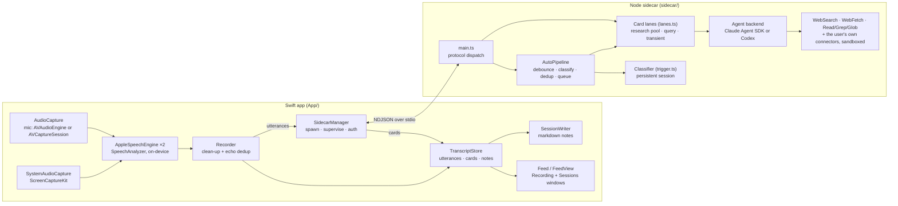

# Advisor — Design

**Status:** Living document. The sections down to *Trade-offs made* describe the
system as it is (checked against the code 2026-10-18, v0.4.7). *Milestones* and
the dated sections after it are the decision history, kept as written; where a
later change overturned an entry, the entry carries a forward pointer.

**Input:** [REQUIREMENTS.md](REQUIREMENTS.md)

## Overview

Two processes on one machine:



The Swift app owns everything realtime and visual; the sidecar owns everything that thinks. Only text crosses the boundary.

## Components

Detail and rationale live in the dated sections below; this is the map.

### Swift app

**Capture.** Mic via an `AVAudioEngine` tap on the default input, or an `AVCaptureSession` for a chosen non-default mic (`AudioCapture`; see *Non-default mic selection*). System audio via a `ScreenCaptureKit` audio-only stream (`SystemAudioCapture`, with a permission preflight). Both delivered as 16 kHz mono Float32, tagged `me` (mic) / `them` (system). Apple's echo cancellation is off (see M2).

**Transcription.** Apple SpeechAnalyzer/SpeechTranscriber (macOS 26), on-device, one engine per source (`AppleSpeechEngine`), locale from the `sttLocale` preference. Streaming with built-in endpointing; volatile (in-progress) text shows at the feed tail. `Recorder` takes each final result, drops `um`/`uh`/`er`/`erm` and immediately repeated words (`cleanedTranscript`) and non-speech junk, then dedupes echo: while system audio is captured a mic final is held 1.5 s, and dropped if its distinctive words (>3 chars) overlap ≥0.7 (on the smaller set) with a `them` line from the last 15 s — or, for a short reply with no distinctive word, exactly matches one. A `them` line arriving later also removes a matching mic line from the previous 12 s. Emits `Utterance{id, time, source, text, latencyMs}` (`text` is mutable for corrections). Start, recovery and teardown run on one serial lifecycle queue. (Originally whisper.cpp; see *STT engine switch* and *Whisper removed*.)

**AppServices.** Launch-lifetime owner of the shared `TranscriptStore` (utterances, cards, editorial notes, volatile text, status), `SidecarManager` and `SessionWriter`, started from the Sessions scene so saved sessions can be queried with no recording open. The `Recorder` belongs to the recording window and is held weakly. Scenes (`AdvisorApp.swift`): **Sessions** (the main window, opens at launch), **Recording** (a single-instance SwiftUI `Window`, ⌘N; never auto-opens) and **Settings**. There is no menu-bar item and no `NSPanel`: the recording window's **Float** toggle raises it to `.floating` level on all Spaces. A first-run terms sheet gates recording (`TermsAcceptance`).

**Recording window** (`TranscriptView`, `ListeningToolbar`, `AskBar`, `RecordControl`). Toolbar: Listen / Stop / Resume with the timer (Stop is resumable), mic mute, audio source, then the folder indicator, Name, Context and Tags chips, Auto cards, Hide Transcript, Summarise, Float and Export. The Ask bar sends free-text queries. Closing the window ends the session; if cards are still researching, `WindowCloseGuard` (`SessionClose.swift`) asks whether to wait for them or stop them. ⌘Q runs the same close through `QuitSequence` (`AppServices.shutdown`, 5 s deadline, then a synchronous save, sidecar stop and `_exit`).

**Feed** (`Feed`, `FeedView`). One model and view for both windows: transcript runs (paragraphs with their time in the margin), cards anchored under the line that triggered them, editorial NOTE cards (`FeedNoteView`) and headings, in chronological order. The live feed follows the tail unless the user scrolls up. Right-click a line for AI actions (Answer / Context / Fact check), a correction, or Add note. Cards collapse, copy, skip or delete, and take follow-ups. Each window supplies its behaviour through `FeedActions`.

**Sessions browser** (`SessionsView`, `SessionArchive`, `SessionDetail`, `TranscriptDoc`, `NoteEdit`, `AnswerPanel`). Master/detail: search (a `#tag` term filters by tag) and a date-grouped list with folders (each folder can hold a default context and tags, and has its own record button); the detail renders the saved note through the shared feed. Ask and Summarise stream into the Answer panel and can be stopped; research actions, follow-ups, corrections and notes work on saved notes too. Edits splice the note's lines (`NoteEdit`) and decline if the note changed underneath; the note still being recorded is read-only there.

**SessionWriter** (with `SessionMarkdown`). One markdown note per session, `yyyy-MM-dd-HHmmss.md`, in the session folder (the `sessionDir` preference, default `~/Library/Application Support/Advisor/sessions/`) or a folder sub-directory of it. Frontmatter: `name`, `started`, `ended`, `context`, `tags`. Body: an optional `# Summary`, then `# Transcript` with cards and NOTE blocks inline as blockquotes at their place in the conversation; the Sessions browser appends Ask answers under `# Follow-ups`. Each card is written as `Card.persisted`: a finished card as it stands, one mid-follow-up or mid-re-summarise as its last completed answer, one still on its first run not at all. Rewritten on a 2 s debounce; transcripts only, no audio; the vault is never written. **Export** copies the note byte-identical (`SessionWriter.export`).

**SidecarManager.** Spawns the Node sidecar and supervises it: on a crash it fails every still-researching card and pending document request, restarts with exponential backoff (1/2/4/8 s, capped 8 s, ≤5 attempts; a crash after a >60 s healthy run resets the budget), then replays `session_start` plus the lane/auto config (not the utterance history — the classifier session is gone). A deliberate `stop()` cancels any pending restart. Authentication: subscription by default; in API-key mode the Keychain key is injected as `ANTHROPIC_API_KEY` / `OPENAI_API_KEY` at spawn (`apiKeyEnv`), and each session start re-reads it, replacing the process if it changed. Saved-session requests route back by request id (`discardDocumentRequest` drops one and cancels it). Sends to a dead sidecar surface on the status line. Transport: newline-delimited JSON over stdin/stdout — no port management, lifecycle tied to the parent, trivially debuggable. The sidecar's stderr goes into the app's log file.

**Logging.** All app and sidecar diagnostics go through `FileLog` (`Log.swift`) to `~/Library/Logs/Advisor/advisor.log` — the standard macOS user logs folder, so the file shows up under Console.app → Log Reports and survives a packaged run (where stderr goes nowhere). The app is the *sole* writer: its own lines arrive via `appLog.write`, the sidecar's stderr is captured by `SidecarManager` and funnelled in via `appLog.appendSidecar` (lines reassembled across chunk boundaries, each wall-clock-timestamped). One serial queue → no write contention and a single chronological timeline that interleaves app and `[sidecar +Xs]` lines. Mirrored to stderr too for dev runs. Rotates by size (5 MB), keeping one previous file (`advisor.log.1`).

**Preferences.** `~/Library/Application Support/Advisor/config.json`, mirrored by `Preferences.swift` and `sidecar/src/config.ts` (App-only fields such as `sttLocale`, `authMode`, `sessionDir`, `logTranscriptText`, saved contexts and tags never reach the sidecar). Tabs: Agent (provider, model, effort, authentication, connector actions), Triggers, Transcription, Contexts, Tags, General (appearance, session folder, transcript text in the log).

### TS sidecar

**main.ts.** Reads NDJSON from stdin and dispatches it; holds the live session prompt (seeded by `session_start`, replaced by `session_context`, prefixed to each task), the lane pools and the transient-lane runners. Sends `hello` on startup. Stray rejections and exceptions are logged, not fatal (issue #45).

**AutoPipeline** (`autoPipeline.ts`). Each utterance or note restarts a 1.5 s quiet debounce; then the classifier gets only the lines past its cursor, consecutive same-source lines merged. The cursor commits only on a successful classify (a failed window is re-fed, up to 3 times). New subjects are deduped for 10 minutes (normalised in any script), queued (≤20) and dispatched to free research lanes, anchored to the last line of the window. Turning Auto cards off drops the pending classify, queued research and any in-flight classify result.

**Classifier** (`trigger.ts`). A persistent session on the shared provider and model, offered no tools (`noTools`; on Codex, no web search or network) and none of the user's settings; returns triggers of kind `question | context | factcheck` (only the kinds enabled in Preferences, at most 2 per pass) with a subject and query, steered by the sensitivity preference (conservative / balanced / eager). Warmed at session start; 30 s timeout. A `question` becomes an `answer` card.

**Card lanes** (`lanes.ts`). Every card-answering session takes `cardLaneOptions`: one system prompt (`buildResearchSystem()`: persona plus fixed operating rules — lead with the answer, notes first then web, no narration, cite, say "couldn't verify", never ask), the tools `WebSearch`, `WebFetch`, `Read`, `Grep`, `Glob` plus the user's own connectors, and the effort preference. The per-task instruction comes from `researchTask` (answer / context / fact-check), `replyTask`, `summaryTask`, `documentQuestionTask` or `documentResearchTask`. Two kinds of lane:

- *Pooled, persistent* — research lanes (3 by default, 1–8 from the app) and one query lane. `Transcript` keeps a cursor per lane, so each task carries only the conversation that lane hasn't seen. `runCard` opens a `pending` card, then streams into it. A failed turn resets the lane and forgets its cursor, so its next card replays the conversation.
- *Transient, one-shot* — card follow-ups (≤3 at once), the live summary, and saved-session tasks (ask, research, follow-up, summarise; ≤2 at once). Created per request, disposed after, never holding a pool slot.

**Query lane.** The Ask box (a `query` card with no anchor, so it sorts in at the time of asking) and right-click actions (the action's kind, anchored under the clicked line). One at a time — a second gets an `error` frame. Gets its conversation through its own cursor, like a research lane.

**guardedRun / cancel** (`guardedRun.ts`, `cancel.ts`). One run skeleton for every card, reply, summary and document task: stream, then a terminal frame, all suppressed once the id is cancelled. Streaming frames go out at most every 150 ms (`throttle.ts`); before any text a card stays `pending` and carries the agent's current `activity` (see *Card text streams as it is written*). `cancel` interrupts whichever lane holds the id and answers on the right channel (`card_update` or `document_answer`).

**Agent backends** (`agent.ts`, `codex.ts`, `providers.ts`). One `Agent` interface (`run` / `reset` / `interrupt`) behind a provider registry; one provider and model serve every lane. `AgentSession` is a long-lived Claude Agent SDK session fed by streaming input, with `includePartialMessages` so text reaches a card delta by delta, loading the user's own Claude configuration (`settingSources: ["user"]` — where personal context such as notes locations belongs), `maxTurns` 40, 180 s per task. `CodexAgentSession` wraps `@openai/codex-sdk` (measured far slower for cards — see the 2026-06-13 sections).

**Sandbox.** Claude: one policy, `toolDecision` — web, `ToolSearch`, connector reads/searches, and non-sensitive `$HOME` reads by absolute or `~` path; connector actions only with the preference on, unknown connector tools denied. Enforced by the `sandboxGate` PreToolUse hook and repeated in `canUseTool`. Codex: the same denylist as a Seatbelt profile, the CLI running under `sandbox-exec` (`codexSandbox.ts`); connectors all or none, by the same preference (`codexClientOptions`). See *Agent sandboxing*, *Codex runs under a Seatbelt profile* and *Codex connectors follow the actions toggle*.

## IPC contract (NDJSON, one object per line)

Types live in `sidecar/src/protocol.ts`. Swift → sidecar:

```json
{"type":"session_start","sessionId":"...","ts":...,"context":"..."}
{"type":"session_context","text":"<live edit of the session prompt>"}
{"type":"utterance","id":"<utterance uuid>","source":"me|them","text":"...","ts":...}
{"type":"note","id":"...","text":"<editorial note>","ts":...}
{"type":"query","id":"q7","text":"...","action":"answer|context|factcheck","triggerId":"<utterance uuid>"}
{"type":"config","auto":true,"lanes":3}
{"type":"cancel","cardId":"<card or request id>"}
{"type":"card_reply","cardId":"...","kind":"answer","title":"...","base":"<card's current body>","replyText":"...","transcript":"them: ...\nme: ..."}
{"type":"summarise_live","cardId":"<existing summary card, on re-summarise>","transcript":"..."}
{"type":"ask_document","id":"d3","question":"...","document":"<the whole saved note>"}
{"type":"research_document","id":"d4","action":"answer|context|factcheck","text":"<selected passage>","document":"<the whole saved note>"}
{"type":"reply_document","id":"d5","kind":"answer","title":"...","base":"<card's current body>","replyText":"...","document":"<the whole saved note>"}
{"type":"summarise_document","id":"d6","transcript":"<the whole saved note>"}
{"type":"session_end"}
```

`action`/`triggerId` on `query` are set by right-click actions and absent for the Ask box; `config` may carry either field alone.

Sidecar → Swift:

```json
{"type":"hello","version":1}
{"type":"card","id":"...","trigger":"<utterance uuid>","kind":"answer|context|factcheck|query|summary","title":"...","body":"...","state":"pending|streaming|done|failed|cancelled"}
{"type":"card_update","id":"...","body":"...","state":"pending|streaming|done|failed|cancelled","activity":"Searching the web for “…”"}
{"type":"document_answer","id":"d3","body":"...","state":"pending|streaming|done|failed|cancelled"}
{"type":"error","fatal":false,"message":"..."}
```

The sidecar sends `hello` once at startup; the app ignores it — there is no version handshake. The app also accepts optional `sources` and `verdict` fields on card frames, which the sidecar doesn't send yet. Card ids are opaque: they carry a random per-process prefix, so a restarted sidecar cannot collide with cards the app still holds.

## Latency

The aspiration is ≤5 s from utterance to a useful card. As measured, it is not met (figures from the M4 note, the 2026-06-13 latency investigation and the 2026-10-07 *Effort preference* log):

| Stage | Now |
|---|---|
| Final transcript | SpeechAnalyzer endpointing; mic finals held 1.5 s more while system audio is captured (echo dedup) |
| Quiet before classify | 1.5 s debounce |
| Classify (warm persistent session) | ~1–1.5 s; the 5–10 s cold spawn is paid by a warm-up at session start |
| Speech → trigger | ~2 s |
| Placeholder card | at dispatch, as soon as a research lane is free |
| Trigger → first card text | median 30.5 s (p90 52.7 s) |
| Trigger → finished card | 33.4 s |

The placeholder-then-stream pattern keeps the card visible early. Until 2026-10-09 text streamed per assistant block, and the model mostly writes its answer as one block at the end, so cards filled in one go. Text now streams as it is written, and a card shows what the agent is doing until then — see *Card text streams as it is written*.

## Error handling

- **Sidecar crash** → in-flight cards fail and pending document requests fail; supervised restart with backoff and session replay (above); the status line shows the crash and each attempt; once the budget is spent it asks the user to stop and start listening again. Inside the sidecar, a stray rejection or exception is logged rather than killing the process.
- **Apple STT result-stream failure** (for example a Speech helper disconnect, `NSCocoaErrorDomain` 4099) → the status line shows recovery, audio sources drain before both speech engines restart, then sources resume; simultaneous mic/system failures coalesce, and a failure during that restart stops listening with the error.
- **Agent failure or timeout** → the card flips to `failed` with the reason, never silently; a failed pooled lane is reset and replays the conversation on its next card; a failed classify is re-fed (bounded).
- **Authentication** → no blocking banner. An API key is checked when entered in Preferences (`AuthValidator`), and re-read at each session start; a key that later fails surfaces as a failed card.

## Trade-offs made

| Decision | Alternative | Why |
|---|---|---|
| stdio NDJSON | WebSocket/gRPC | Simplest; lifecycle coupling is a feature here |
| Apple SpeechAnalyzer, on-device | whisper.cpp (removed 2026-06-14) | Streaming endpointing, no hallucination from noise, far less echo, no native build or model to ship |
| Classifier on the shared model, persistent session fed only new lines | A dedicated Haiku call; local heuristics | One provider/model knob; ~1–1.5 s warm; quality over cost (cost tracking was removed 2026-06-14) |
| Persistent pooled lanes with per-lane cursors | A fresh agent per card | Skips the 5–10 s cold spawn; follow-ups resolve referents from session memory |
| Placeholder + stream cards | Wait for complete answer | The card is visible at dispatch, even though the answer isn't |
| Float toggle on an ordinary window | Non-activating `NSPanel` overlay | Simpler and behaves like any window; revisit if focus-stealing annoys |
| The user's own Claude config and connectors | Built-in vault/Jira/Slack integrations | Keeps the app generic: personal context lives in `~/.claude`, not in Advisor |
| Markdown session files | SQLite | Human-readable, greppable, matches "local markdown" decision; revisit if search over history gets slow |

## Milestones

- **M0 — Spike (benchmark): ✅ 2026-06-11.** whisper.cpp + Metal on the M4 Max, 11 s speech sample, warm timings via the Swift wrapper: `small` 130 ms, `large-v3-turbo` 395 ms. Both far inside budget. Default `small` (override with `ADVISOR_WHISPER_MODEL`); `large-v3-turbo` viable if accuracy disappoints.
- **M1: ✅ 2026-06-12 (verified live).** Mic capture → live transcript in a plain window. `App/` Swift package; headless smoke (`--smoke <wav>`) passes; live mic verified. Gotcha found: system default input was BlackHole (virtual, silent) — app now enumerates devices (CoreAudio) and defaults to the first real mic, with a picker. Speech RMS on Studio Display mic ≈ 0.01, VAD floor 0.006 — watch for clipped soft speech.
- **M2: ✅ 2026-06-12.** System audio (ScreenCaptureKit) + me/them tagging + best-effort echo dedup (text overlap vs last 15 s of `them`; `me` delayed 1 s). Apple AEC abandoned: fails (-10875) on multichannel Studio Display output, and mutes the mic when it does initialise. Dedup imperfect but accepted — attribution is cosmetic for Advisor's purpose; duplicates are further caught by trigger-level dedup (M4).
- **M3: ✅ 2026-06-12.** Sidecar + IPC + on-demand query (F14) end-to-end. `sidecar/` (Node 22 + Agent SDK, NDJSON over stdio, web search + Vault read-only, Claude Code auth); Swift `SidecarManager` + cards pane + query box. Verified live. Note: his npm config has `omit=dev` — install with `npm install --include=dev`.
- **M4: ✅ 2026-06-12.** TriggerDetector + automatic cards (F8–F10). Haiku classifier in a *persistent* streaming-input Agent SDK session (~1 s/classify after first; cold spawn per call was ~10 s — the original design's 0.5 s budget was unrealistic via the SDK). Aggressive on questions (incl. musings), conservative on factcheck; named systems/acronyms trigger context. Subject dedup 10 min; research queue sequential. Remaining latency: research agent still cold-spawns per card (~10–30 s incl. tool use) — candidate for the same persistent-session treatment.
- **M5: ✅ 2026-06-13.** Persistent research/query sessions (per-lane transcript-delta cursors; follow-up questions resolve referents from session memory). Cost reporting via per-task `total_cost_usd` deltas → ticker in toolbar. (Superseded 2026-06-14: cost tracking and the ticker were removed end to end, commit `f663cf3`.) Session markdown files in `~/Library/Application Support/Advisor/sessions/` (debounced rewrite; late cards included). "Float" toggle (floating window, all spaces; named per macOS convention) instead of a full NSPanel overlay — revisit if focus-stealing annoys. "Sessions" button opens the folder in lieu of an in-app history view. (Superseded 2026-06-18: an in-app Sessions browser replaced it — see *Sessions browser (master/detail) + ask-and-append*.)

## Post-M5 tuning (2026-06-13, after first real-meeting test)

- Classifier told it reads messy live STT: reassemble fragments, ignore echo near-duplicates; consecutive same-source utterances merged before classification; window 20.
- Brief made explicitly proactive ("trigger every minute or two in substantive conversation").
- Research parallelised: 3 persistent lanes + dedicated query lane, per-lane transcript cursors.
- Replay harness: `sidecar/test/replay.sh` + `fragments.txt` for tuning against real transcripts.

## STT tuning findings (2026-06-12/13)

- `large-v3-turbo` default (proper nouns), beam search size 2, **temperature fallback disabled** — the default 5× re-decode on noisy segments froze the pipeline. Decode now ~300 ms per 5 s segment (≈15× realtime, M4 Max).
- Vocabulary bias via whisper initial_prompt (~224-token cap): manual dictionary (clickable words in UI + Dictionary popover) merged with macOS spelling LocalDictionary. Vault-derived vocab deliberately NOT in the app — user-specific sources belong in the sidecar.
- Echo dedup: pairwise distinctive-word (>3 chars) overlap ≥0.7 on min-length basis; pool-based common-word matching suppressed genuine speech.
- Segment cap 5 s; segments older than 20 s skipped (back-pressure).
- Known limit: overlapping simultaneous speakers on a mixed mono feed are unrecoverable by any single-stream STT — don't engineer against shouty-debate YouTube videos.

## STT engine switch (2026-06-12)

Apple SpeechAnalyzer/SpeechTranscriber (macOS 26) added as the **default** engine; whisper.cpp retained behind a picker for A/B. Apple wins decisively on real-world capture: true streaming with built-in endpointing (complete punctuated sentences, no hand-rolled VAD boundaries), no hallucination-from-noise, and the duplicate/echo problem largely vanishes. Whisper's remaining edge: vocabulary biasing via initial_prompt (Apple path has no equivalent hook in v1) and fully offline model choice. Known minor: Apple's first Listen may download model assets.

Volatile results are enabled: in-progress words render grey/italic at the feed tail and are replaced by the finalised sentence (live-captioning feel). Mic echo delay is 1.5 s on Apple (vs 4 s for whisper) since both streams finalise near-simultaneously.

### Recording ownership and finalisation (2026-09-21, issues #78/#79)

The writer owns its note until the Recording window closes, including while
stopped or waiting for agent cards. Folder rename/delete commands reject any
folder containing that note, and their menus are disabled. The command rechecks
ownership when an open confirmation is submitted.

Window disappearance starts an app-owned close task. It stops capture, awaits
both speech-result consumers, then drains pending transcript acceptance through
the microphone echo delay and the main-actor store writes. Only then does it
save, release the note and advance the session generation. Reopening awaits this
task before rebuilding the recorder; late old-generation callbacks remain gated.
The Wait close path drains speech first and retains the writer while existing
agent cards finish. Draining finals does not start new agent work.

### Short replies and recording retries (2026-09-21, issues #80/#83)

Absence of distinctive words is not evidence of echo. Short microphone replies
are suppressed only when their token sequence exactly matches recent system
speech; longer utterances retain the existing distinctive-word overlap rule.

The recording view delegates start/stop/resume state and timer bookkeeping to
`RecordingControl`, shared by the toolbar and Space shortcut. Failed starts
become stopped sessions when the start operation completes; a failed automatic
recovery observes capture stopping. Both expose Resume with the existing note,
context and generation intact. A start in progress remains latched against
duplicate retries, and closing cancels its completion bookkeeping.

### Codex session ordering (2026-09-21, issue #81)

Each Codex session queues warm-ups and real requests, selecting its SDK thread
and first-turn instructions only when the request reaches the head. The next
turn waits for completion, not merely `thread.started`. Execution timeouts start
when the turn begins. Reset and explicit cancellation settle active and queued
work without dispatching queued requests. An internal timeout advances the queue.
Both cancellation and timeout retire the active thread so the next request receives fresh instructions.
Late events from abandoned streams cannot replace context or update cards.
Independent sessions still run concurrently.

## Agent sandboxing (2026-06-13)

Sidecar agents run under a `canUseTool` policy instead of `bypassPermissions`: web tools auto-allowed; Read/Grep/Glob restricted to non-sensitive paths under `$HOME` (denylist: .ssh, .aws, .claude, .codex, keychains, …); Bash/Write/Edit/etc. denied and disallowed. Verified: `/etc/passwd` read denied, notes queries unaffected. (That check used a path outside the working directory — exactly the case that does reach `canUseTool`. Reads inside it, and the user's own settings allow rules, never did; see the PreToolUse gate below, 2026-10-06.) A hard OS boundary (OrbStack/Docker container, app spawning `docker run -i`) remains a future option — note the OAuth credentials sit inside any such boundary.

Two refinements after review (`sandbox.test.ts` pins them): **Grep/Glob are gated more tightly than Read** because they recurse — validating only the root path lets a recursive pattern (`Glob {path:$HOME, pattern:".ssh/**"}`, `Grep {path:$HOME, pattern:"PRIVATE KEY"}`) reach secrets in a denied descendant. So a search root may not sit *at or above* any denied path; an unscoped `$HOME` search is illegal and the agent must target a specific subtree. **Comparisons are case-folded** — macOS's default filesystem is case-insensitive, so `~/.SSH/id_rsa` reaches the same file as `~/.ssh`; a case-sensitive denylist check would let the variant through. The path-separator guard still keeps distinct siblings (e.g. `.ssh-notes`) allowed.

### Symlinked credential roots (2026-09-21, issue #77)

Resolving only the requested path left symlinked credential roots unprotected:
if `~/.ssh` points to `~/dotfiles/.ssh`, neither the alias nor the target matched
the lexical denylist. Claude's read and search policies now compare against
both the original denied roots and their resolved targets, using the same
deepest-existing-ancestor resolution as requested paths. Searches rooted at
`~/dotfiles` are therefore refused too. The shared `deniedPaths()` list remains
lexical; Codex already resolves its own policy paths. Regression tests use real
symlinks and synthetic credentials, including credential files, symlinked
parents, missing leaves, and ordinary permitted siblings.

### Enforced by a PreToolUse gate (2026-10-06, code review)

`canUseTool` was never the whole boundary. The SDK resolves a tool call through
hooks → deny rules → ask rules → permission mode → allow rules → `canUseTool`,
and the allow-rules step approves two things on its own: **reads inside the
working directory** (the agents ran with `cwd = $HOME`, so every `$HOME` read)
and **allow rules from the user's settings** (`settingSources: ["user"]` imports
them — a real `~/.claude/settings.json` allowed `Read(~/.claude/**)`). Both
reached the model without `canUseTool` being asked, so the denylist held only
for paths outside `$HOME`. A third hole sat in the policy itself: the CLI's Glob
searches an *absolute* pattern's own base directory instead of `path`, so
`{path: ~/Documents, pattern: ~/.ssh/*}` passed the root check and listed the
denied folder. All three were reproduced against the bundled CLI.

The fix keeps one policy, `toolDecision`, and enforces it in two places:

- **`sandboxGate`, a PreToolUse hook** Advisor registers itself. Hooks run before
  every other step, and a hook deny holds in every permission mode — the docs'
  recommended place for a check that must see every call. The gate only denies:
  a permitted call gets no decision and carries on through the normal flow, so
  `canUseTool` still applies the same policy as a second check. It fails closed.
- **The policy is an allowlist.** Web, ToolSearch (how the CLI loads deferred
  connector tools — refusing it cut agents off from MCP), the MCP resource tools,
  `mcp__*` through `mcpPermission`, and Read/Grep/Glob. Everything else the CLI
  advertises — Skill, Task*/Team*/Workflow, Cron*, ScheduleWakeup,
  AskUserQuestion, worktrees — is refused, where before several ran without
  asking.
- **Paths must be absolute or `~`-based** (`~` expanded to home as the CLI
  does — it expands Read's before the gate but hands Glob/Grep's `path` over
  unexpanded). Relative paths are refused: they resolve against the CLI's cwd,
  so the policy could judge a different file than the one opened. A search
  must name its `path`. **Glob patterns and Grep `glob` filters must be
  relative** — no leading `/`, no `~`, no `..`, no absolute brace alternative —
  so the search stays in the checked root.
- **The agents' cwd is an empty folder of Advisor's own**
  (`~/Library/Application Support/Advisor/agent-cwd`, `agentCwd()`), so the CLI's
  implicit in-cwd approval points at nothing. Codex keeps `$HOME`; its boundary
  is the Seatbelt profile.

Behaviour change: reads the user's own allow rules had silently permitted
(`~/.claude/**`, `~/dotfiles/**`) are now refused, as the denylist always
intended. `sandbox.sdk.test.ts` pins the boundary against the real CLI: a local
fake model endpoint scripts each tool call in a synthetic home and the test
inspects the tool result sent back — the only place a leak shows. It runs in
`npm test` (a couple of seconds; the lockfile pins the SDK and its platform
CLI). The agents' folder is created on first spawn, and a failure there fails
that turn rather than the sidecar's startup. Rejected: moving only the cwd (the
settings allow rules still bypass), and validating the Glob pattern's effective
root (it would copy the CLI's internal pattern split, which can change between
versions; refusing the shapes doesn't depend on it).

## Connector tools (2026-06-13)

User-configured MCP connectors (loaded via the user's Claude settings) pass the sandbox: read/search tools always allowed; tools matching an action pattern (send/create/update/delete/…) denied unless `allowMcpActions` is enabled in preferences (default off — a prompt-injected agent must not post to Slack mid-meeting). The research prompt names connected tools as legitimate sources. Toolbar slimmed to in-session controls (Listen, mic, Auto cards, Float); engine/system-audio/agent-count moved to preferences, engine changes applying when listening stops.

## Preferences & de-vaulting (2026-06-13)

Advisor no longer knows about the vault: agents load the user's own Claude config (`settingSources: ["user"]` → `~/.claude/CLAUDE.md`), which carries personal context like note locations. Verified: Patchwork vault query answered with no vault path in Advisor. Preferences (⌘,) write `Application Support/Advisor/config.json`, re-read by the sidecar at each session_start (sessions rebuilt so prompt/model changes apply): trigger sensitivity + per-kind toggles, the shared agent backend (provider + model), STT locale. (Max-triggers-per-pass was dropped as a preference 2026-06-13: "pass" is an invisible internal cadence a user can't reason about, and it duplicated trigger sensitivity as a volume knob; it's now a hardcoded backstop `MAX_TRIGGERS_PER_PASS = 2` in `trigger.ts`.) The research system prompt is entirely fixed in code (`sidecar/src/prompts.ts` — persona plus the protected operational core: two-pass answering, no-narration, citation rules), so prompt edits can't break card latency/format. (The editable persona preference was dropped 2026-06-13: per-session steering via the session prompt below covers the real need, and an editable persona only risked the card contract.) A **session prompt** field steers a single session: filled before Listen (seeded via `session_start`) and editable mid-session (`session_context` messages). Because the persistent research/query lanes fix their system prompt at session start, the session prompt is injected **per task** (`sessionContextPrefix`, prepended to each research/query/reply dispatch and read fresh) rather than into the system prompt — so a live edit lands on the next card without rebuilding lanes. The app stores the latest text so a sidecar restart replays it; the box clears when the session stops.

## Right-click transcript actions (2026-06-12)

Selected transcript text can be acted on directly: right-click → **Answer / Context / Fact check**. These are exactly the auto-classifier's kinds (`question`→answer, `context`, `factcheck`), gated by the same `config.triggers` toggles, so the manual menu and the automatic pipeline never diverge. Preferences posts `advisorConfigChanged` on save and the transcript view reloads its trigger toggles on receipt, so toggling a kind updates the menu live rather than only after a relaunch. The prompt templates live once in `trigger.ts` (`researchTask`/`cardKind`), shared by the auto pipeline (`drainResearch`, now `AutoPipeline.drain`) and the manual path. The action rides the existing `query` lane (now carrying optional `action` + `triggerId`); `triggerId` anchors the resulting card under the clicked line, the same way auto cards anchor via the classifier's `anchorId`. The free-text Ask box still sends a bare `query` (kind `query`, no anchor) — unchanged.

Selection capture needs the real highlighted span, which SwiftUI's `Text` + `.textSelection` hides from a `.contextMenu`; the transcript line is therefore an `NSTextView` (`SelectableTranscriptText`) whose `menu(for:)` builds the action items over `selectedRange` (falling back to the whole line). Building it via the convenience `NSTextView(frame:)` (not a hand-assembled TextKit stack) so the view owns its text storage — a manual stack leaves storage/layoutManager unretained and they deallocate, blanking the line. The space-to-pause monitor now ignores only *editable* text views, so a focused (non-editable) transcript line still toggles playback.

**Dedup considered and dropped.** A first cut had a manual action supersede the equivalent in-flight auto card (cancel by matching anchor+kind, `card_remove` to hide it; register the subject in `covered`). Reverted after testing: auto-triggers anchor to the *last* line of the classifier window and subjects are fuzzy, so anchor/subject matching missed most real duplicates while adding protocol and state surface — a dedup that only sometimes fires invites false confidence. Manual and auto now run independently; the occasional duplicate is accepted (the user waits, then asks manually if nothing appears). Reliable dedup would need semantic subject matching — out of scope.

## In-card follow-up replies (2026-06-13)

A finished card grows a follow-up box; the answer is appended in place (`---` separator + `**You:**`/answer), so a card becomes a short thread rather than spawning new cards. **The sidecar stays stateless about cards** — it never retains card bodies. Instead the app's `card_reply` carries everything needed to answer in context: the card's current `body` (original answer + any prior turns), the new `replyText`, and a recent transcript slice (last ~15 lines, for resolving referents like "she"/"that"). `replyTask` in `trigger.ts` reconstructs the prompt, mirroring `researchTask` as the single source of truth.

The reply is answered by a **transient one-shot session** (`makeLane("reply", …)` then `reset()` in `finally`), created and disposed per follow-up. This is deliberate over reusing a research lane: the 1–8 lane pool is shared and would otherwise be drained by replies, and — because lanes are reused across unrelated triggers — a lane's session context would have drifted off-topic by the time the user replies. A fresh stateless session means clean context and no pool contention, at the cost of one SDK cold-spawn per reply (acceptable for a user-initiated action). `card_reply` has no `busy` gate and takes no pool slot, so it runs parallel to research. Streamed back as `card_update` on the same `cardId`; the sidecar reproduces the exact `base + **You:**` prefix the app shows optimistically, so the streamed body stays consistent.

A card carries an app-only `replying` flag (never on the wire): while a follow-up is in flight it hides both the reply box (so one card can't take two at once) and the cancel button, cleared when a terminal `card_update` arrives. The optimistic in-card edit is applied only if the `card_reply` send succeeds — if the sidecar is down the message is dropped and the card is left untouched, rather than spinning forever with no answer coming and no cancel.

### A completed card keeps its answer (2026-10-06, code review)

The optimistic follow-up replaced the card's body and set it streaming, and a
re-summarise reset the summary card to `…` pending. Only finished (`done`/
`failed`) cards reach the note, so anything that wrote the store mid-run — a
quit, a window close, Stop and Close (which marks it `cancelled`) — dropped the
card's previous answer from the note, and a failed re-summarise replaced the
summary with its error in the window too. `Card.settledBody` now holds the last
completed answer (set whenever the card reaches `done`):

- **The note** writes a running or cancelled card from `settledBody`
  (`Card.persisted`); the `# Summary` section falls back to it the same way.
- **Cancelling** (from the sidecar or Stop and Close, both through
  `Card.apply`/`cancel`) restores it and sets the card back to `done`, so the
  follow-up box returns.
- **A failed re-summarise** keeps the old summary in the card with a "Couldn't
  update the summary" line, state `failed` (Summarise can run again); the note
  keeps the summary without the line. A failed reply is left as it was — its
  body already carries the thread. A sidecar crash fails in-flight cards through
  `apply` too (issue #49), with no body: a re-summarise it cuts off keeps the
  summary (with the line); a follow-up it cuts off reverts to its last answer,
  `done`, so it can be asked again.

## Packaging as a distributable .app (2026-06-13)

The dev build is a bare SwiftPM executable that locates the sidecar by `#filePath`-derived `repoRoot`. That doesn't survive leaving the checkout. `App/package.sh` now assembles a self-contained `Advisor.app`; `AppResources` resolves resources from `Bundle.main` when packaged and falls back to `repoRoot` in a dev checkout, so one binary runs either way.

Decisions (single-user, few-machine distribution — not the App Store): **bundle the Node runtime** (the ~127 MB arm64 `node` binary, copied into `Contents/Resources`) so the target needs no Node install; the Agent SDK's own child processes reuse it via `process.execPath`. `package.sh` is the local build path: it uses a Developer ID or self-signed `Advisor Dev` identity when present and falls back to ad-hoc signing. First launch of that local build may still need right-click ▸ Open. STT is Apple SpeechAnalyzer, so there are no model files or native dylibs to ship — the bundle is just the executable, Node, and the built sidecar.

(Originally the bundle also flattened the whisper + ggml/Metal dylibs into `Contents/Frameworks` with rpath surgery; removed with whisper — see the dated section below.) The bundled Node boots the bundled sidecar with no system Node on `PATH`. The sidecar still needs the user's Claude Code login on the target.

## DMG distribution (2026-06-24)

The shared artefact is `App/dist/Advisor-<version>.dmg` (version from the repo-root `VERSION` file, stamped into the bundle by `package.sh`), not a raw local `.app`. `App/dmg.sh` first runs `sign.sh` so the app is Developer-ID-signed with the hardened runtime; the app gets no notary round of its own (see "Notarisation: nested entitlements + one notary round" below). It then builds the compressed DMG with an Applications link, signs the DMG, submits the DMG to Apple's notary service, staples the DMG ticket, validates the staple and runs `spctl -t open --context context:primary-signature` against the image. All of that happens under an `Advisor-<version>.partial.dmg` name that is renamed only after the last check passes, so a signed but unnotarised image never sits in `dist/` under the release name. The exit trap deletes the partial on failure; only a run killed outright (SIGKILL, power loss) can leave one behind, still clearly named. This avoids the Gatekeeper failure shown to recipients of the old local-only DMG: "Apple could not verify \"Advisor\" is free of malware that may harm your Mac or compromise your privacy."

## Codex as an alternative provider (2026-06-13)

Every lane — trigger classifier, research lanes, manual query lane — runs on **Claude** (Agent SDK) or **Codex** (`@openai/codex-sdk`), chosen in Preferences with a provider + model picker. (Originally per-component with a per-provider remembered model; collapsed to one shared `{provider, model}` later the same day — see the shared-backend note below.) The sidecar abstracts both behind an `Agent` interface (`run`/`reset`/`interrupt`); `AgentSession` is the Claude impl, `CodexAgentSession` (`codex.ts`) the Codex one. Both are long-lived, FIFO, context-retaining sessions. **Caveat (measured 2026-06-13): Codex is unfit for the research/query lanes** — ~5–7× slower than Claude and non-streaming (card stays empty until done). Keep research/query on Claude; see the latency-investigation section below.

**Provider registry (plug-in shape).** `providers.ts` holds a `PROVIDERS` registry mapping id → `{ label, create(opts) }`, and `createAgent(provider, opts)` resolves through it (unknown id → Claude, forward-compatible with newer configs). Adding a provider is one registry entry + one `Agent` class on the sidecar, and one `AgentProvider.all` entry (id, label, model list) in the app's `Preferences.swift` — the provider/model pickers are data-driven from that array, no per-provider branches. The two lists are mirrored across the language boundary by hand (Swift can't import the TS registry). The per-provider sandbox/tooling impl is irreducible — each SDK differs.

Auth follows the same principle as Claude — **no API key**: the Codex SDK reuses the user's Codex CLI login (`~/.codex/auth.json`). The platform binary ships transitively via `@openai/codex-sdk` → `@openai/codex` → `@openai/codex-darwin-arm64` in `node_modules`, so packaging needs no global `codex` install. Codex has no system-prompt parameter, so Advisor's system prompt is prepended to the first turn of each thread; later turns inherit it from thread context.

**Sandbox — deliberately coarser than Claude's, documented not hidden.** Claude runs under a per-call `canUseTool` policy (path denylist for reads, action-pattern gate for MCP). The Codex SDK exposes no per-call hook, so `CodexAgentSession` maps to `sandboxMode: "read-only"` + `approvalPolicy: "never"` (no writes, edits, escalation, or network-mutating commands), with web search + network enabled only when the component has a `Web*` tool (research/query yes, classifier no). Residual gaps versus Claude: a read-only Codex *shell* command can still read sensitive dotfiles (`~/.ssh` etc.) — there is no path denylist — and Codex MCP servers come from `~/.codex/config.toml`, so they are not gated by `allowMcpActions`. Accept for a single-user local tool; revisit if Codex gains per-tool callbacks. (Superseded 2026-08-10: the Codex CLI now runs under a Seatbelt profile built from the same path denylist — see *Codex runs under a Seatbelt profile*. And 2026-10-09: connectors follow `allowMcpActions`, all or none — see *Codex connectors follow the actions toggle*.)

**One shared backend, not per-component (2026-06-13).** The three independent lane choices (classifier, research, query) collapsed into one top-level `{provider, model}` used by every lane. Rationale: the per-component split was never used in practice — research and query already shared a model, and a separately-tuned classifier added a knob without a payoff. A scalar `model` (`""` = provider default) replaces the per-provider `models` map; switching provider now forgets the prior model (the UI resets it on change) rather than remembering one per provider. Consequence accepted: the classifier no longer defaults to Haiku — it follows the shared model (default Sonnet), trading a little classify latency/cost for a single knob. **No config migration** — still early testing, so a stale `config.json` is simply dropped (its unrecognised keys ignored, missing keys defaulted) rather than normalised. Both sides keep a tolerant decoder (sidecar `mergeConfig()`, Swift `init(from:)`) only so missing keys default instead of throwing.

## Latency investigation — progressive answers, warming, Codex unfit for research (2026-06-13)

First real-use complaint: 60 s+ from a spoken question to a useful card. Instrumented the whole pre-card path (per-stage + per-text-block latency logging in `agent.ts`/`main.ts`/`protocol.ts`, kept on permanently for ongoing tuning — each `[sidecar +Xs]` line is on one timeline). Findings, in order of impact:

- **Codex is unfit for the research/query lanes.** Measured the same question with research on Codex vs Claude/Opus: **Codex ~170 s, Claude ~25–34 s** — a 5–7× gap — and Codex emits nothing until the turn ends, so the card sits empty then pops. Claude streams text blocks as it writes. Keep research/query on Claude; Codex remains selectable (and fine for the classifier, whose output is a single JSON blob) but should not be the research/query backend. The earlier 170 s "agent is slow" symptom was almost entirely this misconfiguration, not the SDK.
- **Claude won't volunteer progressive output — it must be told.** Baseline (no instruction): Claude runs every tool then dumps one block; first text == final, ~24 s into the run. So the system prompt now mandates a **two-pass answer in one turn**: write a brief `From your notes:` preliminary from the local search *first*, then consult web/connectors and revise. With it, useful content reaches the card ~9 s into the run (~15 s earlier) for ~5 s more total. The prompt also **forbids narration** ("I'll check…") — the first block must be real content, or the early-content win is wasted on filler.
- **The local/web split was prototyped and rejected.** A throwaway spike fired a parallel local-only card (Read/Grep/Glob, no web) beside the web card. Local *started* faster (first text ~5 s) but *finished* slower (~38 s) — a heavy model doing many sequential `Read`s. The instructed single agent gives the same progressive feel with **one card and no second model**; the split's only real edge is parallelism, and gathering the local data (~15–20 s here) is the floor either way. Not worth the extra card/lane/model plumbing.
- **Cold-spawn warmed off the critical path.** The Agent SDK boots a CLI subprocess on the first `run()` of each session (~5–10 s; classifier Haiku measured cold 5.7–9.4 s). It was paid serially on the first question by both the classifier and the lead research lane. `session_start` now fires fire-and-forget warm-ups (`warmClassifier()` + a trivial run on `researchLanes[0]`) so the first real question skips both boots.

Remaining floor is STT finalisation (~8–12 s, app-side, separate) plus the unavoidable local-gather time. The ≤5 s aspiration in the latency budget above remains aspirational for agentic answers.

## Whisper removed (2026-06-14)

Whisper.cpp dropped entirely; Apple SpeechAnalyzer is now the only STT engine. In real use Apple won on every axis that mattered (streaming endpointing, no noise hallucination, near-vanishing echo), and the whisper path carried real cost: a vendored CMake/Metal build, the `CWhisper` C shim and header symlinks (`setup.sh`), ~6 native dylibs flattened into the bundle with rpath surgery, a 1.5 GB model to source, and the whole VAD `Segmenter` + decode-queue machinery. Removing it deleted `WhisperTranscriber`, `Segmenter`, `CWhisper`, `setup.sh`, the `--smoke` headless test (whisper-only), the `STTEngine` enum and its Preferences picker, and the `ADVISOR_WHISPER_MODEL` / model-path plumbing in `AppResources`.

The vocabulary/dictionary feature went with it: its sole purpose was biasing whisper's `initial_prompt`, and Apple's path has no equivalent hook — so `VocabularyStore`, the Dictionary preferences pane, and the right-click "Add to dictionary" submenu are gone. Supersedes the "STT engine switch" and "STT tuning findings" sections above. The historical reasoning there is kept as the record of how the engine choice evolved.

## Optional API-key auth (2026-06-14)

Subscription login (Claude Code / Codex CLI) stays the default, but a machine
with no CLI login can now authenticate with a provider API key — an **opt-in
fallback**, not a requirement (which the project constraints still forbid). A
Preferences **Authentication** toggle picks `subscription` vs `apiKey` for the
active provider; the key is held in the **macOS Keychain** (`Keychain.swift`),
never in `config.json`. In API-key mode the app reads the active provider's key
at sidecar spawn and injects it as an environment variable
(`SidecarManager.apiKeyEnv`): `ANTHROPIC_API_KEY` for Claude, `OPENAI_API_KEY`
for Codex.

The injection is the whole mechanism — the sidecar never sees the secret in
config. Claude needs **no sidecar change**: the Agent SDK's `query()` spawns the
`claude` CLI which inherits `process.env`, so the env key flows through (when set
it takes precedence over a stored OAuth login). Codex needs an explicit pass —
`codexConstructorOptions(process.env)` returns `{ apiKey }` only when
`OPENAI_API_KEY` is present, since a leftover ChatGPT login would otherwise win;
`env` is left unset so the Codex CLI still inherits the rest of `process.env`.
`authMode` is App-side only (like `sttLocale`) — deliberately absent from
`sidecar/src/config.ts`, because the sidecar acts purely on the injected env.
Supersedes the "no API key" lines in the packaging and Codex sections above.

**Key validation at entry (2026-06-14).** An invalid key previously failed
silently — it surfaced only as an "Invalid API key" research-lane error
mid-session. `AuthValidator` now tests a key directly against the provider's
models endpoint (Anthropic `x-api-key`, OpenAI bearer) when entered in
Preferences, showing inline status and an alert on rejection. The key field is a
visible rounded-border input.

### Authentication refresh at session start (2026-09-21, issue #82)

The sidecar outlives individual recordings, so reading authentication only at
app launch left mode changes, replacement keys and provider changes unapplied.
`sendSessionStart` now reads the selected provider's current Keychain key and
compares the effective API-key overrides with those used at spawn. Unchanged
authentication keeps the process; changed authentication replaces it before
sending the new session, replaying lane and auto settings first. A required
replacement cancels any in-flight saved-document request.

Both provider API-key variables are removed from the inherited environment
before applying the selected key. Subscription mode therefore leaves neither
override. The developer launch still uses a login shell to find Node, but
reapplies the selection after loading the shell profile, which may itself
export keys. Temporary environment variables carry the selection through that
step and are removed before Node starts. Keys remain in Keychain and process
environment, never command arguments, config or NDJSON messages.

Process state and incoming frames are confined to the main actor. Each spawn
has a generation: termination, spawn-failure, output, write-error and delayed
restart callbacks from retired generations cannot disturb the replacement.
Tests exercise real harmless child processes and pipes with placeholder keys,
including a developer login profile that exports conflicting keys.

## Listening view redesign (2026-06-14)

The Listening view was rebuilt to a high-fidelity handoff spec, keeping
behaviour but introducing the app's first design-token layer (`Theme.swift`:
semantic light+dark colour tokens via dynamic `NSColor`s, plus spacing/radius/
type-scale metrics). Decomposed into components: `ListeningToolbar` (record
cluster — waveform + timer + pause/stop + mic mute — audio-source menu, Context
chip, Auto-cards switch, Float, Export, Sessions; idle collapses to a single
Listen pill), `AskBar` (sparkle input + ⌘↵), and `ListeningCardView` (type/verdict
pill, Researching state, copy/collapse/expand + dismiss, themed Markdown body,
trigger-quote + sources footer, follow-up input). (Superseded 2026-10-06:
`FeedCardView` replaced `ListeningCardView` in both windows — see *One feed for
both windows*.) The transcript is a centred
812 pt column with a day divider and flowing paragraphs that group consecutive
utterances, breaking only on a >1 s gap or an injected card, with a blinking
interim line.

Card-model changes: `isExpanded` (fact-checks collapse by default),
`triggerQuote` (derived from the anchor utterance), `sources` and `verdict`
(parsed when the sidecar emits them; absent for now); `toggleCard`/`dismissCard`
on the store. Pause now freezes the session timer (`sessionStart` shifted
forward by paused durations so elapsed excludes pauses); dismissing an in-flight
card cancels its research; the session note re-writes only on output-bearing
card changes. The session-prompt box moved from a fixed strip below the toolbar
into the Context-chip popover; mic mute moved into the record cluster.

The summarise control (a transient AskBar action) was removed shortly after —
post-meeting summaries remain out of scope (REQUIREMENTS). (Reversed 2026-06-22:
an on-demand Summarise control returned — see *Summarise a conversation*.)

### 2026-06-18 — Markdown export + one session format (inline cards)

A toolbar **Export** button (share icon, left of Sessions) shares the current
session note via `NSSavePanel`. Rather than give export its own renderer, the
**session note format was unified** on the inline layout (`SessionMarkdown.inline`):
utterances and finished cards merge chronologically (a card sorts after an
utterance at equal time, the same ordering the live feed uses), each card a
`>`-quoted "chat" block — `LABEL · Title`, body, then a grounding/trigger-quote +
sources footer — so the saved note reads like the window. Export is then trivial:
flush + copy the on-disk file (`SessionWriter.export`).

This **dropped the footnote format** (the prior `[^card-N]` line↔card backlinks
for Obsidian/GitHub, plus the "Other cards" orphan section). Trade accepted: one
format and far less code over backlink navigation; orphan/query cards now place
chronologically by `created` time instead of in a trailing section. Nothing
parses these files (write-only archival), so no migration — old notes keep their
old format. `SessionMarkdown` is a pure function, covered by the project's first
unit tests (`Tests/AdvisorTests`, swift-testing).

### 2026-06-18 — Sessions browser (master/detail) + ask-and-append

The **History** button (clock icon) opens the **Sessions** window (`SessionsView`,
a single `Window(id: "sessions")` with `.hiddenTitleBar`) — a master/detail
browser over saved notes, per `design_handoff_advisor/SESSIONS.md`. `SessionArchive`
lists `~/Library/Application Support/Advisor/sessions/*.md`, parsing the
`yyyy-MM-dd-HHmmss.md` name to a date (the filename formatter + on-disk location,
previously private to `SessionWriter`, moved here so both share one source of
truth). Left: search + an All / This week filter + a date-grouped list (Today /
Yesterday / Earlier this week / This month / Earlier); each row shows title, gist,
time, duration and card count, with the selected row a white card + blue accent
bar. Right: the selected session — title, meta line, the questions asked of it,
and the full transcript (cards inline, as in the live feed) — plus the ask bar.
(Starting a recording stays in the Listening window's toolbar, not duplicated
here.)

**Scope: layout + real data only.** Everything rendered comes from the saved
notes. The handoff's AI-derived fields (category badge, topic chips, summary,
people, action items) and star / Resume are deliberately **not** built yet — they
need new generation, protocol changes and per-session storage. Two deviations from
the handoff, both deliberate: (1) the handoff wants Sessions and Listening as two
destinations of *one* window (`NavigationSplitView`); fully merging them safely
means hoisting the recorder/sidecar/writer lifecycle out of `TranscriptView` (it
rebuilds on `.task`, so a naïve swap would respawn the sidecar each visit), a large
refactor — Sessions is its own window for now (the handoff allows "your existing
navigation"). (2) Titles come from the **session context** the user types before
Listen, now persisted to the note's frontmatter (`SessionMarkdown.inline` writes
`context:`, collapsed to one line; `SessionWriter` carries it, updatable
mid-session), with a date fallback for untitled/old notes.

**Optionally naming a session.** A session can be given an explicit `name:`
(frontmatter), which wins over `context` as the browser title — context steers
research and is often verbose or empty, so a short label keeps the list scannable
(`SessionDetail` precedence: name → context → date). Set two ways: **before/during
a live session** from the toolbar's Context popover (a Name field beside the
context box — seeded into the writer at `start`, edited live via `updateName`,
gated on `sessionActive` like context so the stop-time blank can't wipe it), or
**after the fact** from the Sessions detail (the `…` menu → Rename). Two write
paths mirror the two-writer split: the **live/just-finished note** (still owned by
`SessionWriter`) is renamed *through* the writer (browser rename calls
`renameOwnedNote`, which sets the name and flushes; live edits ride the normal
debounced write) — a direct frontmatter write would be clobbered when a late
research card finishes; **any other saved note** is edited on disk via
`SessionArchive.setName` (a pure `settingName` frontmatter editor that inserts/
replaces/removes the key while preserving body and follow-ups). The browser
reaches the live writer through `TranscriptWindowContext`, the same bridge it uses
for the live sidecar.

**Rendered like the live window, not as raw markdown.** The saved format is a
timestamped bullet list with `>`-quoted cards, so rendering it via `MarkdownUI`
read nothing like the live feed. `TranscriptDoc` reconstructs display blocks —
the inverse of `SessionMarkdown.inline`: consecutive transcript lines join into
flowing paragraphs (new paragraph when the inter-line gap exceeds 2 s, matching
the live feed's collapsing; blank lines between entries do **not** split, since
`inline` blank-separates every entry), blockquotes become cards. Paragraphs render
through the same `SelectableTranscriptText` the live view uses (no AI actions);
card blocks render in live card chrome. `SessionDetail.parse` layers on top,
splitting the card blocks into "surfaced cards" vs "you asked" (a `Q ·` label) and
deriving title/gist/timing. Pure parsers, unit-tested (`TranscriptDocTests`,
`SessionDetailTests`).

**Asking runs on its own isolated path, not the live query lane.** The query lane
is bound to live-session state (the rolling transcript-delta cursor, the session
prompt, the single `busy` gate), so routing a question about a *saved* document
through it would pollute the live conversation's context and serialise against
live queries. Instead `ask_document` carries the whole note as a self-contained
`document` and is answered by a **transient one-shot session** — the same pattern
as `card_reply` (`makeLane("document")` then `reset()` in `finally`): no pool
slot, no `busy` gate, no live-session state, parallel-safe, works mid-session.
Streamed back as `document_answer` keyed by request id; `SidecarManager` routes
each frame to a per-id handler registered by `askDocument` (kept out of the live
`store.cards`) and drops it on a terminal state. Sidecar crash, spawn failure and
deliberate stop fail and clear every outstanding handler, so saved-session Ask
and Summarise cannot remain pending across process loss. Concurrent document
questions are capped (2) like replies, so a burst can't fork unbounded SDK subprocesses.

On `done` the answer is appended to the note under a one-time `# Follow-ups`
heading as a `>`-quoted block matching the inline-card style
(`SessionMarkdown.followUpBlock`), then the view reloads from disk — so the saved
transcript grows with the questions asked of it.

**Two-writer hazard, guarded.** `SessionWriter` rewrites its note wholesale (a
2 s debounced re-render from the store) and keeps owning its `fileURL` after
`end()` (late research cards still land in the file). A follow-up append to that
same file would be clobbered by the next debounced rewrite. The detail pane
therefore refuses to ask about **any file the live writer still owns**
(`writer.currentFileURL`, not merely "while listening") — the just-ended session
becomes askable once the next session starts or the app restarts. Because the
Sessions window is a sibling scene (not a child of the live view), it can't
receive the sidecar/owned-file as params; `TranscriptWindowContext` (a
`@MainActor` shared holder the live view populates) carries both across scenes.
Residual limitation (accepted for a single-user local tool): the list refreshes
on open and on `.advisorSessionsChanged` (posted when a session starts or ends).

## Appearance preference (2026-06-18)

Light/dark/system picker in Preferences (issue #3). `config.appearance`
("system"|"light"|"dark") is App-side only — deliberately absent from the
sidecar config (like `sttLocale`/`authMode`), since appearance is pure UI.
`AppDelegate` sets `NSApp.appearance` (nil for "system", `.aqua`/`.darkAqua`
otherwise) at launch and again on every `.advisorConfigChanged` post, so the
change lands without a relaunch. The Theme's colours are already dynamic
NSColors resolved against `NSApp.effectiveAppearance`, so forcing the app
appearance drives the whole UI for free — no per-view `.preferredColorScheme`.

## Sessions as the main window (2026-06-19, issue #4)

The app now opens on the **Sessions** browser, not the live feed. `SessionsView`
is the first scene — a `Window(id: "sessions")` with `.defaultLaunchBehavior(.presented)`.
A new recording is started with **Cmd-N** (see issue #11 below). The
recording window (`TranscriptView`) is a separate `Window(id: "recording")`
(`.defaultLaunchBehavior(.suppressed)`, `.restorationBehavior(.disabled)`); being a
`Window` (not a `WindowGroup`) makes it single-instance for free — New just brings
the existing one forward, satisfying "only one recording window at a time".

This forced the **service-lifecycle hoist** the 2026-06-18 Sessions-browser entry
deferred. The sidecar and writer can no longer live in `TranscriptView.setup()`:
if the recording window is the only thing that starts them, the Sessions browser
couldn't answer questions about saved transcripts before a recording window ever
opened. A new `AppServices` (`@MainActor ObservableObject`, the `@StateObject` in
`AdvisorApp`) owns the **app-lifetime** trio — `store`, `sidecar`, `writer` —
constructed in its `init` (so the `@StateObject`-can't-reference-another-`@StateObject`
rule never bites) and started once from the Sessions scene's `.task`. It publishes
`sidecar`/`writer` into the existing `TranscriptWindowContext` bridge, so
`SessionsView` is unchanged. The **`Recorder`** (the audio device) stays
window-owned — built on demand by the recording window — and `AppServices` holds it
only `weak`, purely so the terminate cleanup (`onTerminate`, registered once in
`start()`) can stop it before `_exit(0)`. (Superseded 2026-10-06: `onTerminate` is
gone — ⌘Q runs `QuitSequence`, which calls `AppServices.shutdown`, the same close
as the window's; see *⌘Q saves the recording's tail* below.)

**Close = clean stop.** Closing the recording window mid-session ends *that*
session — `onDisappear` runs the stop branch (stop audio, `session_end`,
`writer.end()`) but never `sidecar.stop()`, so the shared sidecar survives. It then
clears the app-lifetime store so a reopened window starts blank.

**Close guard for in-flight agents (2026-06-19, issue #7).** Ending the session
doesn't stop the research/query agents it already dispatched — they finish on
their shared lanes after the window is gone. `WindowCloseGuard`
(`SessionClose.swift`) intercepts the close to handle this. It's a zero-size
`NSViewRepresentable` that makes a coordinator the window's `NSWindowDelegate`,
proxying SwiftUI's own delegate (forwarding every message except
`windowShouldClose`). On close, if any card is still researching
(`store.cards.contains { $0.isResearching }` — covers research, query and reply
agents) it prompts: **Wait** stops recording and polls until the in-flight cards
reach a terminal state, flushes the note, drops the overlay, then closes via
SwiftUI's `dismissWindow(id:)`. While waiting, a blocking `finishingOverlay`
covers the window and the live UI is `.disabled` — and the Space key monitor is
dropped — so the about-to-close window can't be driven (Space would otherwise start
a fresh session, recording having stopped); the overlay's **Stop now** button
cancels the remaining agents to close at once. The guard ignores any close attempt
while `finishing` is set (the `isFinishing` closure), so the wait can't re-prompt.

Two traps the single-instance `Window` sprang here, both fixed: it keeps the
recording view's **`@State` across close/reopen**, so the `finishing` flag is reset
in `onDisappear` (and before the dismiss) or a "Wait"-close would leave a stale veil
over the *next* session; and **`NSWindow.close()` did not fire SwiftUI's
`onDisappear`**, so the wait's close goes through `dismissWindow` instead —
otherwise the session's clean-stop (`releaseNote`, store-clear) was skipped and the
previous session leaked into the new one. **Stop and Close** cancels each
in-flight
card (`sendCancel`, marked `cancelled` locally so the final write records it) and
closes; **Cancel** keeps the window open. Nothing running → closes straight away,
as before. The sidecar is never stopped — only this session's tasks — so the
Sessions browser keeps working. The pure choice→action map (`SessionClose.action`)
is unit-tested; the AppKit plumbing is exercised by hand. Cmd-Q still bypasses all
of this via `applicationShouldTerminate` (which `sidecar.stop()`s, killing the node
child and every agent with it) — but since 2026-10-06 it ends the recording first
(below).

**⌘Q saves the recording's tail (2026-10-06, code review).** Quit used to call
`recorder.stop()` without awaiting it, flush the note and `_exit(0)` at once, so
microphone text still in the 1.5 s echo delay and the finals the speech engines
emit while stopping never reached the note — the close path already waited for
both (issue #79). `applicationShouldTerminate` now answers `.terminateLater` and
hands `AppServices` (as `Quitting`) to `QuitSequence`:

- **`shutdown`** runs the whole close path, `releaseRecording` — the tail
  reaches the note, which is flushed and released, the window's controls are
  locked meanwhile (`isClosingRecording`, so Space can't resume recording), and a
  close already under way is joined rather than raced.
- It is cut off after **5 s** (a healthy teardown is the echo delay plus engine
  finalisation; the margin is for a slow one), so a wedged SpeechAnalyzer can't
  stop the app quitting.
- **`finishQuit`** always runs next, deadline or not: a synchronous save —
  `writer.end()` while still recording, otherwise `flush()` so an ended session
  keeps its end time (both no-ops once the note is released; otherwise they save
  what the cut-off missed, and a card that finished after a "Wait" close) — and
  `sidecar.stop()`. Then `_exit(0)`. A cut-off is logged; a second ⌘Q meanwhile
  does nothing. With no recording window, note or close, `shutdown` does nothing.

In-flight agents are still not waited for. Tested with the real `Recorder` over
fake speech engines (`req_quit_saves_tail_finals`), the deadline and ordering in
`QuitSequenceTests`, and by quitting the dev build with a quit Apple Event (exits
in well under a second with no recording open, node child gone).

**Trailing-STT bleed across sessions (2026-06-19).** Closing and quickly reopening
showed fragments of the previous conversation in the new session. Cause:
`AppleSpeechEngine.stop()` calls `finalizeAndFinishThroughEndOfInput`, which flushes
buffered audio as *trailing finals*, and `acceptAsync` defers `me` results by up to
1.5 s for echo dedup — so finals land in the **shared, app-lifetime** `store` after
the window closed, and the old `Recorder` lingers because its in-flight closures
retain it. Fix: a **session token**. `TranscriptStore.sessionGeneration` bumps on
each `Recorder.start()`; the token is passed into `AppleSpeechEngine.start` and
tagged onto every result it emits (`onFinal`/`onVolatile` carry it), threaded
through `acceptAsync`/`accept`, and **checked at the actual store write** on the
main actor — the write is dropped when the token no longer matches. This beats a
"stopped" flag (a first attempt): a reused recorder's reset would re-arm before a
1.5 s-delayed `me` final fired, and an already-queued callback had no late check.
The token is fixed at capture, so a previous session's straggler is dropped whether
the recorder is reused (fast Stop→Listen) or a fresh recorder writes to the same
shared store (close→reopen). The generation bumps at **every store reset that
starts a blank view** — synchronously in `toggle`'s start branch (before the clear
and any `await`, closing the race) and in the recording window's `onDisappear`
(which also runs atomically on the main actor) — but **not** on a plain Stop, so a
just-stopped session still shown in its window keeps receiving its own trailing
finals. The close bump is the one that fixed the reported bleed: without it, a
closed session's still-processing finals matched the unchanged generation and
appended to the blank store the next window showed.

**Auto-classifier outliving the session (2026-06-19).** `session_end` cleared only
the debounce timer, so a classify already scheduled or mid-flight could still
enqueue research and stream cards into a closed/replaced session (the close prompt's
`agentsInFlight` can't see a classify that hasn't emitted a card yet). Fix: a
`sessionActive` flag in the sidecar — set on `session_start`, cleared on
`session_end` (which also drops the queued-but-undispatched `researchQueue`).
`scheduleClassify`/`runClassify` bail when it's false, including a re-check after the
classify await. In-flight research lanes keep running — the close prompt waits for or
cancels those; only *new* auto-work is suppressed. User queries (Ask box, right-click)
are deliberately ungated, so they still work after Stop.

**Cancel now reaches reply agents (2026-06-19).** Card-reply follow-ups run on a
transient lane outside `researchLanes`/`queryLane`, and the `cancel` handler only
searched those two — so "Stop and Close" marked a reply card cancelled locally while
its agent kept running in the shared sidecar. Fix: track in-flight reply lanes
(`replyLanes`, keyed by `currentCardId`), include them in the cancel search so the
session is interrupted, and guard `runCardReply`'s streamed/terminal sends with
`cancelledCards` like `runCard` does.

**The store-clear hazard, guarded.** Clearing the *shared* store while the writer
still owned its just-saved note was a data-loss trap: `SessionWriter` rewrites the
note wholesale from the store, and `end()` keeps `fileURL` (late cards land in the
file), so the app-terminate flush — or the store-clear's own debounced rewrite —
would serialise the emptied store over the saved note. The fix is
`SessionWriter.releaseNote()`: on window close (after the final `end()` flush) it
nils `fileURL`/`started`, so `write()`'s existing `guard let fileURL, let started`
no-ops every later rewrite. `liveFileURL` is dropped at the same point, so the
finished note is handed off to disk-based management (the browser renames/queries
it via `SessionArchive`, not the now-detached writer) — which also releases the
two-writer ask-lock immediately on close instead of waiting for the next session.

## Delete sessions (2026-06-19, issue #8)

**Delete** lives in the detail pane's `…` menu (below Rename/Export/Reveal, after a
divider, `role: .destructive`), behind a confirmation alert — the note is removed
from disk, irreversible. It sits with the other note actions rather than as a
per-row icon (tried a row trash icon first; it crowded the cell). The delete itself
is one line — `SessionArchive.delete` (`removeItem`, returns false rather than
throwing) — and the browser's notification-driven `reload()` already reconciles the
selection when the open session goes away. The live (still-writing) session is
exempt: its `SessionWriter` would just recreate any note deleted out from under it,
so the menu item is `disabled(isLive)`.

## Resume after stopping; Pause removed (2026-06-19, issue #6)

**Stop is now resumable, and Pause is gone.** Pause kept the audio engines alive
and merely dropped incoming samples; Stop tore everything down and ended the
session. The two overlapped, so Pause was removed and Stop took on its role: Stop
tears down the audio engines (releasing the mic + ScreenCaptureKit stream) but
leaves the *session* live — no `session_end`, no `writer.end()`, `sessionStart`
retained. The record cluster then shows a frozen-timer **Resume** control that
restarts audio into the **same** session: no STT generation bump (so existing
utterances stand), no new `session_start` (so the sidecar classifier keeps full
context), no new note. The timer excludes stopped spans the way it used to exclude
paused ones (`sessionStart` shifted forward by the stop's duration on resume —
`RecordControl.resumedStart`).

A session is therefore finalised only when the **recording window closes** (or the
app terminates): the close path ends the session whenever one is in progress
(`sessionStart != nil`), not only when audio is live. Consequence: in-window
Stop→Listen no longer starts a fresh session — a new session means closing the
window and opening a new one from the Sessions browser, matching the
single-session-per-window model. The toolbar's three states (idle Listen pill /
recording cluster / resumable cluster) and the resume timer maths live in the pure
`RecordControl` helper (unit-tested, mirroring `SessionClose`); the Space monitor
maps the same three states to start/stop/resume. `store.paused`, the recorder's
`paused` atomic, and `Recorder.pause()/resume()` were deleted.

## Pre-canned contexts (2026-06-19, issue #10)

A library of named, reusable session contexts. A `SavedContext {id, name, text}`
list lives in `config.json` as `contexts` — App-side only data, decoded
tolerantly and **ignored by the sidecar** (its `mergeConfig` reads keys
field-by-field; the sidecar only ever receives the resolved context *text* per
session, like `appearance`/`sttLocale`/`authMode`). Pure list operations
(`ContextLibrary.saving` by name, `.upserting` by id, `.removing`) are
unit-tested; the SwiftUI views are thin wrappers over them.

Managed in three places, kept in sync via the existing `advisorConfigChanged`
post: **Preferences** has a "Saved contexts" section (list + add/edit/delete
through a sheet editor, committing by id so a rename can't spawn a duplicate);
the **recording window's Context popover** gains **Load** (pick a saved context
into the box) and **Save…** (store the current text under a name, upserting by
name). The recording window persists via `AdvisorConfig.persistContexts`, a
load-modify-save that touches only the `contexts` key so it can't clobber
preference settings it doesn't hold in view state. Because contexts are now
editable from two windows, `PreferencesView` also pulls on-disk context changes
back in on `advisorConfigChanged` (guarded on inequality, so it never reacts to
its own posts — no save loop), and the recording window reloads its library on
the same post. Trade accepted (single-user tool): the Preferences "Add" path
commits by id, so typing an already-used name there yields two same-named
entries that the by-name recording-window Save can't disambiguate.

## Cmd-N, no Sessions title panel (2026-06-19, issue #11)

Dropped `SessionsView`'s custom 52pt title panel (the "Advisor · Sessions"
heading + **New** button). Starting a recording is now **Cmd-N**, wired as a
`RecordingCommands: Commands` that `CommandGroup(replacing: .newItem)` (the
shortcut belongs in the menu bar, and there's no document to "new"). It's a
`Commands` type rather than inline `.commands {}` so it can read `openWindow`
from the environment, which the `App` struct can't. The Sessions window keeps
`.hiddenTitleBar`; with the panel gone its traffic lights now overlay the
sidebar's top-left, so the search/filter block gains `.padding(.top, 38)` to
clear them (superseded 2026-06-21 — the toolbar now owns that row; see *Floating
sidebar*). The top strip stays draggable (hidden title bar) and `openWindow`'s
single-instance `Window` semantics are unchanged — Cmd-N just brings an existing
recording window forward.

## Session tags (2026-06-20, issue #15)

Sessions can carry tags. A **tag library** (name + colour) lives in
`config.json` as `tags: [SavedTag]` — App-side only, like `contexts`, so the
sidecar never sees it (`TagLibrary` holds the pure upsert/remove/lookup ops).
Tags are managed in **Preferences ▸ Tags** (add / recolour / delete) and
*applied* to a session from a **Tags chip** — present on both the live recording
toolbar and the Sessions browser detail header (the "both surfaces" choice). The
chip's popover is a pick-list of the library's tags (no free-text entry, no
colour there): you assign existing tags only, because creation + colour belong in
one place (Preferences).

A session stores its tags **by name** in note frontmatter (`tags: a, b, c`, one
collapsed line — the same scalar shape as `context`, formatted by the single
`SessionArchive.tagsLine`, which trims, squashes the comma/newline separators out
of names, and de-dups case-insensitively). Colour is resolved at render time by
looking the name up in the library, which has three consequences we leaned into:

- **Delete is cheap and matches the issue's "just removes them from each card":**
  rows render only library-known tags, so deleting a tag in Preferences makes its
  pills vanish everywhere without rewriting a single note.
- **Rename propagates** so the name reference doesn't orphan. Editing a tag's
  name (`SessionArchive.renameTag`) rewrites that tag across every *saved* note's
  frontmatter; the *live* note is skipped on disk and renamed through its writer,
  driven by the `advisorTagRenamed` notification the recording window observes
  (which remaps its staged `sessionTags`, cascading to `setOwnedNoteTags`). The
  editor blocks a rename that would collide with another tag's name. Mass-rewrite
  is synchronous — fine for a personal archive; revisit if it ever gets large.
- Pills are drawn by a shared `TagPill` (colour text on a low-opacity capsule, so
  one stored hex reads in both light and dark) laid out by a small `FlowLayout`
  (SwiftUI has no built-in flow); colours come from a preset swatch palette in
  `Theme`, stored as `0xRRGGBB` strings.

Persistence mirrors `name`/`rename`: a *saved* note is tagged by a direct
frontmatter write (`SessionArchive.setTags`); the *live/just-finished* note is
tagged through the writer (`SessionWriter.setOwnedNoteTags`, ungated like
`renameOwnedNote`) so a late card-finish rewrite can't clobber it. Because that
path is ungated, `endSession` nulls `sessionStart` *before* clearing the staged
`sessionTags`, or the clear's `onChange` would flush empty tags over the saved
note. Search includes tag names in the browser's haystack, and a `#tag` token
(`SessionSearch`) filters by tag specifically rather than matching any transcript
word.

## Choosable transcript folder (2026-06-20, issue #16)

Where session notes live is now a preference. `config.json` gains `sessionDir`
(App-side only, like `sttLocale`/`contexts`/`tags` — only the app reads or writes
notes, so the sidecar never sees it): `""` means the built-in default
(`Application Support/Advisor/sessions`), otherwise an absolute path.
`SessionArchive.directory` reads it **fresh** each access
(`directory(for: AdvisorConfig.load().sessionDir)` over a pure resolver split out
for testing), so a folder change applies without an app relaunch. The
launch-lifetime `SessionWriter` is the subtle case: it would otherwise pin the
launch-time folder, so it resolves the directory **at each `start()`** (injected
resolver, defaulting to `SessionArchive.directory`) rather than caching it at
`init` — every new session lands in the *current* folder. The browser's `list()`
reads it per notification-driven `reload()`. Resolution is the only hot use and
the config file is tiny, so re-reading beats caching + invalidation.

**Preferences ▸ Session storage** shows the resolved path with a **Change…**
button (`NSOpenPanel`, directories only, create allowed). On a new pick, if the
old folder holds transcripts the user is offered **Move / Leave Them / Cancel**
(`SessionArchive.move` — relocate the session `.md`, create the dest, never
clobber a name collision, ignore non-session files; synchronous, like
`renameTag`). `move` returns `(moved, skipped)`: a partial/failed move would
split the archive across two folders, so the switch isn't silent about it — a
total failure (nothing moved) keeps the old folder, and a partial move reports
what stayed behind before still switching to where the bulk now lives. Writing
`config.sessionDir` rides the form's existing `onChange` → `save()` +
`advisorConfigChanged`, which the Sessions browser already reloads on, so it
re-lists from the new folder for free.

The **live** note is excluded from the move (like `delete`/`renameTag`): the
still-writing session already resolved its `fileURL` in the old folder at
`start()`, and a debounced rewrite would recreate any file moved out from under
it. Consequence (accepted, not fought): a session recording *across* the change
keeps writing to the old folder — it won't appear in the browser (now listing the
new folder) until it ends and — if ever — the folder is pointed back. New
sessions started after the change use the new folder, so this only affects an
in-flight recording; blocking the change mid-session was considered and dropped
as over-scoped.

## Session list right-click menu (2026-06-21, issue #20)

The browser list rows get a `.contextMenu` with the same four actions as the
detail pane's `…` menu — Rename / Export / Reveal in Finder / Delete — so you can
act on a session without first selecting it. The menu acts on the *right-clicked*
row (the `LoadedSession` captured in the closure), not the selected one, so its
Rename/Delete alerts are presented against optional `renaming`/`deleting` row
state in `SessionsView`, separate from the detail pane's own alert state.

The shared part is the *actions*, not the menu chrome: `renameSession` /
`deleteSession` / `exportSession` are file-private `@MainActor` free functions in
`SessionsView.swift`, called by both surfaces, so the live-note handling (rename
routes through the writer; delete is `disabled` for the live note) can't diverge.
Export now reports failures via an `NSAlert` modal rather than the detail pane's
inline `askNote`, since the row has no such inline surface — one error path for
both. This keeps the "actions belong in a menu, not per-row icons" decision from
the Delete section above, just adding a second way to open that menu.

## Share a session (2026-06-21, issue #23)

Both session menus (the list row's `.contextMenu` and the detail pane's `…`
menu) gain a **Share…** entry beside Export: a SwiftUI `ShareLink` over the
note's file `URL`, which presents the standard macOS share sheet (Mail, AirDrop,
Messages, …). `SharePreview(detail.title)` gives the sheet the session's title
rather than the `yyyy-MM-dd-HHmmss.md` filename. This is distinct from Export:
Export copies the markdown to a chosen path (`NSSavePanel`); Share hands the
*same on-disk file* to a share service, so AirDrop sends it and Mail/Messages
attach it. `ShareLink` is a view, so it drops straight into the menu builders —
no shared free-function helper like `exportSession` is needed.

## Session folders (2026-06-21, issue #25)

Sessions can be filed into **folders**. Unlike tags (a config-side library of
names + colours, many-per-session), a folder is a **real sub-directory** of the
storage folder and a session lives in **exactly one** (or none). So folders need
no `config.json` registry — the folder list is derived from disk, and an empty
folder simply persists as an empty directory. They show in Finder too, which is
why the real-directory model was chosen over a virtual `folder:` frontmatter key.

`SessionArchive` owns the on-disk shape. `list` now descends **one level**: a
note in `<root>/Work` comes back as a `SessionFile` with `folder == "Work"`, one
directly in `<root>` with `folder == nil` (deeper nesting and dot-directories are
ignored). `folders` returns the immediate sub-directory names (empty ones
included). Every mutation is a `moveItem` with a pre-move `fileExists` clobber
guard, so nothing is ever overwritten or half-written:

- `setFolder(_:for:)` moves a note between `<root>` and `<root>/<folder>`,
  returning the relocated `SessionFile` (or `nil` on a name clash / invalid name).
  Un-filing the last note leaves its folder behind empty **by design** (folders
  persist).
- `createFolder` / `renameFolder` / `deleteFolder` manage the directories.
  `renameFolder` allows a case-only rename on a case-insensitive volume but blocks
  a collision with a *different* folder. `deleteFolder` **never deletes sessions**:
  it un-files them back to the root (collisions skipped) and removes the directory
  only if nothing remains — an unmovable note keeps both the note and the folder.
- `sanitiseFolderName` is the single gate (trims; rejects empty, dot-leading, and
  `/` or `:`), so a folder name can't escape its single path component.

The **live/just-finished owned note is excluded from filing**, the same exemption
Delete and the issue-#16 storage move already apply: its `SessionWriter` owns the
file path, so moving the file out from under it would be clobbered by the next
debounced rewrite. The Sessions browser enforces this three ways — the row isn't
`.draggable`, the "Move to Folder" menu is `.disabled`, and `fileSession` guards
on `ctx.liveFileURL`. (A saved note is filed by the direct disk move; there's no
writer-routed path for folders, unlike rename/tags, because you simply can't file
the note that's still being written.) The #16 storage-relocation `move` now
**preserves folder structure** — a note in `source/Work` lands in `dest/Work`.

In the sidebar (`SessionsView`), folders render as collapsible rows above the
date-grouped un-foldered list: `grouped` only buckets `folder == nil` sessions,
`sessions(in:)` supplies each folder's flat list, and `visibleFolders` shows every
folder when unfiltered but only folders with a match while searching. (The header
is a plain row, **not** a `Section` header — a sidebar Section header flattens
nested controls, which would hide the per-folder record button added in `#35`.)
Filing changes a note's URL — the selection key — so `fileSession` re-points
`selection` to the moved file before the reload. Drag-and-drop carries the row's
file `URL` and the folder header is a `.dropDestination`; unknown URLs (e.g. a
file dragged in from Finder) are filtered against the current `sessions` so a
stray drag can't misfile, and dropped rows are resolved up front since each
`fileSession` reload reassigns `sessions`. Folder create/rename/delete are inline
(the FOLDERS bar's `+`, and the folder header's right-click menu) rather than in
Preferences, since drag-and-drop already makes the sidebar the place you organise.

## Card text via AppKit, link cursor (2026-06-21, issue #26)

Card bodies (live feed, the Sessions-browser cards, and the ask-and-append
answer) rendered through `MarkdownUI`, which builds the text as a SwiftUI `Text`.
SwiftUI/`Text` never shows the pointing-hand cursor over a link on macOS — links
are `.link` runs inside one `Text`, with no per-link view to attach a
`pointerStyle` to — so links read as plain text. `NSTextView` shows the native
link cursor (and handles clicks) for free over `.link` attributed runs.

So card text now renders through **`MarkdownText`** (`MarkdownText.swift`), an
`NSViewRepresentable` over a read-only, selectable `NSTextView` — the same
height-via-`intrinsicContentSize` pattern as the transcript's `SelectableTranscriptText`/
`ActionTextView` (issue #12), so it lays out like a wrapping label. It is an
**inline-first** markdown renderer, not a full one: blocks split on blank lines,
each parsed with `AttributedString(markdown:.inlineOnly)` (bold/italic/code/links),
then `inlinePresentationIntent` runs are mapped to real fonts and `Theme` colours
(NSColor twins added for accent/code/muted). Soft breaks collapse to spaces;
lists get `•`/kept ordering, headings render bold, `---` becomes a rule. This
suits the app's concise card bodies (the research prompt cites sources inline as
markdown links); nested lists/tables degrade to plain lines — acceptable, and
revisit if card bodies grow richer. (Superseded: nested lists 2026-10-04, see
*Sessions window restyle*; tables 2026-10-15, see *Card tables*.) `MarkdownUI` is now unused and the dependency
is dropped. The footer's discrete source `Link`s (live feed) keep a SwiftUI
`linkCursor()` (`NSCursor.pointingHand` on hover) since they aren't `NSTextView`
links.

## Floating sidebar (2026-06-21)

`SessionsView` moved from a hand-rolled `HStack { sidebar(350) | Divider |
detail }` to a native **`NavigationSplitView`**. On macOS 26 (Tahoe) that renders
the sidebar column as a floating Liquid-Glass panel over the full-bleed detail —
the Calendar/Notes look — which two opaque side-by-side columns could never do.
The float is tied to the column being a real **`.sidebar` `List`**, so the
custom `ScrollView`/`LazyVStack` became a `List` (same `Section`s for folders and
date groups); rows keep their bespoke look via `plainSidebarRow()` (cleared row
insets/separator/background) and the glass shows through
(`.scrollContentBackground(.hidden)`). Selection, folder collapse and row
drag-to-folder are unchanged code, just re-homed in the `List`.

The **Record** button moved out of the sidebar's content top block into the
sidebar `.toolbar` (`ToolbarItem(.primaryAction)`), so it sits in the title-bar
row aligned with the traffic lights (the user's ask) rather than a row below
them. Knock-ons, accepted: the sidebar is now user-resizable (320–420, was a
fixed 350); section headers are no longer pinned/sticky (was
`pinnedViews: [.sectionHeaders]`) — native sidebar behaviour.

Layout-only change, verified by screenshotting the dev build (sidebar floats with
a soft shadow, no hard divider; Record on the traffic-light row; single folder
chevron, no native double-disclosure). Row click / drag / collapse are
runtime-only and weren't automatable (synthetic clicks need an Accessibility
grant) — confirm by hand in the running app.

## Mic capture wedge + stable signing (2026-06-21)

Two separate faults surfaced while debugging "the mic stopped working", worth
recording because both are easy to misdiagnose as each other.

**The silent mic was an AVAudioEngine bug, not permissions.** `AudioCapture`
selected the input device by setting `kAudioOutputUnitProperty_CurrentDevice` on
`engine.inputNode.audioUnit` for *any* chosen device. On macOS 26, setting that
to a device that is **already the system default input** wedges the input: the
engine starts, `isRunning` is true and `inputFormat` is valid, but the tap never
fires — zero buffers, no error. (Diagnosed by logging tap callbacks: none.) Fix:
only switch the AU's device when the chosen one differs from the default
(`AudioCapture.defaultInputDeviceID()`); the node is already bound to the default,
so the common case needs no set at all. Selecting a genuine non-default device
still goes through the property set. Symwise it presents as "system audio
transcribes but mic is silent" because system audio uses ScreenCaptureKit, a
different path. *Not* caused by the Studio Display, AEC, or STT.

**TCC grants resetting was the ad-hoc signature.** Separately, the app's mic /
screen-recording approvals kept lapsing because the local build is ad-hoc signed
— its code hash rotates every build, so macOS sees each rebuild (and each of the
duplicate dev-binary / installed-`.app`, which share the bundle id) as a different
app and drops the grant, while still *showing* it enabled in System Settings.
Fix: `package.sh`/`install.sh` sign with a stable identity (a self-signed
**`Advisor Dev`** cert, or a Developer ID if present), keeping the Designated
Requirement constant so grants persist. See docs/development.md. Distribution-grade sharing
is `dmg.sh`; `sign.sh` (formerly `notarize.sh`) is the app-level Developer ID
signing helper it runs.

## System-audio permission preflight (2026-06-23)

Starting system audio by calling `SCShareableContent.excludingDesktopWindows`
directly made a first-run permission miss look like a capture failure:
"The user declined TCCs for application, window, display capture". That was
especially confusing while changing mic devices because mic capture was healthy,
but the status line reported a ScreenCaptureKit failure beside it.

`SystemAudioCapture` now preflights/requests Screen & System Audio Recording via
CoreGraphics before touching ScreenCaptureKit. If access is missing, recording
continues mic-only and the status tells the user to grant the permission in
System Settings and relaunch. ScreenCaptureKit TCC errors are still normalised
to that same instruction in case preflight and `SCStream` disagree.

## Non-default mic selection (2026-06-24)

The previous mitigation only avoided `kAudioOutputUnitProperty_CurrentDevice`
when the chosen mic was already the system default. The built-in **MacBook Pro
Microphone** can also wedge when selected as a non-default device while the
Studio Display mic is default: STT starts, system audio can transcribe, but mic
samples never reach Apple STT. Advisor now uses `AVAudioEngine` only for the
default input path and uses `AVCaptureSession` for any explicitly selected
non-default mic, matched by CoreAudio device UID with a name fallback. That keeps
the app-level mic picker without changing the user's global macOS default input.

## Correct a transcription word/phrase (2026-06-22, issue #32)

On-device STT mis-hears words; you can now fix them in place. Highlight text in a
transcript paragraph and right-click ▸ **Correct "…"** or **Replace all "…"**, type
the replacement, and it's written back. Scope is chosen in the menu (this
occurrence vs every occurrence in the session) — the user asked to pick per
correction rather than have a fixed rule.

The maths lives in a pure, unit-tested `TranscriptCorrection` (no UI), shared by
both surfaces:

- **Live feed** — the source of truth is the in-memory `TranscriptStore`. A
  paragraph carries its `utteranceIds`; the menu reports the highlighted span's
  0-based occurrence index *within that paragraph* (`occurrenceIndex`, UTF-16 so
  it matches `NSTextView` offsets), and `TranscriptStore.correctOccurrence`
  rewrites the right utterance's `text` in place (now `var`, keeping id/time/
  source). The writer's existing `onChange(of: utterances)` debounce persists it.
  Correction is **text-only** — nothing is re-sent to the sidecar, so no cards
  regenerate.
- **Saved sessions** — the source of truth is the markdown file.
  `SessionArchive.correctOccurrence/correctAll` apply the same primitives to the
  file body and post `advisorSessionsChanged` to reload. Only the transcript
  utterance lines (`- HH:MM:SS …`) change; frontmatter, cards, and follow-up
  blockquotes are left byte-identical. The still-being-written **live note is
  excluded** in the browser (`onCorrect == nil` when `isLive`), same guard the
  ask-and-append path uses, to avoid the two-writer clobber.

Paragraph indexing for "this occurrence" must stay in lock-step with how
`TranscriptDoc` groups display blocks (cards/headings/2s-gap breaks, empty-text
lines skipped) — the grouping is mirrored in `TranscriptCorrection` and guarded by
a test, since a drift would silently correct the wrong line.

Out of scope (documented limitation): a selection that straddles a paragraph join
boundary — a phrase split across two utterances / two transcript lines by the 2s
rule — isn't matched for single-occurrence correction (it's counted per line).
Whole-session replace is unaffected.

## Summarise a conversation (2026-06-22, issue #30)

Post-meeting summaries were originally out of scope, and an early transient
summarise control was removed (2026-06-14 note above). Issue #30 reintroduces
them deliberately as an **on-demand Summarise control** — a button on both the
live recording toolbar (`ListeningToolbar`) and the saved-session detail header
(`SessionsView.SessionDetailPane`). REQUIREMENTS updated accordingly.

A session has **one** summary, stored in the note as a `# Summary` section placed
before `# Transcript` and written as a single `> **SUMMARY**` card
block — the same blockquote-card shape used elsewhere, so it renders in card
chrome and re-parses via `TranscriptDoc`. Clicking Summarise again **updates** it
in place rather than appending a second.

The summary always covers the **whole** transcript (not the classifier's delta),
so it runs on a transient one-shot session — like `card_reply`/`ask_document` —
sharing one prompt (`prompts.summaryTask`). Two wirings, one note location:

- **Live** (`summarise_live`): the app sends the full transcript and, on
  re-summarise, the existing summary card's id. The sidecar emits a
  `summary`-kind card (first time) or a `card_update` on that id (re-summarise),
  so there's only ever one summary card. `SessionMarkdown.inline` derives the
  `# Summary` section from the done summary card and **excludes** summary cards
  from the inline transcript — so the store-driven full rewrite keeps one summary.
- **Saved** (`summarise_document`): reuses the `document_answer` channel (shared
  `runDocumentTask`), then `SessionArchive.upsertSummary` writes/replaces the
  `# Summary` section on disk and reloads the browser. Disabled while the note is
  still live-owned (the writer would clobber it — same guard as ask-and-append).

The two paths produce a **byte-identical** `# Summary` section for the same text
(`SessionMarkdown.inline` insert == `SessionArchive.upsertingSummary` insert),
guarded by a test, so "update existing" holds even across surfaces: a session
summarised live and later re-summarised from the browser replaces the same
section rather than duplicating it. Summary cards take no follow-ups, and a
`cancel` interrupts an in-flight live summary (its lane is in the cancel search).

## Transcript runs in their own card (2026-06-22)

The feed already collapsed consecutive utterances into paragraphs; now each run
of paragraphs *between two cards* is grouped into a single transcript card, so
the feed reads as a stack of cards rather than cards floating in bare prose. The
grouping is a thin display pass over the existing paragraph list (live:
`displayedItems` in `AdvisorApp.swift`; saved: `displayBlocks` over
`TranscriptDoc` blocks in `SessionsView.swift`) — a card or heading flushes the
current run. Each paragraph keeps its own selectable text view inside the card so
right-click actions and `#32` corrections still map to the right utterances
(grouping doesn't touch paragraph identity or offsets).

Transcript cards use the recessed `surfaceCardInset` fill (vs `surfaceCard` for
answer/context cards) so transcript reads as a quieter, sunken surface and answer
cards stand out — the visual hierarchy is fill-tint, not chrome. Applied to both
the live feed and saved sessions so the two stay identical. (Reversed: the
Sessions window dropped the run cards for plain text with margin times on
2026-10-04 — see *Sessions window restyle* — and the recording window followed on
2026-10-06, both now rendering `FeedTranscriptRun`; see *One feed for both
windows*.)

## Editorial notes injected into the transcript (2026-06-24, issue #34)

On-device audio can mishear or miss implied context. The user can now inject
their own context: highlight (or just right-click) a transcript paragraph in the
live feed ▸ **Add note here…**, type the note, and it lands as a distinct
green-bordered **NOTE** card anchored at that line. Deletable via the card's
dismiss button; add + delete only (no edit) — like a `#32` correction, removal is
display/persistence only and never un-sends what the agents already read.

The note is **fed to the agents as part of the transcript stream**, not a
side-channel: the app sends a new `note` NDJSON frame (`SidecarManager.sendNote`),
and the sidecar pushes it into the same `transcript[]` every research/query lane
and the classifier read via their cursor deltas. It's labelled, not disguised as
speech — `prompts.transcriptLine` renders a note as `[note from the user] …` (vs
`me:`/`them:`), and the classifier system prompt is told that line is
authoritative user context. Per the user's choice, a note also `scheduleClassify`s
and **may itself trigger research** (it's not gated out).

Placement hugs the selected text: the right-click offset (selection end, or the
character nearest the click when nothing is highlighted) is mapped back through
the paragraph's `utteranceIds` to the line it falls in (`NoteAnchor.time`), and
that line's time becomes `EditorialNote.time`. The feed/markdown sort then uses a
tie-break rank — utterance (0), note (1), card (2) — so at one line the note sits
directly under the text and above any card triggered by it. The sidecar still
appends the note at receipt (it carries the anchor `ts` but order there is
arrival order) — semantically "the user just added this", regardless of where it
sits in the scrollback. Deletion is append-only on the sidecar side (consistent
with utterances/corrections).

Persistence mirrors the inline-card format: `SessionMarkdown.noteBlock` writes a
`> **NOTE**` blockquote, and `TranscriptDoc` parses a `**NOTE**`-headed quote back
to a `.note` block (distinct from `.card`) so the Sessions browser re-renders it
in the same green chrome (`SessionsView.noteBlock`). The green styling is
duplicated live (`EditorialNoteView`) vs saved, mirroring the existing
`transcriptCard`/`cardBlock` live-vs-browser split. (Superseded 2026-10-06: one
`FeedNoteView` renders notes in both windows — see *One feed for both windows*.)
Notes aren't counted as cards
or questions in `SessionDetail`, and (known minor gap) aren't yet in the browser
search haystack.

## Start a recording in a folder (2026-06-25, issue #35)

Filing a saved session into a folder (`#25`) is a post-hoc drag/menu move. You can
now start a recording **already filed**: each folder header in the Sessions sidebar
carries a small red record button (`folderRecordButton`) that targets that folder
for the next recording, so its note is written straight into `<root>/<folder>/`
rather than the root and a later move.

The target rides a `pendingFolder` on `TranscriptWindowContext` (the same shared
holder the recording window already reads `liveFileURL`/`sidecar` from), because the
recording window is a single-instance `Window` and `openWindow(id:)` can't pass a
value to it. The folder button sets `pendingFolder` then opens the window; the
global record button (and the writer's un-foldered default) clear it. At session
start `startSession` reads `pendingFolder`, passes it to `SessionWriter.start(…,
folder:)`, captures it into the window's `recordingFolder` for display, and clears
the pending value so it can't leak to a later un-foldered recording. The window's
`onDisappear` also clears both, so reopening with ⌘N starts un-foldered.

`SessionWriter.start` nests under the resolved base directory:
`base.appendingPathComponent(sanitiseFolderName(folder))` (an unusable name falls
back to the root, reusing the `#25` gate). `list` already returns such a note with
`folder` set, so no browser change is needed — it appears under its folder.

The folder is **fixed at session start**, shown read-only as a folder chip in the
recording toolbar (`ListeningToolbar.folderIndicator`), not a picker. Re-filing mid
recording would mean moving the live note the `SessionWriter` owns — exactly the
two-writer clobber the `#25` live-note filing exemption avoids — so it's deferred to
the saved-note **Move to Folder** path after the session ends.

## Folder-level context (2026-06-25, issue #36)

A folder can carry a **default context** that a recording started in it inherits as
the seed of its session prompt — so a "Weekly platform sync" folder pre-fills who's
there and what to focus on without retyping per session.

Stored where folders already live: a hidden `.context.md` inside the folder
directory (`SessionArchive.folderContext`/`setFolderContext`/`folderContextURL`), not
config. This keeps the `#25` "folders are pure filesystem, no registry" property —
the context **travels with `renameFolder`** automatically (the directory moves) and
needs no rename bookkeeping. The dot-prefixed, non-session-date name means `list`
and `folders` already ignore it. Two file ops were taught about it: `deleteFolder`
removes it so an otherwise-empty folder can go, but **only once everything else is
gone** — it's excluded from the emptiness gate, not deleted up front, so an aborted
delete (a same-named note that couldn't un-file) keeps the folder *and* its context;
`move` (the `#16` storage relocation) carries each folder's context file across, or a
storage-dir change would strand it. A blank save removes the file (no empty litter).

The Sessions sidebar folder header gains a context button (`FolderContextButton`)
left of the record button: a speech bubble, tinted/filled when a context is set,
opening a popover with a `TextEditor`. It owns its own draft/popover state so each
folder row edits independently; `SessionsView.folderContexts` caches each folder's
text (loaded in `reload`) for the button state and is updated in place on save.
The popover also has the `#10` **Load** menu (`SavedContextMenu`, shared with the
recording window's Context popover), filling the draft from a saved context;
`SessionsView` reads `config.contexts` in `reload` and on `advisorConfigChanged`,
so a Preferences edit shows without a relaunch. Load copies the text — the folder
keeps its own `.context.md`, not a link to the saved context.

Inheritance reuses the `#35` `pendingFolder` bridge: when the recording window opens
via a folder's record button, `seedDefaultsFromPendingFolder` seeds the recording
draft's context from that folder's saved context (`RecordingDraft.seedFromFolder`,
loading `FolderRecordingDefaults` in `TranscriptWindowContext.swift`; since #76 the
same seed also carries the folder's default tags) — at `setup` for a fresh window,
and via a `pendingFolder` onChange for an already-open one. It's a **seed, not a
lock**: the user edits it freely per session, and it's skipped once `sessionStart`
is set so it never
disturbs (or pushes stale context to the sidecar for) a live session.

## Failed classify no longer drops its window (2026-07-03, issue #43)

The classifier is fed only the transcript delta because its session is
persistent — the earlier fix (2026-06-19, above) leans on "every line judged
exactly once". But `classifierDelta` advanced the `classifier` cursor when the
window was *built*, and `classify` returned the same `{triggers: []}` for a
genuine "found nothing" **and** for a classify timeout (30 s) or unparseable
output. So a single mid-meeting timeout advanced the cursor past 4–5 utterances
(perhaps the only explicit question) that were then never re-fed — judged zero
times, no card, no error surfaced.

Fix: make success and failure distinguishable and commit the cursor only on
success. `classify` now returns a discriminated `ClassifyResult`
(`{ok:true, triggers}` | `{ok:false}`); a set run `error` (timeout / dead
session), empty output, missing JSON, or a `JSON.parse` throw all map to
`ok:false`. The parse is extracted to a pure `parseClassifierResponse` so the
distinction is unit-tested without the SDK. `classifierDelta` no longer mutates
the cursor — it returns the window's end index and `runClassify` commits it only
on `ok:true`; on `ok:false` the cursor stays put, so the window is re-fed next
pass. This is safe because classify is serialised (the `classifying` guard), so
no second delta runs during the await to double-feed or skip lines; the end
index is captured at delta time, so lines that arrive mid-await are still judged
next pass, not folded into the committed window.

Re-feed loop bounded: `MAX_CLASSIFY_RETRIES` (3) consecutive failures → give up
on that window and advance anyway, so a persistently failing classifier can't
stall the pipeline or grow the re-fed window without bound. Retries are
utterance-driven (the existing debounce/`rerunWanted` path), so in an active
conversation a failed window is re-judged within seconds; only in dead silence
does it wait for the next utterance. Residual: on re-feed the persistent session
may see the failed window's lines a second time, but the classifier is already
told to treat near-duplicates as one, and re-judging is strictly better than the
previous silent drop.

## Pooled lanes recycle on failure, never wedge (2026-07-03, issue #46)

Transient lanes (reply/summary/document) `reset()` their session every turn;
pooled lanes (the 1–8 research lanes + the query lane) deliberately do **not** —
they keep the SDK subprocess warm and carry transcript-delta context across
triggers (M5). But that meant a pooled lane had *no* recycle path: if a turn
timed out, `AgentSession.run`'s 180 s timeout settled the task and fired a
best-effort `interrupt()`, but if the interrupt failed the SDK turn never emitted
a `result`, so its settled `PendingTask` stayed at the FIFO head forever. Every
later trigger `drainResearch` routed to that lane then (a) queued behind the
wedged turn and burned a full 180 s with no output, indefinitely, and (b)
desynced — the stream loop's `!current.settled` guard (head still settled)
suppressed the new task's streaming, and a late `result` shifted the *stale* head
rather than the new task.

Fix, two parts:

- **Recycle on failure (`runCard`, now in lanes.ts).** After any failure outcome
  (timeout or error) on a pooled lane, `reset()` the session so the next
  `drainResearch` dispatch re-spawns clean. This mirrors the transient lanes'
  `reset()`-in-`finally`, but gated on failure so the **success path keeps the
  warm session and its context**. Ordering is load-bearing: `runCard`'s `finally`
  (the reset) completes before `drainResearch`'s chained `.finally` clears
  `lane.busy` and re-dispatches, so the re-dispatch always sees a fresh session
  and a consistent `busy` flag. Cost accepted: a failed card pays one cold-spawn
  (and loses pre-failure session memory — the lane rebuilds context from
  subsequent deltas; the `cursors` entry is intentionally left as-is, so no giant
  whole-transcript replay). *Reversed 2026-10-06 — see below.*

- **`reset()` made robust + a defensive recycle in `run()` (agent.ts).**
  `reset()` now also settles any unresolved queued task (so a caller's promise
  can't hang) and clears the queue. Each spawn binds its **own** `pending` array,
  captured by that generation's stream loop, so after a recycle the old
  (possibly wedged) loop drains its orphaned queue and can never fight the new
  generation over a shared array. As a backstop, `run()` recycles up-front if it
  finds an already-settled task at the queue head — this also recovers a wedged
  **classifier** or **warm-up** turn, which settle via timeout but don't pass
  through `runCard`. A genuinely wedged SDK subprocess may still linger until GC /
  sidecar restart (interrupt is best-effort), but it no longer stalls the pool.

Unit-tested without the SDK via an injectable `queryFn` (default: the real
`query`; the pattern mirrors the injectable `realpath`): a fake stream drives the
timeout → recycle → fresh-spawn lifecycle and asserts no result desync, that
streaming lands on the recycled task, and that the success path reuses the warm
spawn (`agent.test.ts`).

### Recycled lanes replay the conversation (2026-10-06, code review)

Leaving the cursor as-is meant the fresh session never saw anything said before
the failure: the next card on that lane got only the newest lines. Automatic
cards mostly survived (the classifier writes each research query to stand
alone), but the query lane didn't — after one timed-out card, an Ask-box "who
owns it?" lost the conversation it referred to. The recycle now forgets the
lane's cursor (`Transcript.forget`), so its next card is sent the whole
conversation once. The cost is one larger prompt per failure (a one-hour meeting
is roughly 10–15k tokens, small beside a research turn's web fetches), the same
replay a lane added mid-session already gets. Rejected: re-sending a bounded tail,
which keeps short-range referents but still loses earlier topics.

`runCard` and the transcript/cursor bookkeeping moved out of `main.ts` into
`lanes.ts` (`Transcript`, `runCard` with injected deps, like `guardedRun`), so
the recycle is tested through the real card flow (`lanes.test.ts`).

## Auto cards off means off (2026-10-06, code review)

The toggle only set a flag that `scheduleClassify` checked, so switching it off
mid-flow still produced cards: the classify waiting out its 1.5 s pause fired
anyway, a classify already running enqueued its triggers when it returned, and
research queued behind busy lanes kept dispatching as lanes freed. Off now stops
all three — the timer is cleared, the queue dropped (its subjects un-covered, so
they can come up again), and a running classify's result discarded. Cards
already researching finish; cancelling those is the per-card ✕.

Turning it back on moves the classifier's cursor to the end of the transcript:
the stretch spoken while it was off is not classified on re-enable, which would
research topics that have gone stale (chosen over catching up).

A result is discarded by an **epoch** the pipeline bumps on every toggle and on
session start/end, checked when a classify returns — so a classify from before an
off-and-on can't drag the cursor back over the skipped stretch, and one from a
previous session can't commit its cursor or cards into the next (the old
`sessionActive` re-check covered only the end, not end-then-start).

The pipeline moved out of `main.ts` into `autoPipeline.ts` (`AutoPipeline`, with
the classifier, lane choice and research injected), so it is tested directly
(`autoPipeline.test.ts`), including the issue #43 re-feed-on-failure behaviour
that had no test before.

### Subjects in any script (2026-10-06)

The dedup key (`normalise`) kept only `a-z0-9` and spaces, so a subject written
entirely in another script — 東京, Ελλάδα — keyed as the empty string, which is
skipped: no card at all, silently, for any non-Latin conversation (the app
transcribes other locales via `sttLocale`). Accented subjects also collided
(café and caf both keyed `caf`).

The key now keeps letters, marks and digits of every script and drops
punctuation, folding only what is certainly the same word: case (Turkish İ
mapped to I first, or it lower-cases to i plus a combining dot) and whitespace. The governing asymmetry: a wrong merge silently loses a card, a
missed merge only duplicates one (and the classifier's covered list catches
many). So marks are kept — año/ano, мой/мои, Vietnamese tones and Japanese
がっこう/かっこう are different words — ß is not folded to ss (Maße/Masse), and
NFC is used, not NFKC, which would make ½ and 12 one key. Accepted duplicates: Greek capitals written without
accents (ΕΛΛΑΔΑ vs Ελλάδα), full-width letters, vocalised vs unvocalised
Arabic/Hebrew, Straße vs STRASSE. A first cut that dropped Latin/Greek/Cyrillic
accents and folded ß was reverted for exactly the wrong merges above. Not attempted: symbols still drop
(C# and C++ both key `c`, as before), and translations (東京 vs Tokyo) can't
meet by key.

## Versioning and the release cut (2026-07-04)

The repo-root `VERSION` file is the single source of truth for the app
version, chosen over deriving it from git tags: tags demand tagging
discipline this repo doesn't have (work lands straight on main between
releases), untagged builds would get noisy `git describe` versions, and a
forgotten tag silently reuses the previous version. A one-line file is
edited deliberately and reads the same everywhere — scripts, CI, a tarball
without git. `package.sh` stamps it into the bundle as
`CFBundleShortVersionString`; `CFBundleVersion` is the commit count
(`git rev-list --count HEAD`, falling back to 1 without git) — monotonic
with zero bookkeeping. `dmg.sh` names its artefact `Advisor-<version>.dmg`.

`mise run release` cuts a release: build the DMG, rewrite the version/size line
on `www/index.html` from the real artefact, commit that sync, tag
`v<version>`. Two guards make it honest: it refuses to run if the tag
already exists (forcing a `VERSION` bump, which also guarantees the sed
changes the line) and if `www/index.html` is already dirty — the release
commit must contain only the sync, never sweep up unrelated edits. Pushing
commit and tag stays manual.

## Beta time limit, removed (2026-09-17; added 2026-07-04, issue #67)

Packaged betas used to expire one month after packaging. `package.sh` stamped
`AdvisorBetaExpiry` (packaging date + 1 month) into the bundle's Info.plist and,
from midnight UTC on that day, `BetaExpiry.swift` blocked recording **and all AI
interaction**: `SidecarManager.spawn()` refused to start an agent process at all
(covering every path including crash-restart replay) and `send()` dropped every
message bar `cancel`/`session_end`/`config`, with UI guards in the recording
window and the Sessions browser there only to say *why*.

All of it is gone — the stamp, `BetaExpiry.swift`, its tests and every gate.
Builds no longer stop working. Keep the reasoning that shaped it in case a time
limit is ever wanted again: it was a courtesy gate for honest beta users, not
DRM (anyone could flip their clock or edit the plist), and licence servers and
signed timestamps were rejected because no server exists in this architecture
(REQUIREMENTS.md). The terms lost their time-limit clause with it (TERMS.md §2,
`www/terms.html`); the terms stay at Version 1.0, since dropping a restriction
is not a material change and must not re-prompt anyone to accept.

## Terms of use + first-run acceptance (2026-07-05)

The repo-root `TERMS.md` is the canonical terms text (licence, agent-action
responsibility, AI-accuracy and recording-consent disclaimers, E&W liability
caps). `package.sh` bundles it; `AppResources.termsURL` resolves
bundle-then-repo like every other resource. `www/terms.html` carries the same
text for the site — a material change means updating **both**, bumping the
"Version" line in each, and bumping `TermsAcceptance.currentVersion` to match
(a test pins the constant to TERMS.md's version line).

First run, the Sessions window presents a blocking sheet (`TermsSheet`):
Accept persists `acceptedTermsVersion` (app-side only key in config.json, like
`sttLocale`); Decline quits. Any other accepted version — older terms or "" —
re-presents the sheet. Because ⌘N can open the recording window behind the
sheet, three UI entry points (`startSession`/`resumeRecording`/`submitQuery`)
also surface `TermsAcceptance.notice`; there is no `SidecarManager`
chokepoint — the sheet is the enforcement, the guards close the ⌘N gap.

Known gap, accepted: Monoidal Ltd's company number/registered office and a
contact email are still to be added to TERMS.md and terms.html.

## Review-suggestion batch: hardening + de-duplication (2026-07-04, issues #55–66)

The 2026-07-03 codebase review's lower-severity half landed as a batch. Most were
mechanical fixes (git history and the closed issues carry those); the decisions
worth not re-litigating:

- **`cancelledCards` is bounded by construction (#55).** A `cancel` marks an id
  only while a lane is actually running it — the set can therefore hold at most
  one id per live lane, and each run clears its own id in `finally`. Previously a
  cancel for an already-terminal card (or any document id) was added and never
  removed, leaking for the process lifetime. Cancellation also routes by pool: a
  document task streams back as `document_answer` (keyed by request id on the app
  side), a card as `card_update` — sending the wrong frame was a silent no-op on
  both ends. The handler lives in a side-effect-free `cancel.ts` so it is testable
  without main.ts's stdin/lane globals. The document-cancel path is latent today
  (the history-browser ask UI has no cancel affordance) but no longer a dead end.
  (Superseded 2026-10-06: Skip on a saved research card and the Sessions Answer
  panel's ✕ now use it, through `SidecarManager.discardDocumentRequest` — see
  *Stopping Ask and Summarise in Sessions* under *One feed for both windows*.)

- **One cancel-aware run skeleton (`guardedRun`, #66).** `runCard`,
  `runCardReply`, `runDocumentTask` and `runSummariseLive` had repeated the same
  run→stream→terminal→error block, differing only in the message they build.
  Extracted to `guardedRun(session, cardId, task, frame, …)`: it streams via
  `frame(body, state)`, suppresses everything once the id is cancelled, and
  returns whether the turn failed (so a pooled lane can recycle per #46). Each
  caller supplies only its `frame`.

- **Shared intrinsic-height text view (#66).** The transcript's `ActionTextView`
  and the card renderer each carried a byte-identical copy of the #12
  height-reporting machinery (`intrinsicContentSize` + width-tracked
  `setFrameSize`) — a divergence risk for exactly the bug it fixes. Both now
  subclass `IntrinsicHeightTextView`. Toolbar controls likewise share a
  `.controlChrome()` modifier; the two accent-toggle buttons keep their own
  state-dependent fill and are deliberately left out of it.

- **`maxTurns` is a secondary bound (#58).** Dropped 1000 → 40. The 180 s task
  timeout is the real ceiling; `maxTurns` only caps a tight loop or prompt
  injection within it, so a realistic tens-scale value is enough.

- **#57 is already prevented, not fixed.** The reset()+immediate-run() FIFO
  hazard the review flagged was made unreachable by the per-spawn `pending`
  capture from #46; it is pinned by a regression test rather than re-fixed — do
  not re-add a guard.

Deliberately **not** done (won't-fix at current scale, recorded so they aren't
re-opened blindly): memoising `SessionsView.filtered` (#61 — the O(folders ×
n log n) per-body-pass recompute is microseconds at single-user scale, and a
correct memoise means restructuring the sidebar view); de-duplicating card and
tag-pill *view scaffolding* (#66 tail — CPD flags it by token overlap, but
forcing shared views there trades clarity for DRY on UI that needs a live session
to verify); and a SidecarManager crash/restart injection harness plus codex.ts
streaming tests (#65 — real value, poor ROI versus the fake-process scaffolding
they need). SidecarManager's restart path is consequently the one area still
without a unit harness; its #63 fix (clear pipe readability handlers on exit;
retry a spawn that throws inside `restart()` so the sidecar isn't stranded) was
verified by build + inspection, not a runtime harness.

Small policy also folded in: `config.json` now writes `.atomic` and logs failures
rather than silently resetting every preference on a mid-write crash (#60);
`package.sh` prunes dev deps from the shipped bundle and prints install output on
failure (#64); `renameFolder`/`deleteFolder` route names through
`sanitiseFolderName` as defence-in-depth (#62); the API-key field is a
`SecureField` (#59); and `askedTime` anchors to the `_Asked …_` footer rather
than the first "Asked " anywhere in a card (#65).

## Notarisation: nested entitlements + one notary round (2026-07-05)

The v0.2.0 DMG shipped a broken sidecar: every SDK lane died in ~70 ms with
"Claude Code process exited with code 1". Root cause: the agent SDK (2.1.x)
vendors a Bun-compiled `claude` binary
(`@anthropic-ai/claude-agent-sdk-darwin-arm64/claude`), and `notarize.sh`
hardened-runtime-signed nested Mach-O executables **without entitlements** —
JavaScriptCore without `allow-jit` loses `SharedArrayBuffer`, so the CLI
crashed at startup. Dev builds (unsigned) never hit it. Fix: the nested-binary
signing loop now applies `entitlements.plist` (the JIT set `node` already got).
The crash was invisible because the sidecar dropped the CLI's stderr;
`AgentSession` now passes a `stderr` callback that logs per line (per chunk
would truncate a crash dump whose error sits at the end).

Same day, the double notary round was dropped: `notarize.sh` used to zip and
notarise the app, staple it, then `dmg.sh` notarised the DMG again (~220 MB
uploaded twice). Apple scans the DMG's nested content in one submission, so
`sign.sh` (renamed from `notarize.sh`) now only builds and signs; `dmg.sh` owns
the single notarise+staple. Trade-off accepted: the app inside the DMG carries
no stapled ticket, so a recipient's first launch needs the network for
Gatekeeper's ticket lookup — fine for website distribution.

## Live-feed tail following (2026-07-10, issue #70)

The live feed auto-scrolls only while it is following the bottom. A user scroll
that moves the viewport away disables following, so incoming utterances and
cards do not yank earlier content away while it is being read. Continuous scroll
geometry re-enables following as soon as the viewport is within 24 pt (roughly
one transcript line) of the bottom. Following disables only when the visible
bottom moves upwards while the container size stays fixed, so it does not depend
on SwiftUI scroll-phase delivery and content growth alone never disables it.

## Transcript disfluency cleanup (2026-07-13, issue #40)

Apple Speech occasionally finalises a single segment with filler words and long
runs of the same recognised word. `Recorder.cleanedTranscript` removes the narrow
filler set `um`/`uh`/`er`/`erm` and collapses only immediately repeated words,
case-insensitively. Non-consecutive repeats remain because they may carry meaning.
Cleanup runs at the common final-result boundary before echo matching and store
insertion, so the UI, markdown transcript and sidecar all receive identical text;
volatile in-progress text remains untouched.

## Folder tag defaults (2026-07-30, issue #76)

A folder can hold default tags from the existing tag library. Its header gains a
tag button beside the context and record buttons; the same `SessionTagsEditor`
used by session surfaces edits the defaults. Starting a recording through that
folder seeds the live window's editable `sessionTags`, then the existing
`SessionWriter.start(tags:)` path writes them to note frontmatter. Filing an
existing session into the folder does not change its tags.

Defaults live in `<root>/<folder>/.tags` as the canonical comma-separated value
from `SessionArchive.tagsLine`, alongside the folder-owned `.context.md`. This
preserves the real-directory model: rename carries defaults automatically,
storage relocation moves both hidden metadata files, and delete ignores them
for the emptiness check but removes them only once deletion can complete.
Renaming a library tag also rewrites folder defaults so future recordings do not
inherit an orphaned name. Deleting one removes it from folder defaults; the
recording seed also filters against the current library so a failed/stale metadata
cleanup cannot put an unknown tag onto a new note.

## Codex runs under a Seatbelt profile (2026-08-10)

The Codex backend used to rely solely on the CLI's own `sandboxMode:
"read-only"` plus `approvalPolicy: "never"`. That is weaker than it reads.
Codex's read-only mode is a *modification* boundary, not a read boundary — its
documentation says the agent "can inspect files", and there is no CLI or SDK
option to deny reads of particular paths (`ThreadOptions` has none;
openai/codex#4410 asks for one). So on that backend the whole home directory,
`~/.ssh` included, was readable, while `networkAccessEnabled` was true whenever
a component used web tools. Read plus egress is exfiltration. Separately,
openai/codex#4152 reports MCP tools bypassing both the sandbox mode and the
approval policy, so a user with a filesystem-writing MCP server in
`~/.codex/config.toml` had an agent that could write and delete too.

None of that is reachable from the SDK, so the fix moves to the process
boundary. `codexSandbox.ts` generates a macOS Seatbelt profile from the same
`deniedPaths()` list the Claude backend's `canUseTool` enforces, writes a small
wrapper that `exec`s the vendored CLI under `sandbox-exec -f`, and passes that
wrapper as `codexPathOverride`. Children inherit the profile, so MCP servers and
any shell command the agent runs are covered by construction rather than by the
CLI honouring a flag. Writes are denied outright except to Codex's own state,
the temp roots and `/dev`.

Two things worth keeping in mind. Codex's own state (`~/.codex`: `auth.json`,
`config.toml`, its sqlite databases, sessions, logs and locks — the
global-state file lives in there too) must stay readable and writable or the
CLI cannot authenticate or persist threads, so the agent can still read its own
provider credentials — the one residual the Claude backend's in-process
denylist covers and this one cannot. (Two files in that folder are write-denied
all the same; see *Code review batch (2026-10-17)*.) And Seatbelt matches *resolved* paths: on a dotfiles-managed
machine where `~/.codex` symlinks into `~/dotfiles`, a rule naming the link
matches nothing. That bit during development in the harmless direction (Codex
could not log in); the same miss on `~/.ssh` would have left the keys readable.
`sandboxPolicy()` resolves both lists, and `codexSandbox.test.ts` covers the
symlinked layout alongside the plain one.

Installation failure throws rather than falling back: an unsandboxed Codex is
the defect this closes, so it must fail the backend, not silently widen it.

## DMG built with `diskutil image` (2026-10-02)

On macOS 27, `hdiutil` warns that `create -size … -volname` and `convert
-format` are deprecated in favour of `diskutil image`. `dmg.sh` used both to
make a blank HFS+ image, mount it, copy the app in, and convert it to UDZO
(zlib-9). The script now stages `Advisor.app` and the
Applications link in a folder and builds the compressed image in one step with
`diskutil image create from --format ULFO`. Two consequences: `diskutil` cannot
make HFS+ images, so the volume is APFS (readable on macOS 10.13+, well below
the app's macOS 26 floor), and it has no compression-level knob, so the image is
LZFSE rather than zlib-9 — about 2% smaller in practice. The staging folder also
removes the size estimate the blank image needed.

## Sessions window restyle (2026-10-04)

The Sessions window read as dated: outlines around every element, bold and
upper-case labels everywhere, blue on chips, counts and selection, and card bodies
that ran as a wall of text. Approved from an HTML mockup, the restyle keeps every
feature and removes signals rather than adding them:

- **Space instead of outlines.** The transcript is plain text in a centred
  reading column (`Theme.Metric.readingWidth`), with each paragraph's start
  time hanging in the left margin. `TranscriptDoc.timedBlocks` keeps the first
  stamp of each paragraph alongside the blocks (`SessionDetail.blockTimes`), so
  `blocks(from:)` and its callers are unchanged. Cards and notes
  (`SessionCardView`) lose their borders and keep a faint fill
  (`surfaceCardSubtle`).
- **Two weights, no capitals.** Section labels (Folders, date buckets,
  Transcript, You asked) are title-case semibold in grey; the session title is
  semibold 24pt. The date-bucket strings themselves are now title case.
- **Card text layout.** `MarkdownText.lines(from:)` lays a card body out into
  prose, lead lines (a bold line directly above a list, or a line that is bold
  end to end), list items with nesting level from their indentation, headings
  and rules; `render` hangs item text past the marker on a tab stop, puts list
  items closer together than blocks, gives leads and headings room above, sets
  strong runs semibold, and uses 14pt at about 1.5 line height. This replaces the
  inline-first renderer's flattened lists (the 2026-06-21 section) and applies to
  the Recording window's cards too, which share it. Saved cards split their
  `**LABEL · Title**` header (`SessionDetail.cardParts`) into a coloured kind
  label over the title; Copy shows on hover. (Superseded 2026-10-06: saved
  cards are parsed into `Card`s and share the recording window's card view — see
  *One feed for both windows*.)
- **One accent, used rarely.** `Theme.accent` and its tints follow the macOS
  accent colour (`NSColor.controlAccentColor`) instead of a fixed periwinkle, in
  both windows. Card counts and metadata are grey, row tags are coloured dots
  (names in the tooltip), and "1 cards" is now "1 card".
- **Native sidebar.** A plain Search field (the `#tag` hint moved to its tooltip)
  with All / This week and Newest / Oldest first in a filter menu at its end;
  the glyph takes the accent while "This week" hides sessions. Selection is one
  soft fill (`selectionFill`) in place of fill, outline, shadow and accent bar.
  The opaque strips behind folder and date headers — left over from when headers
  were pinned — are gone, so the glass shows through. Folder rows show their
  count, and swap it for the context, tags and record buttons on hover (by
  opacity, so an open popover stays anchored); the filled glyphs, not the
  accent, now show a folder has context or tags.
- **Quieter chrome.** The detail's Hide Transcript, Summarise, Tags and `…`
  actions moved from boxed buttons beside the title into one toolbar group, and
  the window uses `.unifiedCompact`, which shrinks the toolbar buttons — Record
  among them, still beside the window controls.
- **Ask field.** One glass capsule with an inline send arrow that takes the
  accent once there's a question, floating over the bottom of the reading column
  with the page fading out beneath it; a streaming answer shows as a card above
  it.

The Recording window was out of scope beyond the shared card renderer and accent
colour; its toolbar, AskBar and card chrome keep their earlier look.

## Website rebuilt as plain HTML (2026-10-04)

The site in `www/` was a design-tool export: every page loaded a generated
React runtime (`support.js`) to render inline-styled `<x-dc>` templates, with no
`@media` rules, so at phone width an `overflow: hidden` wrapper silently clipped
the nav's Download button and every third grid column. Its "screenshots" were
hand-built HTML mockups that had drifted from the app (upper-case kind chips,
blue pills, named speakers with avatars, which the app has never had), and the
copy repeated the privacy pitch six times, advertised a paid plan and
described the Codex sandbox as it was before the Seatbelt profile.

The three pages now share one `www/style.css` (system font, light and dark
from `prefers-color-scheme`, two breakpoints) and no script. The index is
hero, how it works, sessions, six features, privacy once, and download. The
pricing section is gone: Advisor is free. The terms lost their "paid
subscriptions, when introduced" sentence (§2, both copies) and stay at Version
1.0, since removing it adds no obligation. The feature guide was rewritten from
FEATURES.md, so change the two together. Screenshots are real window
captures in `www/img/` (`recording-` and `sessions-`, `-light` and `-dark`,
swapped by a `<picture>` media query), taken with `screencapture -l` from
staged demo sessions, never real ones, so recapturing after a UI change is the
whole maintenance cost. `terms.html` kept its wording; `mise run release`'s two
`sed` lines still match the version line and DMG link.

## MIT licence (2026-10-04)

Advisor is free and open source under the MIT licence (`LICENSE`, copyright
Monoidal Ltd). The terms' §1 used to grant a personal, non-transferable licence
that forbade redistribution and modification; it now points at the MIT licence
and says nothing in the terms takes away a right it gives. Both copies (TERMS.md
and `www/terms.html`) changed together and stay at Version 1.0: like the
time-limit and paid-subscription removals, the change only widens what users may
do, so it must not re-prompt anyone to accept.

## One feed for both windows (2026-10-06)

The Sessions detail had drifted from the recording window: saved cards were
display-only (`SessionCardView`), so they couldn't be collapsed, deleted or
replied to, and the paragraph-to-run grouping was written twice
(`displayedItems` live, `displayBlocks` saved). Both windows now render one feed:

- **One model.** `Feed` (`Feed.swift`) builds `FeedItem`s — transcript runs,
  cards, notes, headings — from the live store (`Feed.live`) or a saved note's
  blocks (`Feed.saved`); `Feed.grouped` merges adjacent paragraphs into runs and
  applies Hide Transcript (paragraphs and headings go, cards and notes stay).
- **Saved cards are `Card`s.** `SavedCard.card(from:id:)` is the inverse of
  `SessionMarkdown.cardBlock`: the header label gives the kind and verdict, the
  one-line footer the trigger quote and sources. Only the writer's own footer
  forms count — an italic `↳ quote`, grounded line or follow-up `Asked …`,
  optionally followed by links — so a body that merely ends in italics or links
  keeps that line (a links-only footer can't be told apart from the body's own
  citations, and the sidecar doesn't emit sources yet); link labels may contain
  ` · `. The `Asked …` stamp has no live field, so it's kept in
  `Card.footnote`. Saved follow-ups are kind `question` (labelled Question); a
  blockquote without a known header (one the user typed) has no kind, so it
  shows no label and no grounded footer.
- **One view, per-window actions.** `FeedView` renders the items;
  `FeedCardView` and `FeedNoteView` replace `ListeningCardView`,
  `EditorialNoteView` and `SessionCardView`. Behaviour comes from `FeedActions`,
  a struct of handlers each window supplies — the store and sidecar live, the
  note on disk saved. A nil handler hides its control, which is how the note
  still being recorded stays read-only in Sessions; otherwise Sessions supplies
  every handler the recording window does — corrections, collapse, delete,
  notes, research actions and card follow-ups.
- **Saved cards have content ids.** A saved card or note has no id in the
  file, and its block offset shifts whenever another block is added or removed.
  `Feed.savedIds` gives each one a digest of its markdown (FNV-1a — `hashValue`
  is seeded per run) plus how many identical blocks precede it, so the id
  follows the content; an edit maps it back to a block offset with
  `firstIndex(of:)`. Paragraph ids stay block offsets, which corrections key on.
- **Detail actions at the trailing edge.** Hide Transcript, Summarise, Tags and
  `…` sat at the detail column's leading edge, beside the sidebar, where they
  were missed (macOS places `.primaryAction` there, and `.automatic` measured the
  same on macOS 26). A flexible `ToolbarSpacer` ahead of the group pushes it to
  the window's trailing edge, where the recording window keeps its controls.
- **Saved-note edits splice lines.** `TranscriptDoc.TimedBlock.lines` records
  the body lines each block was read from, and `TranscriptDoc.splitFrontmatter`
  (moved from `TranscriptCorrection`) keeps the frontmatter verbatim, so
  `NoteEdit` edits the note by line. Each edit names the block it expects at the
  offset and declines if the note no longer has it there, so a stale view can't
  edit the wrong block; `SessionArchive.rewrite` writes nothing when an edit
  declines.
- **Delete is immediate, as live.** `NoteEdit.removingBlock` drops a card's or
  note's `>` lines and one of the blank separators either side; a `# Summary` or
  `# Follow-ups` section left empty goes too (the transcript and any heading the
  user wrote never do). A card that split two paragraphs within 2s of each other
  lets them rejoin, as dismissing it live would. An edit that doesn't apply
  still reloads the detail, with a line under the ask field saying so — it
  usually means the note changed on disk. `SessionArchive.strippingFrontmatter`
  now delegates to `splitFrontmatter`, so display and edits can't disagree about
  where the body starts.
- **Notes in saved sessions.** "Add note here…" on a saved transcript inserts a
  `**NOTE**` block (`SessionMarkdown.noteBlock`) straight after the line the
  click or selection end falls in (`NoteAnchor.lineIndex`, shared with the live
  feed, over `TranscriptDoc.memberText`), so it splits the paragraph there and
  sits above a card under that line — where the live feed would put it. Nothing
  goes to the sidecar: a saved session has no agents running.
- **Research on saved transcripts.** Right-click Answer / Context / Fact check
  (gated by the same Preferences toggles, via `TranscriptAction.research`) sends
  `research_document`: the live action's instruction (`researchTask`, wrapped by
  `documentResearchTask`) over the whole note, on a transient document lane like
  `ask_document`, streamed back as `document_answer`. The card streams in under
  its paragraph (`Feed.inserting`, after the cards and notes already there) and,
  when done, is written into the note with `SessionMarkdown.cardBlock` under the
  paragraph's last line (`NoteEdit.anchor` / `insertingBlock`) — where a live
  manual card anchors. The line is found again by its text, nearest where it
  was, so edits made while the research ran don't misplace the card — or by its
  `- HH:MM:SS` stamp if a correction changed it; if it has gone altogether the
  card goes under the last transcript line rather than being lost — not by
  heading, since a user's own heading can sit inside the transcript and an
  older note's summary after it, where a later Summarise would replace it. While
  it streams the card shows under the paragraph that ends with that line, or
  the paragraph nearest where it was (`NoteEdit.paragraphOffset`), so it doesn't
  jump as other edits shift block offsets. The save runs from captured values,
  so it still lands if the user has moved to another session, and is retried at
  the note's new path if it was filed into a folder meanwhile
  (`SessionArchive.save(to:)`, via `relocated`). Ask and Summarise saved to
  the captured path only, so filing the note during either lost the answer
  until 2026-10-06 (code review); all four saved-note writes now go through
  `SessionArchive.save(to:)`. An answer researched here is footed "Grounded
  in the saved transcript" (kept as `Card.footnote`, which `cardBlock` writes in
  place of the live line). Failed and skipped cards aren't saved; they stay
  until deleted. Skip and Delete both drop the request's handler
  (`discardDocumentRequest`), so a finish already on its way can't save the
  card. The sidecar rejects an unknown action (`researchKind`) instead of
  prompting with it. Saved research shares the document lanes' cap of two
  requests with Ask and Summarise; a third is refused at once (the live query
  lane takes one action at a time).
- **Smooth scrolling: redraws don't re-lay out text.** SwiftUI calls
  `updateNSView` whenever a row redraws — and rows redraw a lot: on hover as
  cards scroll under the pointer, and on every live interim-speech update in
  the recording window (the row actions are closures, so SwiftUI can't tell a
  row is unchanged). `MarkdownText` re-parsed and re-rendered its markdown and
  both text views invalidated their intrinsic size on every update, forcing a
  layout pass each time, so scrolling stuttered in both windows. Now each text
  view remembers what it last showed (`IntrinsicHeightTextView.renderedContent`)
  and an update bringing the same text and style does nothing; the colours are
  dynamic, so light/dark still follows. And hover lives in a `HoverState` the
  card holds but never reads — only `HoverReveal`, around the buttons, reads it
  — so a pointer crossing a card redraws its buttons, not its text.
- **Built per detail, not per redraw.** The pane builds the note's feed items
  and card ids in its initialiser, from `detail`, so its own state changes —
  streamed answers, typing in the ask field — redraw without re-parsing every
  card. (The parent still re-creates the pane when it redraws.)
- **Follow-ups on saved cards.** A card's follow-up field sends `reply_document`
  — `card_reply`'s fields with the whole note in place of the recent transcript
  slice, answered by `replyTask` in its saved-session wording (`saved: true`:
  the card is from a session being reviewed, and the context is the whole saved
  note, not a live slice) on a transient document lane. The
  sidecar streams only the answer; the app shows it in the live turn format
  (`SessionMarkdown.replyBody`, which the live optimistic edit now uses too) and,
  when done, rewrites just that card's body in the note
  (`NoteEdit.replacingCardBody`), keeping its header and footer. The card is
  found by its content id, so edits made meanwhile don't misplace the reply; a
  failed or skipped follow-up leaves the note untouched, and one that finished
  but couldn't be saved stays on screen to copy. The rewritten card has a new
  content id, so its expansion is carried over (`NoteEdit.cardId`) — a
  fact-check would otherwise snap shut on the answer just given. Deleting the card stops its
  follow-up. Replies aren't offered on summaries (as live), on blockquotes
  Advisor didn't write, or on a research card that isn't in the note yet.
  `SidecarManager`'s four document requests share one sender
  (`sendDocumentRequest`).
- **Saved collapse is view state.** Saved fact-checks start collapsed, as live
  ones do. A toggle is kept in the pane by card id, so it survives other blocks
  changing (a follow-up reply changes the card's markdown, so that card returns
  to its default); it resets when another session is selected and never touches
  the note, so the note still being recorded can be collapsed too. A card with
  neither a kind label nor a title (a blockquote the user typed) can't collapse —
  it would collapse to an empty box.
- **One look.** The quiet Sessions style in both windows: a coloured kind label
  over the title on a faint fill, no outline or pill; Copy, collapse and delete
  on hover, with the chevron kept visible on a collapsed card. Transparent
  controls drop out of the accessibility tree, so each card and note also
  offers them as named accessibility actions, and `CardIconButton` is labelled
  with its help text rather than its symbol name. The recording
  window's transcript is no longer boxed into recessed run cards — it is plain
  text in the same reading column (`readingWidth`, `readingMargin`) with each
  paragraph's time in the margin. This supersedes the 2026-10-04 restyle's note
  that the Recording window keeps its earlier card chrome; `contentMaxWidth` is
  gone.

**Stopping Ask and Summarise in Sessions (2026-10-06).** The recording window could
stop any card (✕), including the Ask box's query card and the live summary, but
the Sessions window's own Ask and Summarise ran in the Answer panel with no stop —
the field stayed locked until they finished. The panel now has a ✕ while one runs:
`discardDocumentRequest` (the path Skip already uses for saved research) drops the
handler, so no late frame can save it, and interrupts the document lane. Nothing
reaches the note (`req_sessions_answer_cancel` pins the dropped handler), and a
stopped Ask's question returns to the field, ready to edit or resend. The panel
(`AnswerPanel`) now keeps its header outside the scroll view, so the ✕ can't be
scrolled away or sit over text, and it shows while a request runs even before
any text arrives.
Follow-ups on cards still can't be stopped in either window (their ✕ is hidden
while replying) — a separate change, now safe since a cancelled follow-up
restores the card's answer.

## Effort preference (2026-10-07)

Card latency is the main complaint. The log since 2026-09-01 (184 research
cards): trigger to first card text median 30.5 s (p90 52.7 s), to finished 33.4 s;
speech to trigger only ~2 s. The 2026-06-13 two-pass prompt ("From your notes:"
first) mostly doesn't hold — 155 of 184 cards arrived as one block at the end.

One cause: card lanes load the user's settings (`settingSources: ["user"]`), so
they inherit the user's `effortLevel`. Verified against the real CLI with a fake
model endpoint (`effort.sdk.test.ts`): with `effortLevel: "xhigh"` in settings
and no SDK `effort`, the request carries `output_config.effort: "xhigh"`; an
explicit `effort` overrides it.

So Preferences ▸ Agent has an **Effort** picker (`effort` in `config.json`,
mirrored in `Preferences.swift` and `config.ts`): Default (inherit, so nothing
changes until the user picks) or low / medium / high / xhigh / max. It applies
to every card lane — research, query, reply, document, summary — via
`cardLaneOptions` in `lanes.ts`. Not to the classifier: it doesn't load user
settings, already answers in ~1.5 s, and more thought would delay every card.
Claude only; Codex ignores it. Every level is offered whatever the model,
because the CLI lowers an unsupported one rather than failing the turn (xhigh
is sent as high to Sonnet 4.6; Haiku 4.5 gets no effort at all). An unknown
level in `config.json` falls back to Default in the sidecar. Each run's level is
logged on its `run start` line, so card timings can be compared by level from
the log.

This is a measuring knob, not the whole fix: token streaming
(`includePartialMessages`) followed on 2026-10-09 — see the next section.

## Card text streams as it is written (2026-10-09)

Cards still felt slow: they showed nothing until the agent finished. Measured
over 183 research cards since 2026-09-01 (Sonnet, medium effort): run start to
the last tool call a median 11.8 s, the last tool call to the first text 15.7 s,
first text to done 0.1 s. 163 of 183 cards arrived as one text block, written
whole at the end of the turn, so "streaming" per block streamed nothing.

Two changes, one per gap:

- **Text deltas.** `AgentSession` sets `includePartialMessages`, and the stream
  loop appends each top-level `text_delta` as it arrives. The finished
  `assistant` message that follows repeats the text, so a message whose id was
  streamed adds nothing; one that wasn't (no stream events) is still added
  whole. The real CLI was checked to give a finished message the id of its
  `message_start` (`streaming.sdk.test.ts`). A message still open (no
  `message_stop`) when another starts, or when an unstreamed one arrives, broke
  off: the CLI retries it or falls back to a non-streaming request under a new
  id, and drops the partial one from its own transcript, so its text comes off
  the card too. The `first text` log line now marks the first visible text, so
  latency stays comparable in the log.
- **Cut-short answers.** Text can now stop mid-sentence, so a turn that ends in
  an error with some text (timed out, `error_max_turns`, the CLI exiting) keeps
  the text and adds "*Stopped early: <reason>.*" (`cardOutcome`).
- **Activity lines.** Tool calls the sandbox gate lets through
  (`describeToolUse` in `activity.ts`: "Searching the web for “…”", "Reading
  example.com", "Reading Cedar.md", connector calls) and thinking blocks
  ("Thinking…") go to `RunProgress.onActivity`. They come from the gate's allow
  path, not the model's `tool_use`, so a denied call (a credential read) never
  shows as if it ran.
  `guardedRun` sends them as `activity` on `card_update`: with no text yet the
  frame is `pending` with body "…", as at dispatch. Each frame replaces the line
  and a frame without one clears it, so text arriving ends it and terminal
  frames never carry one. `ToolSearch` (loading connector schemas) shows
  nothing. The app keeps it on `Card.activity` while the card researches and
  shows it under the body, never in the saved note. Saved-session answers
  (`document_answer`) ignore it.

`guardedRun` rate-limits streaming frames to one per 150 ms: deltas arrive
every few words, each frame resends the whole body, and the app re-renders its
markdown per frame. The first frame goes at once, later ones collapse into one
trailing frame carrying the latest state, and that trailing frame is dropped
when the run ends, so nothing follows the terminal frame. `Agent.run` now takes
a `RunProgress` (`onText`, `onActivity`) instead of a bare text callback.

The session note's debounced rewrite was keyed on every card's body, so each
streaming frame restarted its 2 s wait and held back transcript writes while a
card streamed. It is now keyed on what the note holds (`Card.writerKey`, each
card as `persisted`), which streaming text never changes.

Not changed: time to a finished answer is still the searching and thinking.
Codex reports no activity yet (its SDK has `item.started` events for web
searches and connector calls that could feed it). A collapsed card (fact-checks
start collapsed) shows neither the streaming text nor the activity line until
expanded. The two-pass "From your notes:" prompt rule predates this and may now
cost more than it gives — measure before dropping it.

## The classifier is offered no tools (2026-10-09)

The classifier was meant to have no tools, but `allowedTools: []` only skips the
permission check — the CLI still offered it every built-in tool (29 on the real
login: Grep, Read, WebSearch, AskUserQuestion, ScheduleWakeup, ToolSearch, …),
and the sandbox let the reads and web searches through. 46 classifies in the
log used one, 22 of them on 6–9 October: AskUserQuestion 23 times, WebSearch 13,
ToolSearch 5, Grep 4. Those took a median 10.2 s against 1.9 s, and classifies run
one at a time, so every later trigger waited behind them.

`AgentSessionOptions.noTools` now offers the model nothing: `tools: []` (no
built-ins) plus `mcpServers: {}` with `strictMcpConfig` (no MCP servers but
those passed, so none of the user's or claude.ai's). The classifier sets it; the
card lanes don't. `classifier.sdk.test.ts` checks the request the real CLI
sends: a card lane in the same synthetic home sees a stub MCP server and the
built-ins, the classifier sees no tools, and `noTools` with the user's settings
loaded still sees no stub (with `tools: []` alone it does). Checked on the real
login too: the classifier went from 29 built-in tools and the claude.ai
connectors (Linear, Gmail, Calendar, Drive, Docs connected; they join after the
init message, so ask `mcpServerStatus()` after a turn) to no tools and no
servers. A tool the user's settings switch on still comes through —
`ENABLE_LSP_TOOL` adds LSP to a card lane with `noTools` — which is why the
classifier also keeps `settingSources: []`.

Codex was not covered: its classifier had web search and network off, but kept
its shell (read-only, under the Seatbelt profile) and the user's MCP servers.
See the next section.

## Codex connectors follow the actions toggle (2026-10-09)

The Claude backend lets connector reads and searches through and refuses
actions unless "Allow connector actions" is on (`mcpPermission`). Codex has no
per-call hook to do that, so every Codex lane had all the user's connectors,
whatever the toggle said: the MCP servers in `~/.codex/config.toml`, the
servers its plugins bring, and ChatGPT apps. The classifier had them too, and
its shell.

`codexClientOptions` now decides per session. With actions allowed nothing
changes: everything is allowed, as on Claude. Without them (the default), and
always for the classifier (`noTools`), a session gets no connectors:
`features.apps` and `features.plugins` are off, and each server the user's
config defines is disabled by name (`mcp_servers.<name>.enabled=false`). The
names come from `codex mcp list --json -c features.plugins=false`, run through
the same wrapper from the session's directory when the session first runs
(about 0.5 s). If that fails, the card fails and the next card tries again.
Reply, summary and document lanes are made for one card each, so they pay the
0.5 s on every card; research and query lanes pay it once, research lanes past
the first (which is warmed) on their first card. The classifier also loses the
shell (`shell_tool`, `unified_exec`), goals, image generation and sub-agents
(`multi_agent`).

Found against the real Codex CLI 0.139.0, with a fake Responses endpoint and a
synthetic `~/.codex` (`codex.sdk.test.ts`):

- `config: { mcp_servers: {} }`, proposed above, does nothing: `--config`
  overrides merge into the user's tables rather than replace them.
- `codex exec --ignore-user-config` drops the servers but also the user's
  model, and Preferences has no Codex model of its own, so on a ChatGPT login
  the CLI's default (`gpt-5.4`) was refused. Tried and dropped.
- Disabling a plugin's server by name makes a server with no command, which
  the CLI rejects. `features.plugins=false` drops those servers instead, which
  is why the listing runs with plugins off.
- The tools offered depend on the model: `gpt-6.1-sol` gets sub-agents
  (`multi_agent_v1`) and no `apply_patch` or `tool_search`; the CLI's default
  for an API key the reverse.
- No setting removes `update_plan`, `request_user_input`, `view_image` and,
  for some models, `apply_patch` and `tool_search`. Each is inert for the
  classifier: `update_plan` has no effect, `request_user_input` fails in exec
  mode, `apply_patch` is refused by read-only mode and the Seatbelt profile,
  `view_image` reads only what the profile allows, and `tool_search` has no
  connectors to find. The test fails if a CLI upgrade offers anything else.

One classify turn on the real ChatGPT login offered no shell, no MCP servers
and no apps; it was offered `update_plan`, `request_user_input`, `view_image`
and the sub-agent tools, which are now off too (checked on the fake only).
That run had `features.apps=false` on, with no control run, so it doesn't show
that apps would otherwise have appeared. The turn itself was refused: the
vendored CLI 0.139.0 can't use the `gpt-6.1-sol` model the user's config names
on a ChatGPT login, as with `gpt-5.6-sol` in August. The Codex backend needs a
newer CLI before it runs here at all.

Limits: a server name the SDK can't write as a dotted key (anything but
letters, digits, `-` and `_`; `codex mcp add` refuses such names, but
`config.toml` can quote one) fails the session rather than leave the server
running. Each lane lists the servers when it first runs and again after a
reset (which recycles a failed lane), but the CLI reads `config.toml` on every
turn, so a server added mid-recording runs in lanes that started before it
until they are reset or the next recording rebuilds them. Listing before every
turn would add the 0.5 s to every research card and classify too. The other
way round, a server removed mid-recording leaves an override naming a server
with no command, which the CLI rejects: that turn fails, and a failed turn
makes the session list again, so the next one runs. A task stopped while the
listing runs shares it with the next task rather than starting another.

## Node and dependencies pinned (2026-10-10)

`package.sh` bundles whatever `node` is on `PATH`, so v0.4.5 shipped Node
26.10.0 (the build machine's mise default) while CI tested on Node 22. A test
passed locally and failed in CI: it waited on the session's timeout timer, which
is unref'd and so keeps nothing alive, and Node 22's test runner ended the test
before it fired where Node 26's didn't. The test now uses mock timers, which
holds on any version; the pin is so CI tests what ships.

Node is now pinned once, in `.tool-versions` (`node 26.10.0`): mise reads it
locally, CI's `actions/setup-node` reads it through `node-version-file`, and
`package.sh` refuses to bundle any other version. Node 26 because the app
already shipped it, and it becomes LTS this month; both SDKs need only Node 18
or later. npm dependencies are exact in `sidecar/package.json` (the Claude Agent
SDK was `latest`, `typescript` and `@types/node` were ranges) at the versions
the lockfile already resolved, and `sidecar/.npmrc` sets `save-exact` so new
ones are pinned too. `@types/node` moved from 22.19.21 to 26.6.3 to match the
runtime: Node 22's types would type-check calls to APIs Node 26 removed.
(Bumped to 26.11.1 on 2026-10-15. The line must say `node`, not asdf's
`nodejs`, because `package.sh` reads the `node` line, though mise accepts both.)

## Card tables (2026-10-15)

A pipe table in a card body showed as one run-on line of pipes: `MarkdownText`
joins a block's lines with spaces, and the 2026-06-21 renderer left tables to
degrade. Every place the app shows markdown goes through `MarkdownText` (live
and saved cards, notes, Ask and Summarise answers, the terms sheet), so tables
are handled there once.

`lines(from:)` finds a GitHub-flavoured table anywhere in a block, as GFM does:
a piped header row followed by a piped delimiter row (`---`, `:--`, `--:`,
`:-:`) with the same number of cells. Lines above it lay out as before, prose
directly above becoming its lead; rows run to the first line without a pipe
(GFM runs on to a blank line, but straight after a table such a line is more
likely prose), padded or cut to the header's width; the delimiter's colons set each column's
alignment; `\|` is a literal pipe, and a pipe inside a code span still splits
the cell, as in GFM.

`render` builds the table as an AppKit text table: one paragraph per cell,
each in its own `NSTextTableBlock`, with a hairline grid (`hairlineStrong`), a
semibold header row, its italic and code runs included, on a faint fill
(`surfaceCardSubtle`), cell padding from
`Theme.Metric`, and inline markdown in cells. Text tables need TextKit 1, which
the view already forces for height measurement, so the card's intrinsic height
includes the table, cells wrap at the card's width, and the table stays part of
the one selectable text view, links and their cursor included. Tab stops were
rejected because a cell longer than its stop breaks the columns rather than
wrapping. A SwiftUI `Grid` was rejected because it splits the card into several
views, so one selection could no longer span the table and the text around it.

TextKit 1's table layout needed working around, measured against the real
layout manager:

- **Columns split evenly.** The "automatic" layout algorithm gives every
  column the same width whatever its content, and it ignores minimum and
  maximum cell widths. Fixed cell widths are honoured as content widths, but
  are scaled down when they don't fit. So `FittedTextTable`, an `NSTextTable`
  subclass, records each column's widest word and longest cell when the card
  renders. In `rect(for:layoutAt:in:…)`, TextKit's per-cell layout callback,
  it sets fixed widths for the width on offer, as a browser does:
  - every column at its natural width when they all fit, so a small table
    shrinks to its content;
  - otherwise narrow columns first at their natural width (see below), and
    the rest at their widest word plus a share of what remains, in proportion
    to their slack;
  - and when even the widest words don't fit, words must break somewhere:
    narrow columns keep their widest word, and the rest are scaled into what
    remains.

  A point is kept spare, because a full-width table overhangs by half a point
  and its right border was clipped.
- **Table and cell margins are ignored**, so a table that isn't last is
  followed by an empty spacer line one block-spacing tall. It works between
  two tables, and gives what follows the same rhythm as after any block.
- **Translucent borders double where cells meet.** Cells draw only their top
  and left edges, and the last row and column close the frame, so each line is
  drawn once.
- **Cells align by their top edge**, and `.baselineAlignment` has no effect.
  A cell of only inline code, which is smaller, sat higher than its row, so
  cell lines get the body font's line height as a minimum.
- **Narrow columns keep their natural width.** Shares in proportion to slack
  alone left a short header ("Monthly cost") a few points short, so it
  wrapped beside a long column that could spare them. So, narrowest first, a
  column that fits an even share of the remaining width keeps its natural
  width, provided the other columns can still fit their widest words.

## Website removed (2026-10-17)

The `www/` site (index, features, terms, served by Cloudflare with the DMG in
an R2 bucket) is gone: it was never kept in step — the DMG link on the live
page returned 404 for the last three releases and the tags it advertised had
not been pushed since v0.4.0. `mise run release` now just builds the DMG and
tags `HEAD`, which also fixes an off-by-one: the sync commit used to land
*after* the DMG was built, so the tag pointed one commit past the source the
bundle's `CFBundleVersion` (commit count) was stamped from. `TERMS.md` is the
only copy of the terms; the in-app fallback when the bundled file is missing
names the repo file rather than a URL, since the repo is private and there is
no public page. The DMG is not published anywhere until a new home is chosen
(GitHub Releases is the obvious one, with `gh release create` in the task).

## Code review batch (2026-10-17)

A whole-codebase review (both halves, read against the sandbox, the process
lifecycle and the docs) found no release blocker; the fixes landed one per
commit, in order of risk.

**A flagged `success` result is a failure.** The Claude SDK reports some
failures as a `success` result with `is_error` set and the message in
`result` — a logged-out CLI answers "Not logged in · Please run /login" that
way, instantly, without touching the API, and echoes the same text as an
assistant block whose `message.model` is `<synthetic>`. `AgentSession` keyed
only on the subtype, so the message reached the card as a *done* answer; and
because `runCard` recycles on `result.error` alone, the lane's transcript
cursor was not forgotten — the CLI exits after such a result (the SDK rethrows
it as "Claude Code returned an error result"), so the next card re-spawned the
session but was sent only the lines after the cursor, missing the ones the
dead turn had consumed. Now: synthetic assistant messages are skipped at the
source (they are the CLI's words, not the model's), `resultOutcome` reports a
flagged result as a failure carrying the CLI's message (text streamed *before*
the failure is kept, so the card can say it stopped early), and an error result
carries its subtype plus the CLI's own first message rather than a bare
`error_max_turns`. A stream that dies names its cause ("agent session ended:
Claude Code process exited with code 1") instead of leaving the reason in
stderr alone. `auth.sdk.test.ts` proves the logged-out shape against the real
CLI. (A 401 from the API is a different path: the CLI retries it ten times with
backoff, longer than a task lives, so that one ends as the lane's timeout.) The
session is kept after a flagged result: with no credentials the CLI exits within
~100 ms and the stream's end drops it, but after an API 400 ("prompt is too
long", probed) it carries on and answers the next prompt, and dropping it would
cold-spawn the classifier on every recoverable error. The gap between a fatal
flagged result and the process exit is real but shorter than any dispatch
interval; a task caught in it fails with the cause named.

**Codex may not write its own inputs.** The Seatbelt profile allowed writes to
all of `~/.codex`, and Codex writes all over it (sqlite databases, sessions,
logs, locks, temp files), so the folder has to stay writable. But the CLI
re-reads its config every turn and Advisor disables the user's connectors by
name through `--config` overrides (*Codex connectors follow the actions
toggle*), so a research lane's shell could append an `[mcp_servers.x]` block to
`config.toml` and have a connector back next turn — and `managed_config.toml`
is layered *above* those overrides, so a line there would re-enable one by
name. `hooks.json` runs commands; `.env` is loaded into the CLI's environment,
so an `OPENAI_BASE_URL` there would redirect the user's token and transcript;
`AGENTS.md`, `instructions.md`, `agents/`, `skills/`, `rules/`, `prompts/` and
`plugins/` are instructions and commands every later session loads, which
makes them the persistence a prompt-injected turn would reach for. Only Codex's
own `read-only` mode stood in the way, which is kept but not relied on.
`sandboxWriteDenials` lists those inputs and the profile denies them with
`subpath` rules placed after the folder allowance (last match wins). Each input
is denied under every path the kernel might match it by: its own name resolved
through its folder (what `rm` and a fresh `>` act on; the folder is the part a
dotfiles symlink redirects) and, when the input is itself a symlink, its target,
dangling or not (where a write *through* the link is matched). Either alone was
bypassable — unlink-and-replace at the name, or a write through the link to an
undenied target. A relative link target is read from the resolved folder, and a
dangling one resolves as far as its ancestors exist. Two things Seatbelt does
on its own (verified against the kernel, pinned in the tests): a hard link
cannot lend a denied file an allowed name, since linking needs write access to
the source path, and on the default case-insensitive volume a case variant
(`HOOKS.JSON`) is matched too. Not covered: a symlink nested *inside* a denied
folder (`skills/mine` → elsewhere in `~/.codex`) is not followed, so a write
through it lands where it points — a residual. The CLI's own writes under the
denied folders (`skills/.system`, the plugin cache) are refused as well; its
turns complete regardless, and plugins are off under Advisor, but a Codex
upgrade that re-syncs its bundled skills while Advisor runs would need a
carve-out. `auth.json` stays writable: the OAuth token refresh rewrites it. It is a
denylist of inputs, not an allowlist of the state the CLI writes: that set is
large and changes with releases, and an allowlist would break the backend on the
first unexpected write, where a denylist leaves a new input class open until it
is added. Two outputs are also read back and stay writable as known residuals:
a resumed thread's rollout under `sessions/` (the sidecar resumes threads by id,
so a turn could edit its own history) and the memories the CLI writes and feeds
into later prompts. A CLI-initiated config write (a model-migration notice on
upgrade, a trust entry) now fails with EPERM too; the real CLI completes its
turns regardless (`codex.sdk.test.ts`), but that path is otherwise
unexercised. Verified both ways on the files: append, rename-over, new-file and
through-the-link writes fail under the new profile and succeed under the old.

**The connector gate judges names by structure, not only by verb list.**
`mcpPermission` (the Claude backend's read/search-only rule for the user's MCP
connectors with actions off) had `share` in its *read* allowlist — sharing
grants a third party access — and lacked `replace`, `insert`, `append`,
`submit`, `save`, `modify`, `put` and more, so a compound such as
`find_and_replace` passed on its leading read verb. Adding verbs alone created
regressions the other way: `comment`, `reply`, `mark`, `patch`, `push`,
`deploy`, `share`, `copy`, `open`, `commit`, `release` are the nouns read tools
are named after (`get_comment`, `get_commit_patch`, `list_deploy_keys`,
`get_share_link`). The gate now works in layers over a normalised name
(camelCase and acronym runs split, every separator a tool name may use — `.`,
`/`, `:`, space — folded to `_`, the `mcp__<server>__` prefix stripped at its
first `__` so a tool's own `__` is kept): a conjunction (`_and_`, `_or_`,
`_then_`) denies outright, whatever follows — fail-closed, so a read tool named
with one (`search_public_and_private`) is refused too, the recorded cost; an
unambiguous action verb anywhere denies; an ambiguous verb denies unless a read
verb precedes it (`jira_get_issue_comment` reads, `gmail_mark_as_read` acts);
a whole-word read verb anywhere allows; a read noun (`history`, `docs`, `info`,
`schema`) allows only as the whole name or last word (`conversations_history`,
`atlassianUserInfo`), so `purge_history` is judged by its verb. What remains
open is a verb on no list ahead of a read verb (`listen_webhook` was the probe
until `list` became a whole word); the lists are the defence and connector
actions being off by default the backstop. `sandbox.sdk.test.ts` now drives a
stub connector through the real CLI to prove tool names reach the hook in the
shape the gate assumes.

**One shutdown contract.** The app closed the sidecar's stdin and sent SIGTERM
in the same instant, so the sidecar's own stdin-close path (exit once the lanes
were idle) was unreachable, and the two sides disagreed about who ended the
process. The idle wait bought nothing — the app has already failed every
in-flight card before it closes the pipe — but the exit path matters for a
different reason: it is where the sidecar's CLI children are cleaned up. On
stdin close the sidecar now resets every lane, which aborts its in-flight turn
— the Codex SDK kills its CLI on abort and registers no exit handler, so
leaving without this would orphan a running `codex exec`; the Agent SDK kills
its CLIs from Node's `exit` handlers as well, which a SIGTERM skips — then
exits on the next tick (`main.ts`). `SidecarManager.discardProcess` closes
stdin and terminates only a sidecar still running after `exitGrace` (2 s;
injectable, so the tests use 0.2 s) — the backstop against a wedged one, not
the mechanism. ⌘Q is the exception: `finishQuit` is followed by a synchronous
`_exit`, so a delayed backstop would never fire there; `stopForExit` instead
waits for the clean exit, bounded (1 s on quit, so a wedged sidecar adds at
most that to the 5 s shutdown deadline) — including the wait for the queued
stdin close, which a write blocked on a wedged sidecar's full pipe must not
hold up — and terminates what is left. On an authentication change the old
sidecar likewise gets the grace before it is terminated, so for up to 2 s two
may be running, the old one's stderr still reaching the log. The
`stopping` flag went entirely: a deliberate stop bumps the generation, which
every crash, spawn-failure and backoff callback checks first, so no branch on
the flag was reachable. Tests: the sidecar exits within a second of stdin
closing (`stdin.test.ts`); a fake sidecar that reads stdin leaves by exit
status, not signal, one that ignores stdin is terminated after the grace
period, not before, and the quit path does both synchronously.

**Transcript text stays out of the log by default.** `Recorder` logged every
recognised utterance and every echo-suppressed one verbatim, and the sidecar
the first 60 characters of each utterance and note, all into
`~/Library/Logs/Advisor/advisor.log` — up to 10 MB of rolling conversation
text, surfaced in Console.app, whatever folder the `sessionDir` preference had
moved the transcripts to. The guide disclosed it, but it undercut that
preference. The log is now diagnostics: both sides log the length of a line,
not its text (`Recorder.utteranceLogLine`), and an app-side-only preference,
`logTranscriptText` (General tab, off by default), turns the text back on for
debugging echo dedup and disfluency cleanup. The recorder holds it in an atomic
and the recording window applies it on every `advisorConfigChanged`, so the
switch works mid-recording; the sidecar has no such key because it no longer
logs transcript text at all (utterances and notes as lengths, a bad frame as
its size and error name, a denied tool by its path or URL only, an unparseable
classifier reply by its length). Not covered, by choice: card bodies and the
classifier's parsed triggers still reach the log — the agents' words about the
conversation, kept for diagnosing cards — and a trigger's `query` restates
what was said.

**Hardening batch.** Three smaller findings from the same review. *Lane
shrink leaked subprocesses:* lowering the parallel-agents preference only
stopped dispatching to the lanes beyond the new count; each kept its warm CLI
subprocess until the next session start. The research pool is now a `LanePool`
(`lanes.ts`, unit-tested without the SDK): it grows lazily to its size and
sheds an excess lane as soon as it is idle — at the resize for idle ones, and
for one that was mid-card the moment its card finishes, which the pipeline
reports through `releaseLane` (waiting for the next dispatch would not do: in a
quiet conversation there is none). A shed lane's session is reset so the CLI
goes, and its transcript cursor is forgotten, so a lane re-created under the
same name is sent the whole conversation — the same rule `runCard` applies when
it recycles a failed lane. *Session folder path:* `SessionArchive.directory(for:)` took the
`sessionDir` preference verbatim, so a hand-edited `~/Transcripts` or a relative
path resolved against the app's working directory (`/` when packaged) and every
save failed with "session note not saved". A `~` now expands; a relative path
falls back to the default folder. Preferences itself only ever writes an
absolute path. *Apple Events and launchers:* the Codex Seatbelt profile's
`(allow default)` left `appleevent-send` open, so `osascript -e 'tell app
"Finder" to do shell script …'` would have run the script inside Finder,
outside the profile, gated only by a TCC prompt — and `open`, `launchctl` and
`shortcuts` hand a program to launchd the same way. The profile now denies
Apple Events and the `process-exec` of those four binaries; nothing the CLI or
an MCP server does needs them (the real-CLI tests still pass). The exec denial
is exercised live (`osascript -e '1 + 1'`, which needs no Apple Event, is
refused); the Apple Events rule is pinned in the profile text only, since
driving `osascript` at Finder from a test would raise the very TCC prompt.
Residual: any other route to launchd (a scripting bridge, a different launcher
binary) is still open under `(allow default)`.

**The crash path is tested at the manager.** `SidecarManager`'s recovery —
failing the cards a dead sidecar can never finish, the restart budget and its
exhaustion message, the healthy-run reset, the replay of lanes, auto and
`session_start` to the replacement — was covered only through `Card.apply` and
one test of a backoff being replaced by a new session. The authentication
harness (a real `/bin/sh` child behind `launchProcess`) already supported the
rest; the backoff delay and the healthy-run threshold are now injectable (the
production defaults unchanged), so the tests run in well under a second where
the real 1/2/4/8 s backoff would take half a minute.

**Two files became seven.** `AdvisorApp.swift` (1,200 lines) held the app
delegate and scenes, the whole recording window and an `NSTextView` subclass;
`SessionsView.swift` (1,630) held the sidebar with its folder controls, three
free functions shared with the detail pane, and the 650-line detail pane. Both
are now split along those seams — `TranscriptView.swift`, `ActionTextView.swift`;
`SessionFolders.swift`, `SessionActions.swift`, `SessionDetailPane.swift` — as
moves: declarations used across a new file boundary lost their file-scope
`private`, the browser's export free function became `exportSessionCopy` (it
had shared a name with the recording window's method, which only member lookup
kept apart), and `repoRoot` moved to `AppResources.swift`, where it is used.
One change rode along: the two Export save panels (recording window via the
writer, browser as a file copy) differed — only one offered the `.md` content
type — and now share `exportDestination(suggestedName:)` in
`SessionActions.swift`.

**Add note on a stale row reloads (issue #84).** The saved pane's "Add note
here…" closure indexed `detail.blocks` with the paragraph's id unchecked, where
its sibling `startResearch` guards it, so an id outside the blocks would trap
with an index out of range. Not seen in use: `FeedView` builds each row's
paragraph and its action from the same `detail` in one pass, so the guard is
defensive. The closure's body is now `SessionDetailPane.addNote`, which returns
whether the note was written. An id that isn't one of the detail's block
offsets — past the end, negative or not a number — returns false, so the pane
takes its edit-failed path (`finishEdit(false)`): the note is left alone, the
pane says it couldn't update the note, and the list reloads. `startResearch`
returns silently on the same guard; a note is text the user has just typed, so
it gets the message rather than vanishing. `SessionDetailPaneTests` drive
`addNote` with each kind of bad id and with a real paragraph. Not covered: the
correction closure turns the id into a paragraph ordinal by slicing
`detail.blocks[..<offset]`, unchecked, and would trap the same way (issue
#90). Both that and `startResearch`'s silent return changed in the next entry.

**Correct transcription on a stale row reloads (issue #90).** The correction
closure turned the paragraph's id into an ordinal by slicing
`detail.blocks[..<offset]` unchecked, so a negative offset, or one beyond
`blocks.count`, trapped (one at the count gave an ordinal past the last
paragraph). Defensive, like #84: not seen in use. The three paragraph actions
now resolve the id through one helper, `SessionDetailPane.blockOffset(of:in:)`,
so the next action can't miss the check. It accepts only an offset that names a
paragraph block: a heading or card offset would otherwise give the ordinal of
the next paragraph, a wrong paragraph rather than a trap. `paragraphOrdinal(of:in:)`
returns nil for a bad id, and the correction then takes the edit-failed path
for either scope. "All in session" doesn't need the paragraph, but an id the
pane can't place means its rows are out of step, so it reloads and the user can
try again. `startResearch` now takes that path too instead of returning
silently: its anchor miss, a few lines on, already did, and a right-click that
does nothing gives no hint the note moved. The guard catches ids the detail
can't place, not a detail that is behind the file: a correction on a stale row
whose offset still names a paragraph re-reads the file and edits the paragraph
at that ordinal, as before, and a correction that finds nothing to change still
does nothing (Add note and research compare the block's text first).
`SessionDetailPaneTests` drive `paragraphOrdinal` and `addNote` with each kind
of bad id, the heading's among them, and `paragraphOrdinal` with both real
paragraphs.

## Revisit as it grows

Echo suppression approach; markdown vs SQLite once history is large; exposing an MCP server over past sessions (the hybrid from REQUIREMENTS).
