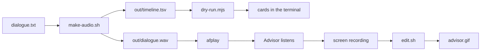

# Demo GIF

These files make `advisor.gif`, the README GIF: cards appear in the real app
while a scripted conversation plays as system audio. Advisor hears the audio
as the other side of a call, so the transcript, the triggers and the cards are
the real behaviour.

| File | Use |
|---|---|
| `dialogue.txt` | The conversation: one line per utterance, with its voice and the pause after it. |
| `context.txt` | The session context to paste into the recording window. |
| `make-audio.sh` | Makes `out/dialogue.wav` and `out/timeline.tsv` with the macOS `say` voices. |
| `dry-run.mjs` | Sends the dialogue to the built sidecar and prints the cards, with no window and no audio. |
| `edit.sh` | Makes `advisor.gif` from a screen recording of the take. |

`out/` holds the generated audio and is not committed.



## Requirements

- macOS `say`, `afplay` and ffmpeg.
- For the dry run: Node and a built sidecar (`cd sidecar && npm run build`).
  The dry run uses your `config.json` and your CLI login, as the app does.

## Change the dialogue

1. Edit `dialogue.txt`. Keep the topics public: the research agents can read
   your notes and connectors, and a card can quote them.
2. Run `docs/demo/make-audio.sh`.
3. Run `node docs/demo/dry-run.mjs`.
4. Read the cards that it prints. Make sure that each card is one you want in
   the GIF and that no card shows private content.

The dialogue in this folder gave three cards in a dry run on 2026-10-31: a
context card on the Elastic licence change, a fact-check on HTTP/3 over TCP
(false) and an answer on the lifetime of a Let's Encrypt certificate. The last
card finished about 52 s after the audio started. Your trigger sensitivity
changes the result; the dry run used *eager*.

The dry run sends text, not audio, so it does not test the speech recogniser.
Only a take shows how the recogniser hears the `say` voices.

## Record a take

1. Run `docs/demo/make-audio.sh`, if `out/dialogue.wav` does not exist.
2. Turn on Do Not Disturb, so that no notification shows in the take.
3. In Advisor, open a new recording window. Make it taller than it is wide,
   so that all the cards stay in view.
4. Put the terminal where it does not cover the recording window. Do not move
   the window after this step.
5. Paste `context.txt` into the session context.
6. Click **Listen**, then mute the mic. The mute stops room noise from adding
   lines to the transcript.
7. Press ⇧⌘5, choose **Record Selected Portion**, and drag the selection
   around the recording window. Click **Record**.
8. In the terminal, run this command. It waits 5 s before the audio starts:

   ```sh
   sleep 5; afplay docs/demo/out/dialogue.wav
   ```

9. In those 5 s, click the title bar of the recording window, so that it is
   the active window. Then move the pointer out of the window.
10. Optional: when a fact-check card appears, click it open, so that its
    verdict shows. Fact-check cards start collapsed.
11. Do not scroll the feed. Wait until the last card is complete, about 20 s
    after the audio ends.
12. Stop the screen recording from the menu bar.
13. Read each card. Make sure that no card shows private content.

The classifier can skip a trigger, so a take can need a second attempt.

## Make the GIF

Run `edit.sh` on the screen recording. Trim the start and the end with
`START` and `END`, in seconds:

```sh
START=3 END=60 docs/demo/edit.sh ~/Desktop/"Screen Recording ….mov"
```

The default GIF plays at double speed, 720 px wide, at 10 frames a second,
and holds the last frame for 4 s. `SPEED`, `WIDTH`, `FPS` and `HOLD` change
these values. To make the file smaller, decrease `WIDTH` or `FPS`.
