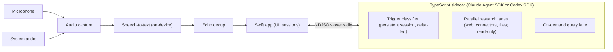

# Developing Advisor

How Advisor is put together, how to build it, and how releases are cut.
Architecture and decision history live in [DESIGN.md](../DESIGN.md); conventions
for coding agents in [AGENTS.md](../AGENTS.md).

## How it works



- **App** (`App/`): Swift/SwiftUI. Captures the microphone and system audio
  (ScreenCaptureKit), transcribes on-device, dedups speaker echo, shows a
  chronological feed of sentences with research cards inlined, and writes each
  session to markdown. Speech-to-text is Apple SpeechAnalyzer (macOS 26+),
  on-device.
- **Sidecar** (`sidecar/`): Node 26 + TypeScript, running its agents on the
  Claude Agent SDK or the Codex SDK (the provider chosen in Preferences). Watches the
  transcript, decides what is worth researching (questions, topics, claims —
  including questions about the user's own notes), researches in parallel
  persistent sessions, and streams answer cards back. Uses your local CLI
  login (Claude Code subscription, or Codex CLI) by default; an API key is an
  optional fallback for machines with no CLI login (see
  [Providers and authentication](guide.md#providers-and-authentication)).

## Building from source

```sh
# sidecar
cd sidecar && npm install --include=dev && npm run build

# app
cd ../App && swift build
.build/debug/Advisor
```

Tests: `cd App && swift test` and `cd sidecar && npm test`. The sidecar suite
includes the `*.sdk.test.ts` files, which check the tool sandbox, the tools the
classifier is offered, effort and streaming against the real bundled Claude CLI
(a local fake model, no network). `mise run commit-check`
(below) runs the same clean build and tests as CI. To watch the trigger
classifier on a real transcript, `sh sidecar/test/replay.sh` feeds
`sidecar/test/fragments.txt` through the built sidecar and prints the triggers
and cards (needs `jq` and a CLI login).

Requires: macOS 26+ (Apple Silicon), Xcode toolchain, Node 26.10.0 (pinned in
`.tool-versions`; `mise install` fetches it), a logged-in
Claude Code or Codex CLI. First run prompts for Microphone and Screen & System
Audio Recording permissions. A packaged app prompts as Advisor; a bare
`.build/debug/Advisor` dev run may be attributed to the launching terminal.

## Developer shortcuts

If `mise` is installed, common tasks are available from the repo root:

```sh
mise run commit-check   # clean build and test both sides; Swift warnings fail it (alias: mise run cc)
mise run run            # run the debug build
mise run dmg            # create App/dist/Advisor-<version>.dmg
mise run release        # dmg + sync website version line + commit + tag vVERSION
mise run install        # install to ~/Applications/Advisor.app
```

## Packaging

`App/package.sh` assembles a self-contained `Advisor.app` — release build plus
the Node runtime and the built sidecar. It signs through `sign-local.sh`, which
uses a Developer ID cert if present, else a self-signed `Advisor Dev` cert (see
below), else ad-hoc signing. Node is **not**
required on the target Mac.

**On the build machine** (Apple Silicon), you need:

- the Xcode toolchain (`swift`, `codesign`);
- an arm64 `node` on `PATH` — its binary is copied into the bundle. It must be
  the version `.tool-versions` pins, which CI tests on; `package.sh` refuses
  any other.

**Build:**

```sh
cd App && sh package.sh        # → App/dist/Advisor.app
```

The script runs a release `swift build`, builds the sidecar (`npm install` +
`tsc`), assembles the `.app`, and signs it. Re-run it any time; it rebuilds
`dist/Advisor.app` from scratch.

To clean-build **and** install over your own copy in one step:

```sh
cd App && sh install.sh        # → ~/Applications/Advisor.app
```

`install.sh` wipes prior build artefacts, runs `package.sh`, quits a running
Advisor, then replaces `~/Applications/Advisor.app` and clears its quarantine
flag.

**Persistent permissions across rebuilds (optional).** Ad-hoc signing gives the
app a new code hash every build, so macOS treats each rebuild as a new app and
**drops its Microphone / Screen-Recording grants** — you'd re-approve every time.
To avoid that, create a one-off self-signed code-signing certificate named
**`Advisor Dev`** (Keychain Access ▸ Certificate Assistant ▸ *Create a
Certificate…* → name `Advisor Dev`, Identity Type *Self-Signed Root*, Certificate
Type *Code Signing*). `package.sh` and `install.sh` sign with it automatically,
the Designated Requirement stays constant, and you grant the permissions just
once.

**Install a local build on another Mac** (macOS 26+, Apple Silicon):

1. Copy `Advisor.app` across (e.g. to `/Applications`).
2. Clear the quarantine flag, since the app is locally signed, not notarised:

   ```sh
   xattr -dr com.apple.quarantine /Applications/Advisor.app   # or right-click ▸ Open
   ```

3. Ensure a logged-in Claude Code or Codex CLI is present — the sidecar's
   agents use it.
4. Launch. First run prompts for Microphone and Screen & System Audio
   Recording permissions.

## Distribution (signed and notarised)

For sharing beyond your own Macs, local signing isn't enough — Gatekeeper wants a
Developer ID signature + notarisation.

```sh
cd App && sh dmg.sh            # → App/dist/Advisor-<version>.dmg
```

`dmg.sh` runs `sign.sh` to build and Developer-ID-sign the app, wraps it in a
compressed DMG with an Applications link, then signs, notarises, staples and
Gatekeeper-checks the DMG. One notary round: Apple scans the nested app as part
of the DMG submission, so the app needs no round of its own (it carries no
stapled ticket — Gatekeeper fetches it online on first launch). One-off setup
first: an Apple Developer Program membership, a Developer ID Application cert
in your keychain, and stored notary credentials —

```sh
xcrun notarytool store-credentials "advisor-notary" \
  --apple-id you@example.com --team-id TEAMID --password <app-specific-password>
```

It exits early with guidance if no Developer ID cert is found, so it's safe to
run before you're set up. (Mac App Store isn't viable — the App Sandbox fights
the bundled Node sidecar and `$HOME` reads.)

## Versioning and releases

The repo-root `VERSION` file is the single source of truth. `package.sh` stamps
it into the bundle as `CFBundleShortVersionString`, with `CFBundleVersion` set
from the commit count, and `dmg.sh` names its output `Advisor-<version>.dmg`. To
release: bump `VERSION` and commit the bump, then

```sh
mise run release
```

which builds the DMG, rewrites the version/size line and DMG link on
`www/index.html`, commits that sync, and tags `vVERSION`. It refuses to run if
the tag already exists (bump `VERSION` first), if `VERSION` has uncommitted
changes (the tag must point at a commit carrying the version it names), or if
`www/index.html` has uncommitted changes (so the release commit contains only
the sync). Push the commit and tag yourself.

## Website

`www/` holds plain HTML pages sharing `www/style.css`, with no build step or
scripts. Screenshots live in `www/img/` as `-light`/`-dark` pairs; capture them
from demo sessions, never real ones.

The site is hosted by Cloudflare. The DMG is stored in an R2 bucket called
`advisor-downloads` with a custom domain of `downloads.advisor.monoidal.co.uk`;
the download link is `https://downloads.advisor.monoidal.co.uk/Advisor-a.b.c.dmg`.
